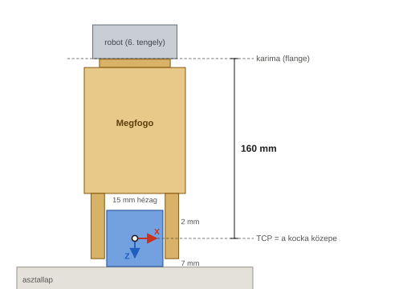
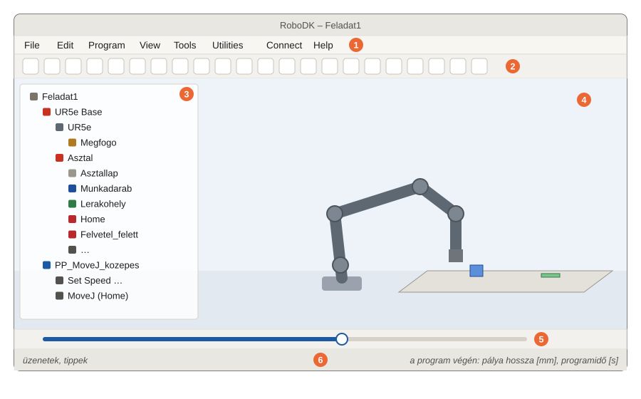
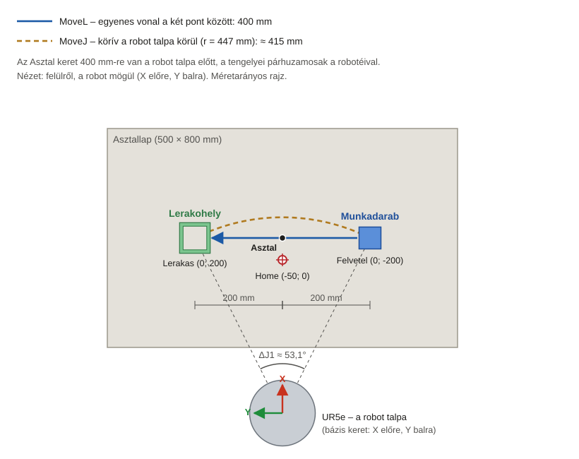
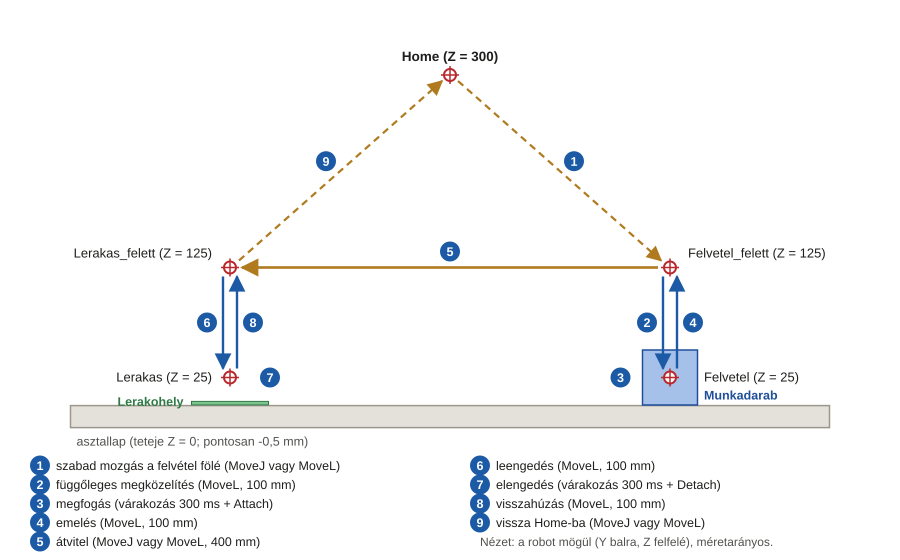
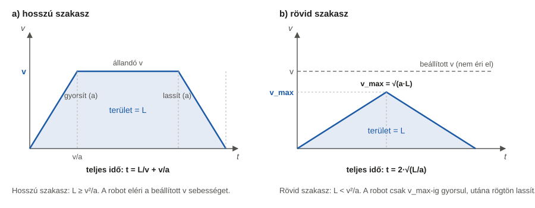

# 1. feladat – Pick & Place a RoboDK-ban: részletes útmutató kezdőknek

Ez az útmutató a nulláról vezet végig az 1. mérési feladaton. **Nem kell programozni, és szkripteket sem
használsz:** mindent a RoboDK menüiből csinálsz meg, egérrel és néhány szám beírásával.

Minden lépésnél leírjuk:
- hová kattints, és mit írj be;
- mit kell utána látnod;
- mit tegyél, ha nem azt látod.

> **A feladat röviden.** Egy modern, 6 tengelyes robotkar vegyen fel egy munkadarabot, és tegye át egy másik
> helyre, movej és movel mozgással, különböző sebességekkel.
>
> **Mérendő adatok:**
> 1. a felvételtől a lerakásig eltelt idő;
> 2. a mozgás során megtett út;
> 3. a robot maximális sebessége;
> 4. a movej és a movel végrehajtási idejének különbsége.
>
> **Sikeres a feladat,** ha a robot ütközés nélkül, pontosan és ismételhető módon helyezi át a munkadarabot.

## Hogyan használd ezt az útmutatót?

| Jelölés | Jelentése |
|---|---|
| **File → Open** | Kattints a felső menüsorban a *File* menüre, majd a lenyíló listában az *Open* pontra. |
| `-200` | Pontosan ezt írd be. A mínuszjel a billentyűzet kötőjel (mínusz) gombja. |
| **Ctrl+S** | Tartsd lenyomva a Ctrl billentyűt, és közben nyomd meg az S-t. |
| ✅ **Ellenőrzés** | Ezt kell látnod, ha jól csináltad. Csak akkor menj tovább, ha stimmel. |
| ⚠️ **Ha nem így van** | A leggyakoribb hibák és a javításuk. |
| 💡 **Tipp** | Magyarázat vagy könnyítés. Nem kötelező. |
| 📸 **Képernyőkép** | Itt készíts képet a jegyzőkönyvbe. Mellette áll, hogy a Word-sablon melyik pontjába kerül. |

**Négy fontos szabály:**
1. A lépéseket **sorban** csináld, és ne hagyj ki egyet sem: a későbbi lépések a korábbiakra épülnek.
2. **Ments gyakran:** **Ctrl+S**. Ha elrontasz valamit, a **Ctrl+Z** visszavonja az utolsó műveletet.
3. A RoboDK **tizedespontot** használ (pl. `7.200`). A jegyzőkönyvbe tizedesvesszővel írd: 7,200.
4. Az útmutató az **angol** menüneveket használja. Verziótól függően egy-egy felirat kicsit eltérhet. Ilyenkor
   a hasonló nevű pontot keresd, vagy nézd meg a 13. fejezetet (Hibaelhárítás).

## Az egész munka egy pillantásra

| Rész | Mit csinálsz | Eredmény | Idő |
|---|---|---|---|
| **A. Előkészület** (2. fejezet) | telepítés, fájlok letöltése, ismerkedés a képernyővel | működő RoboDK, letöltött modellek | 30–45 perc |
| **B. A cella** (4. fejezet) | robot, megfogó, asztal, munkadarab, lerakóhely | a `Feladat1.rdk` állomás | 30–45 perc |
| **C. Célpontok** (5. fejezet) | 5 robothelyzet rögzítése | `Home`, `Felvetel_felett`, `Felvetel`, `Lerakas_felett`, `Lerakas` | 20–30 perc |
| **D. Programok** (6–8. fejezet) | 1 pick & place program, 5 másolata és 2 mérőprogram | 8 program, ütközésvizsgálat | 45–60 perc |
| **E. Mérések** (9–10. fejezet) | idő, út, sebesség, pontosság, ütközés | kitöltött T1.0–T1.6 táblázatok | 45–60 perc |
| **F. Jegyzőkönyv** (11–12. fejezet) | képek, szöveg, értékelés | a kész Word- és PDF-jegyzőkönyv | 1–2 óra |

---

## Tartalom

- [1. Fogalmak, amelyekre szükséged lesz](#1-fogalmak-amelyekre-szükséged-lesz)
- [2. Előkészületek](#2-előkészületek)
- [3. A cella terve: mit fogsz megépíteni?](#3-a-cella-terve-mit-fogsz-megépíteni)
- [4. A cella felépítése](#4-a-cella-felépítése) – 1–6. lépés
- [5. A célpontok felvétele](#5-a-célpontok-felvétele) – 7–10. lépés
- [6. Az első program: PP_MoveJ_kozepes](#6-az-első-program-pp_movej_kozepes) – 11–15. lépés
- [7. Ütközésvizsgálat](#7-ütközésvizsgálat) – 16. lépés
- [8. A többi program](#8-a-többi-program) – 17–19. lépés
- [9. Mérések lépésről lépésre](#9-mérések-lépésről-lépésre) – M1–M6
- [10. Számítások lépésről lépésre](#10-számítások-lépésről-lépésre)
- [11. Az eredmények értelmezése és az értékelés](#11-az-eredmények-értelmezése-és-az-értékelés)
- [12. A jegyzőkönyv befejezése Wordben](#12-a-jegyzőkönyv-befejezése-wordben)
- [13. Hibaelhárítás](#13-hibaelhárítás)
- [A függelék: Gyorsbillentyűk](#a-függelék-gyorsbillentyűk)
- [B függelék: Dobozok készítése a RoboDK-ban, STL-fájlok nélkül](#b-függelék-dobozok-készítése-a-robodk-ban-stl-fájlok-nélkül)
- [C függelék: Hasznos RoboDK-dokumentáció](#c-függelék-hasznos-robodk-dokumentáció)

---

## 1. Fogalmak, amelyekre szükséged lesz

| Fogalom | Mit jelent | Hol látod a RoboDK-ban |
|---|---|---|
| **Állomás** (*station*) | Egy RoboDK-projekt: minden, ami a cellában van. Egyetlen `.rdk` fájlba mentődik. | az állomásfa legfelső eleme |
| **Állomásfa** (*station tree*) | A cella összes elemének listája. Ami egy elem alatt beljebb van, az ahhoz van rögzítve, és vele együtt mozog. | a képernyő bal oldalán |
| **Referencia keret** (*reference frame*) | Koordináta-rendszer: egy origó és három tengely. Ehhez képest adod meg a tárgyak és a célpontok helyét. A tengelyek színe: **X piros, Y zöld, Z kék**. | piros-zöld-kék nyilak |
| **Karima** (*flange*) | A robot utolsó tengelyének vége. Ide szereljük a megfogót. | a robot „csuklójának” vége |
| **Szerszám, TCP** (*tool, Tool Center Point*) | A megfogó, illetve a „munkapontja”: a robot ezt a pontot viszi a célpontokba. Nálunk a TCP 160 mm-re van a karimától, a megfogó két ujja között. | kis koordináta-rendszer a megfogón |
| **Célpont** (*target*) | Egy elmentett robothelyzet: hol legyen a TCP, és merre nézzen a szerszám. | célpont-ikonok a fában |
| **Program** | Utasítások sora. A robot ezeket egymás után hajtja végre. | program-ikon a fában |
| **MoveJ** (*joint move*, csuklómozgás) | A robot minden csuklója egyszerre fordul a célhelyzetbe. Gyors, de a TCP íves pályán halad. | utasítás a programban |
| **MoveL** (*linear move*, lineáris mozgás) | A TCP egyenes vonalon halad a célpontig. | utasítás a programban |
| **Sebesség, gyorsulás** | MoveL-nél mm/s és mm/s², MoveJ-nél °/s és °/s² (a csuklók fordulása). A *Set Speed* utasítással állítod be. | utasítás a programban |
| **Ciklusidő** | Ennyi ideig tartana a program a valódi robotnak. A RoboDK kiszámolja és kiírja. | a képernyő alján, a program végén |
| **Szimulációs esemény** (*simulation event*) | Csak a szimulációban történik meg. Például a kocka „hozzáragad” a megfogóhoz (*Attach*), majd elválik tőle (*Detach*). | utasítás a programban |


*1. ábra – A megfogó a felvételi helyzetben. A TCP 160 mm-re van a karimától, pontosan a kocka közepén.*

---

## 2. Előkészületek

### 2.1 A RoboDK telepítése és a licenc

1. Nyisd meg a [robodk.com/download](https://robodk.com/download) oldalt. Add meg az e-mail-címed, és töltsd le
   a Windows-telepítőt.
2. Futtasd a telepítőt. Minden kérdésnél jó az alapbeállítás: **Next → Install → Finish**. A telepítő a
   Pythont is felteszi; ez rendben van, de nem fogod használni.
3. Indítsd el a RoboDK-t az asztali ikonnal.
4. **Licenc:**
   - Az első indítás után 30 napig teljes értékű próbaverzió fut.
   - A RoboDK árlistája szerint 30 nap után a mentés nem érhető el. Ezért a munkát lehetőleg 30 napon belül
     fejezd be.
   - Kérdezd meg az oktatót vagy a tanszéket: a laborgépeken gyakran van egyetemi (oktatási) licenc.
5. **Nyelv:** ha a menük nem angolul jelennek meg, válaszd a **Tools → Language → English** pontot.

### 2.2 A szükséges fájlok letöltése

1. Töltsd le a repót: a GitHubon **Code → Download ZIP**. Utána csomagold ki: jobb klikk a ZIP-fájlra →
   **Összes kibontása**.
2. A `feladat1` mappából ezekre lesz szükséged:

   | Fájl | Mire kell |
   |---|---|
   | `modellek/Megfogo.stl` | a megfogó 3D-modellje |
   | `modellek/Asztallap.stl` | az asztallap (500 × 800 × 20 mm) |
   | `modellek/Munkadarab.stl` | a munkadarab (50 mm-es kocka) |
   | `modellek/Lerakohely.stl` | a lerakóhely jelölője (70 × 70 mm-es zöld keret) |
   | `jegyzokonyv_sablon.docx` | a jegyzőkönyv Word-sablonja |
   | `UTMUTATO.pdf` | ez az útmutató |

3. Hozz létre egy munkamappát, például `C:\RoboDK_feladat1\`. Másold bele a négy `.stl` fájlt és a sablont.
4. Nyisd meg a sablont Wordben, és mentsd el a saját neveddel, például `Feladat1_jegyzokonyv_Nev.docx`.
   Ebbe dolgozol végig.

> 💡 **Tipp:** Az STL-fájlok egyszerű 3D-testek pontos méretekkel: egy lap, egy kocka, egy keret és egy megfogó.
> Ezek nem szkriptek. Úgy nyitod meg őket, mint bármilyen 3D-modellt. Ha inkább magad készítenéd el a
> dobozokat a RoboDK-ban, a B függelék leírja, hogyan.

### 2.3 Ismerkedés a RoboDK ablakával


*2. ábra – A RoboDK ablakának részei (egyszerűsített vázlat, a valódi ablak ettől kicsit eltérhet)*

| # | Rész | Mire való |
|---|---|---|
| ① | **Menüsor** | Itt van minden parancs: *File, Edit, Program, View, Tools, Utilities, Connect, Help*. |
| ② | **Eszköztár** | A gyakori parancsok gombjai. Ha az egeret egy gomb fölé viszed, megjelenik a neve. |
| ③ | **Állomásfa** | A cella elemei. Itt jelölöd ki, nevezed át és rendezed az elemeket. |
| ④ | **3D nézet** | A cella térben. |
| ⑤ | **Szimulációs csúszka** | Program futtatásakor jelenik meg. Ezzel előre-hátra tekerheted a mozgást. |
| ⑥ | **Állapotsor** | Üzenetek. A program végén a jobb alsó sarokban itt jelenik meg a program ideje és a pálya hossza. |

**Alapműveletek:**

| Mit akarsz | Hogyan |
|---|---|
| Elem kijelölése | bal klikk az elemre (a fában vagy a 3D nézetben) |
| Elem beállításainak megnyitása | dupla klikk az elemre. **Kivétel:** célpontra dupla klikk → a robot odaugrik; programra dupla klikk → a program lefut |
| Átnevezés | jelöld ki → **F2** → írd be az új nevet → **Enter** |
| Elem áthelyezése másik elem alá a fában | fogd meg a bal egérgombbal, húzd rá a másik elemre, és ott engedd el |
| Törlés | jelöld ki → **Delete** |
| Visszavonás | **Ctrl+Z** |
| Mentés | **Ctrl+S** |
| A fa betűmérete | **Ctrl** + görgő a fa fölött |

**Mozgás a 3D nézetben:**

| Mit akarsz | Egérrel | Laptopon, egér nélkül |
|---|---|---|
| Forgatás | a jobb egérgombot nyomva tartva húzd | **Ctrl+Shift** + bal gombbal húzás |
| Eltolás | a középső gombot (görgőt) lenyomva tartva húzd | **Ctrl+Alt** + bal gombbal húzás |
| Nagyítás | görgetés | **Shift** + bal gombbal húzás |
| Minden látsszon | az eszköztár *Fit All* gombja | ugyanaz |

> ⚠️ **Vigyázz az Alt billentyűvel!** Ha a 3D nézetben az **Alt**-ot nyomva tartva húzol, az elemet (például
> egy keretet vagy a robotot) arrébb viszed. Ha ez véletlenül megtörtént, nyomd meg a **Ctrl+Z**-t.

> 💡 **Tipp:** A forgatás, eltolás és nagyítás parancsokat a 3D nézetben jobb klikkel is eléred.

### 2.4 Képernyőkép készítése

1. Nyomd meg a **Win+Shift+S**-t. A képernyő elsötétül.
2. Egérrel jelöld ki a lefényképezendő területet.
3. A Wordben kattints a sárga „[Ide illeszd be a képernyőképet: …]” szövegre, töröld ki, és nyomd meg a
   **Ctrl+V**-t.
4. A kép alatti képaláírást („3. ábra – …”) hagyd meg.

> 💡 **Tipp:** Windows 11-en a kép a *Képek → Képernyőképek* mappába is elmentődik.

---

## 3. A cella terve: mit fogsz megépíteni?

A robot (Universal Robots **UR5e**) előtt egy asztal áll, a közepe 400 mm-re van a robot talpától. Az asztal
egyik felén van a munkadarab, egy 50 mm-es kocka. A másik felén van a lerakóhely, egy zöld keret. A robot:
1. felülről, függőlegesen megközelíti a kockát;
2. megfogja;
3. felemeli;
4. átviszi a lerakóhely fölé;
5. leteszi;
6. visszatér a kiinduló helyzetbe.


*3. ábra – A cella felülnézetben, méretarányosan. A kék vonal a MoveL, a barna szaggatott ív a MoveJ pályája
a felvételtől a lerakásig.*


*4. ábra – A célpontok magassága és a mozgás sorrendje, oldalnézetben*

**Az elemek** (minden helyet az `Asztal` keretben adunk meg):

| Elem | Mi ez | Fájl | Hely az `Asztal` keretben (X; Y; Z) |
|---|---|---|---|
| `Megfogo` | szerszám a robot karimáján, TCP: **Z = 160 mm** | `Megfogo.stl` | – (a robotra kerül) |
| `Asztal` | referencia keret, a robot talpától **X = 400 mm**-re | – | a robothoz képest (400; 0; 0) |
| `Asztallap` | 500 × 800 × 20 mm-es lap | `Asztallap.stl` | (0; 0; 0) |
| `Munkadarab` | 50 × 50 × 50 mm-es kocka | `Munkadarab.stl` | (0; -200; 0) |
| `Lerakohely` | 70 × 70 mm-es, 1 mm vastag zöld keret | `Lerakohely.stl` | (0; 200; 0) |

**A célpontok** (a TCP helye az `Asztal` keretben; a szerszám mindig függőlegesen lefelé néz):

| Célpont | X [mm] | Y [mm] | Z [mm] | Mire való |
|---|---|---|---|---|
| `Home` | -50 | 0 | 300 | kiinduló és végpont |
| `Felvetel_felett` | 0 | -200 | 125 | 100 mm-rel a megfogási pont fölött |
| `Felvetel` | 0 | -200 | 25 | a kocka közepe: itt fog meg |
| `Lerakas_felett` | 0 | 200 | 125 | 100 mm-rel a lerakási pont fölött |
| `Lerakas` | 0 | 200 | 25 | itt engedi el a kockát |

**A három sebességszint:**

| Szint | Lineáris sebesség | Lineáris gyorsulás | Csuklósebesség | Csuklógyorsulás |
|---|---|---|---|---|
| lassú | 100 mm/s | 250 mm/s² | 30 °/s | 60 °/s² |
| közepes | 300 mm/s | 800 mm/s² | 90 °/s | 180 °/s² |
| gyors | 800 mm/s | 2000 mm/s² | 180 °/s | 400 °/s² |

**A programok:**
- `PP_MoveJ_lassu`, `PP_MoveJ_kozepes`, `PP_MoveJ_gyors`: a szabad mozgások MoveJ-k.
- `PP_MoveL_lassu`, `PP_MoveL_kozepes`, `PP_MoveL_gyors`: minden mozgás MoveL.
- `Meres_atvitel_J`, `Meres_atvitel_L`: két rövid mérőprogram. Csak a felvételtől a lerakásig tartó mozgást
  tartalmazzák, így annak idejét és útját külön le tudod olvasni.

A megközelítés, az emelés, a leengedés és a visszahúzás mindegyik programban függőleges MoveL (100 mm). A MoveJ-
és a MoveL-változat csak a három szabad mozgásban különbözik:
- a felvétel fölé menetben;
- az átvitelben;
- a visszatérésben.

---

## 4. A cella felépítése

### 1. lépés – Új állomás létrehozása és mentése

1. Indítsd el a RoboDK-t. Ha üdvözlő vagy licencablak jelenik meg, zárd be, vagy válaszd a próbaverziót.
2. Válaszd a **File → New Station** pontot (**Ctrl+N**).
3. Válaszd a **File → Save Station as…** pontot. Lépj be a munkamappádba (`C:\RoboDK_feladat1\`), fájlnévnek
   írd be: `Feladat1`, majd kattints a **Mentés**-re.

> ✅ **Ellenőrzés:** A fa legfelső eleme és az ablak címsora is *Feladat1*.

> ⚠️ **Ha nem így van:** Ha a RoboDK nem engedi a mentést, valószínűleg lejárt a próbaidőszak (2.1, Licenc).

### 2. lépés – A UR5e robot betöltése

1. Válaszd a **File → Open Robot Library** pontot (**Ctrl+Shift+O**). Régebbi verzióban ennek a neve
   **File → Open online library**. Megnyílik a RoboDK online könyvtára.
2. A keresőmezőbe írd be: `UR5e`. Szűrhetsz gyártóra is: *Brand → Universal Robots*.
3. Vidd az egeret a **UR5e** képe fölé, és kattints az **Open** gombra.
4. Néhány másodperc múlva a robot megjelenik a 3D nézetben. A könyvtár ablakát bezárhatod.

> ✅ **Ellenőrzés:** A fában megjelent a `UR5e Base` (a robot talpának koordináta-rendszere), és alatta a `UR5e`
> (maga a robot).

> ⚠️ **Ha nem így van:**
> - **Nem jelent meg a robot:** ellenőrizd az internetkapcsolatot. Másik út: a könyvtárban a **Download**
>   gombbal töltsd le a robotot (`.robot` fájl), majd húzd be a RoboDK ablakába.
> - **Más robotot töltöttél be** (például UR5-öt vagy UR10e-t): jelöld ki a fában, nyomd meg a **Delete**-et, és
>   töltsd be a UR5e-t. A számítások a UR5e méreteivel készültek.

> 💡 **Tipp:** Ha a robot nem látszik jól, forgasd vagy nagyítsd a nézetet (2.3), vagy kattints az eszköztár
> *Fit All* gombjára.

> 📸 **Képernyőkép → a sablon 6.1 pontjába:** a robot a 3D nézetben és a fa.

### 3. lépés – A megfogó felszerelése

A robot karimájára szereled a megfogót, és a TCP-t 160 mm-re állítod.

**A) Ajánlott: a kész megfogómodellel**

1. Válaszd a **File → Open** pontot. Keresd meg a munkamappádban a `Megfogo.stl` fájlt, és kattints a
   **Megnyitás**-ra. Úgy is jó, ha a fájlt a Windows Intézőből behúzod a RoboDK ablakába.

   > ✅ **Ellenőrzés:** A fában megjelent egy új elem `Megfogo` néven. A 3D nézetben, a robot talpánál látszik
   > egy függőlegesen álló test.

2. A fában fogd meg a `Megfogo` elemet a bal egérgombbal. Húzd rá a **`UR5e`** elemre (a robotra, nem a
   `UR5e Base`-re), és ott engedd el. Ha a RoboDK megkérdezi, mi legyen vele, válaszd, hogy a robot szerszáma
   (*tool*) legyen.

   > ✅ **Ellenőrzés:** A megfogó átugrik a robot csuklójára (a karimára). A fában a `UR5e` alá kerül, és az
   > ikonja szerszám-ikonra változik.

3. Kattints duplán a `Megfogo`-ra: megnyílik a szerszám beállító ablaka.
4. Keresd meg a TCP helyét megadó hat mezőt. A felirata valami ilyesmi: *Tool Center Point (TCP) with respect to
   the robot flange*. A mezők: X, Y, Z és három forgatás. Írd be ezeket, és minden szám után nyomj **Enter**-t:

   | X | Y | Z | 1. forgatás | 2. forgatás | 3. forgatás |
   |---|---|---|---|---|---|
   | `0` | `0` | **`160`** | `0` | `0` | `0` |

   A RoboDK magától beír egy kezdőértéket (például Z = 200). Ezt kell 160-ra átírnod.
5. Zárd be az ablakot a jobb felső sarokban lévő X-szel.

> ✅ **Ellenőrzés:** A TCP kis koordináta-rendszere (piros, zöld és kék nyilacska) a megfogó két ujja között
> látszik, az ujjak végétől 18 mm-re, a karima felé (1. ábra). A kék Z nyíl az ujjak irányába, a karimától
> elfelé mutat.

> ⚠️ **Ha nem így van:**
> - **A megfogó nem a csuklón van, vagy fejjel lefelé áll:** valószínűleg nem a `UR5e`-re húztad. Nyomd meg a
>   **Ctrl+Z**-t, és próbáld újra.
> - **Nem sikerül:** használd a B) változatot.

**B) Egyszerűbb, megfogómodell nélkül**

1. Kattints a fában a `UR5e`-re.
2. Válaszd a **Program → Add Empty Tool** pontot. A robot alatt megjelenik egy új szerszám, például *Tool 1*.
3. Kattints rá duplán. Állítsd be: Z = `160`, a többi mező `0`. Zárd be az ablakot.
4. Nyomd meg az **F2**-t, írd be: `Megfogo`, majd **Enter**.

> 💡 **Tipp:** A B) változatban nincs látható megfogó, csak a TCP kis koordináta-rendszere. A kocka a robot
> csuklója alatt, 135 mm-rel „lebegve” utazik majd. A mérési eredményeket ez nem befolyásolja.

> 📸 **Képernyőkép → a sablon 6.2 pontjába:** a megfogó a roboton és a TCP-ablak (Z = 160).

### 4. lépés – Az Asztal referencia keret

Létrehozol egy koordináta-rendszert az asztal közepén, 400 mm-re a robot előtt. Ehhez képest adod meg a tárgyak
és a célpontok helyét.

1. Kattints egyszer a fában a `UR5e Base` elemre, hogy ki legyen jelölve.
2. Válaszd a **Program → Add Reference Frame** pontot.

   > ✅ **Ellenőrzés:** A `UR5e Base` alatt megjelent egy új keret (például *Frame 2*).
   >
   > ⚠️ **Ha nem így van:** Ha a keret nem a `UR5e Base` alá, hanem a legfelső szintre került, húzd rá a
   > `UR5e Base`-re.

3. Nyomd meg az **F2**-t, írd be: `Asztal`, majd **Enter**.
4. Kattints duplán az `Asztal`-ra. A megnyíló ablakban a keret helye látszik a szülőjéhez (a `UR5e Base`-hez)
   képest: X, Y, Z és három forgatás. Írd be ezeket (mindegyik után **Enter**), majd zárd be az ablakot:

   | X | Y | Z | 1. forgatás | 2. forgatás | 3. forgatás |
   |---|---|---|---|---|---|
   | `400` | `0` | `0` | `0` | `0` | `0` |

> ✅ **Ellenőrzés:** A 3D nézetben a keret (piros, zöld és kék nyíl) 400 mm-re van a robot előtt, a robot talpának
> magasságában. A piros X nyíl a robottól elfelé mutat.

> 💡 **Tipp:** Ha a keretek túl kicsik vagy túl nagyok, a **+** és a **-** billentyűvel nagyíthatod és
> kicsinyítheted őket.

### 5. lépés – Az asztallap, a munkadarab és a lerakóhely

Betöltöd a három tárgyat, és az `Asztal` keretben a helyükre teszed őket. Először az asztallapot, részletesen:

1. Válaszd a **File → Open** pontot, majd nyisd meg az `Asztallap.stl` fájlt.

   > ✅ **Ellenőrzés:** A fában megjelent az `Asztallap`.

2. Húzd a fában az `Asztallap`-ot az `Asztal` keretre: bal gombbal fogd meg, és az `Asztal` fölött engedd el.

   > ✅ **Ellenőrzés:** Az `Asztallap` most beljebb, az `Asztal` alatt látszik.

3. Kattints duplán az `Asztallap`-ra. A megnyíló ablakban a tárgy helye látszik a szülőjéhez (az `Asztal`-hoz)
   képest. Írd be: X = `0`, Y = `0`, Z = `0`, és a három forgatás `0` (mindegyik után **Enter**). Zárd be az
   ablakot.
4. Ugyanígy töltsd be és helyezd el a másik kettőt is:

   | Fájl | Hová húzd a fában | X | Y | Z | forgatások |
   |---|---|---|---|---|---|
   | `Munkadarab.stl` | `Asztal` | `0` | `-200` | `0` | `0` |
   | `Lerakohely.stl` | `Asztal` | `0` | `200` | `0` | `0` |

5. **Színek** (nem kötelező, de a képeken jobban látszik). Kattints duplán a tárgyra → **More options…** →
   keresd a szín (*Color*) beállítását. Javaslat: az asztallap világosszürke, a munkadarab kék, a lerakóhely
   zöld. Másik út: **Tools → Change Color Tool**, majd kattints a tárgyra.
6. Ments: **Ctrl+S**.

> ✅ **Ellenőrzés:** A cella úgy néz ki, mint a 3. ábrán:
> - a robot előtt van az asztallap;
> - rajta a robot mögül nézve jobbra a kék kocka, balra a zöld keret;
> - mindkettő 200 mm-re van az asztal közepétől.

> ⚠️ **Ha nem így van:**
> - **A tárgy rossz helyen van.** Két dolgot ellenőrizz:
>   1. A fában az `Asztal` alatt van-e.
>   2. A dupla kattintásra megnyíló ablakban a hely az `Asztal`-hoz képest értendő-e. Ha van ott legördülő
>      lista a *w.r.t.* (*with respect to*, azaz „valamihez képest”) felirat mellett, abban az `Asztal`
>      legyen kiválasztva.
> - **A tárgy óriási vagy apró:** a RoboDK rossz mértékegységgel olvasta be. Töröld, és nyisd meg újra. A
>   modellek milliméterben vannak.

> 💡 **Tipp:** Miért van az asztallap teteje 0,5 mm-rel a tárgyak alatt? Ha két tárgy pontosan érintkezik, a
> RoboDK ütközésnek veheti. A fél milliméteres hézag ezt elkerüli, a mérési eredményeket pedig nem befolyásolja.
> Ezt a jegyzőkönyvben is említsd meg.

> 📸 **Képernyőkép → a sablon 6.3 pontjába:** az `Asztal` keret és a három tárgy a fában és a 3D nézetben.

### 6. lépés – Ellenőrzés: így néz ki a fa

```
Feladat1
└── UR5e Base
    ├── UR5e
    │   └── Megfogo
    └── Asztal
        ├── Asztallap
        ├── Munkadarab
        └── Lerakohely
```

A sorrend kicsit eltérhet, a lényeg, hogy melyik elem melyik alatt van. Ha minden stimmel, ments: **Ctrl+S**.

---

## 5. A célpontok felvétele

### 7. lépés – A robotpanel megnyitása és beállítása

1. Kattints duplán a fában a `UR5e`-re. Megnyílik a **robotpanel**: egy ablak vagy oldalpanel sok számmal.
2. A panelen két legördülő listát keress:
   - a szerszám listában (*Tool* vagy *Tool Frame*) válaszd a `Megfogo`-t;
   - a referencia keret listában (*Reference* vagy *Reference Frame*) válaszd az `Asztal`-t.

> ✅ **Ellenőrzés:** A fában a `Megfogo` és az `Asztal` ikonján megjelenik egy kis zöld pötty. Ez jelzi, hogy ezek
> az **aktívak**. Az új célpontok mostantól az `Asztal` alá kerülnek.

3. Ismerd meg a panel részeit. A feliratok verziótól függően kicsit eltérhetnek:

   | Rész a panelen | Mit mutat | Mit csinálj vele |
   |---|---|---|
   | **Joint axis jog** (J1…J6) | a hat csukló szöge fokban | itt írsz be csuklószögeket (8. lépés), és innen olvasod le őket (10. lépés) |
   | **Tool Frame (TF) w.r.t. Robot Flange (FF)** | a TCP helye a karimához képest. Itt **0, 0, 160, 0, 0, 0** áll | **ne nyúlj hozzá!** |
   | **Reference Frame (RF) w.r.t. Robot Base (BF)** | az `Asztal` helye a robothoz képest. Itt **400, 0, 0, 0, 0, 0** áll | **ne nyúlj hozzá!** |
   | **Tool Frame (TF) w.r.t. Reference Frame (RF)** | a TCP helye az `Asztal`-hoz képest (X, Y, Z és három forgatás) | **ezt fogod használni:** ha ide számot írsz, a robot odamegy |

> ⚠️ **Vigyázz:** Ha véletlenül a második vagy a harmadik mezőcsoportba írtál, a megfogó TCP-jét vagy az `Asztal`
> helyét változtattad meg. Nyomd meg a **Ctrl+Z**-t, vagy írd vissza a helyes értéket (Z = 160, illetve X = 400).

### 8. lépés – A robot kiinduló helyzetbe állítása

Egy jól ismert helyzetbe állítod a robotot. Ha innen indulsz, minden célpontnál ugyanazt a karállást kapod. Így
a csuklószögeid egyezni fognak az útmutató ellenőrző értékeivel (10. lépés).

1. A robotpanel **Joint axis jog** részében írd be egyenként ezeket a csuklószögeket (mindegyik után **Enter**):

   | J1 | J2 | J3 | J4 | J5 | J6 |
   |---|---|---|---|---|---|
   | `0` | `-90` | `-90` | `-90` | `90` | `-90` |

> ✅ **Ellenőrzés:**
> - A robot felkarja függőlegesen felfelé áll, az alkarja vízszintesen előre nyúlik az asztal fölé, a megfogó
>   lefelé néz.
> - A *Tool Frame w.r.t. Reference Frame* mezőkben kb. ez áll: X ≈ `91.9`, Y ≈ `-133.3`, Z ≈ `327.9`.
> - A három forgatás közül az egyik `180` vagy `-180`, a másik kettő `0`.

> ⚠️ **Ha nem így van:**
> - Ellenőrizd a mínuszjeleket.
> - Ha a forgatások nem ilyenek, nézd meg, hogy a szerszám listában a `Megfogo`, a referencia keret listában az
>   `Asztal` van-e kiválasztva (7. lépés).

### 9. lépés – Az öt célpont felvétele

A robotot sorban az öt helyzetbe állítod, és mindegyiket elmented célpontként. **A forgatásokhoz nem kell
nyúlnod:** a megfogó a 8. lépés óta pontosan lefelé néz, és ez így is marad, ha csak az X, Y és Z értéket írod át.

**Az első célpont (`Home`), részletesen:**

1. A robotpanel *Tool Frame w.r.t. Reference Frame* részében írd be:
   - X = `-50`, majd **Enter**;
   - Y = `0`, majd **Enter**;
   - Z = `300`, majd **Enter**.

   > ✅ **Ellenőrzés:** A robot minden **Enter** után kicsit elmozdul. A végén a TCP az asztal közepe fölött,
   > 300 mm magasan, a robothoz 50 mm-rel közelebb van.

2. Válaszd a **Program → Teach Target** pontot (**Ctrl+T**).

   > ✅ **Ellenőrzés:** A fában az `Asztal` alatt megjelent egy új célpont (például *Target 1*).

3. Rögtön nevezd át: **F2** → `Home` → **Enter**.

**A további négy célpont:** mindegyiknél ugyanez a három lépés.
1. Írd be az X, Y és Z értéket, mindegyik után **Enter**.
2. Nyomd meg a **Ctrl+T**-t.
3. **F2**, írd be a nevet, majd **Enter**.

| Sorrend | Név | X | Y | Z |
|---|---|---|---|---|
| 1. | `Home` (kész) | `-50` | `0` | `300` |
| 2. | `Felvetel_felett` | `0` | `-200` | `125` |
| 3. | `Felvetel` | `0` | `-200` | `25` |
| 4. | `Lerakas_felett` | `0` | `200` | `125` |
| 5. | `Lerakas` | `0` | `200` | `25` |

> 💡 **Tipp:** Ha egy érték már jó (például X = 0), azt nem kell újra beírni.

> ✅ **Ellenőrzés:** Az `Asztal` alatt öt célpont van, a 3D nézetben öt kis célpontjel látszik (a 3. és a 4. ábra
> szerinti helyeken). Ments: **Ctrl+S**.

> ⚠️ **Ha nem így van:**
> - **Elfelejtetted átírni a koordinátákat a Ctrl+T előtt**, és a célpont rossz helyre került. Állítsd a robotot
>   a jó helyre, majd jobb klikk a célponton → **Teach Current Position**. Ez felülírja a célpontot a robot
>   jelenlegi helyzetével.
> - **A robot nem mozdul, vagy hibaüzenetet ír** (például *target not reachable*): valószínűleg elírtál egy
>   számot (például 2000-et 200 helyett). Írd be újra.
> - **Egy célpont rossz néven szerepel:** jelöld ki, majd **F2**.

### 10. lépés – A célpontok ellenőrzése és a csuklószögek felírása (T1.0)

1. Kattints egyszer a `Home` célpontra a fában: a robot odamozog. Dupla kattintásra azonnal odaugrik.
2. Olvasd le a robotpanel **Joint axis jog** részéről a hat csuklószöget. Írd be őket a Word-sablon **T1.0**
   táblázatába, egy tizedesjegyre kerekítve.
3. Ugyanezt csináld meg a többi négy célponttal is.
4. Közben nézd meg a *Tool Frame w.r.t. Reference Frame* mezőket is: a célpont X, Y és Z értékét kell mutatniuk.

> ✅ **Ellenőrzés:** Ha a 8. lépés kiinduló helyzetéből indultál, ezeket az értékeket kell látnod (±0,1°):
>
> | Célpont | J1 | J2 | J3 | J4 | J5 | J6 |
> |---|---|---|---|---|---|---|
> | `Home` | 22,4 | -66,7 | -112,3 | -91,0 | 90,0 | -67,6 |
> | `Felvetel_felett` | -9,2 | -88,9 | -122,3 | -58,9 | 90,0 | -99,2 |
> | `Felvetel` | -9,2 | -99,6 | -129,6 | -40,8 | 90,0 | -99,2 |
> | `Lerakas_felett` | 43,9 | -88,9 | -122,3 | -58,9 | 90,0 | -46,1 |
> | `Lerakas` | 43,9 | -99,6 | -129,6 | -40,8 | 90,0 | -46,1 |

**Két összefüggés, amely a 10. fejezet számításaihoz kell:**
- A `Felvetel_felett` és a `Lerakas_felett` között **csak a J1 és a J6** változik, mindkettő **53,1°**-ot. A
  J2–J5 egyforma.
- A `Home` és a `Felvetel_felett` között a J4 fordul a legtöbbet, **32,1°**-ot. Ugyanennyit fordul a
  `Lerakas_felett` és a `Home` között is.

> ⚠️ **Ha nálad egészen más számok vannak, de a robot a jó helyen áll:** például J5 = -90 vagy J1 ≈ 136. Ilyenkor
> a robot más karállással (konfigurációval) éri el ugyanazt a pontot.
> - Ez nem hiba. A felvételtől a lerakásig tartó szakasz eredményei ugyanazok maradnak.
> - A teljes programok ideje viszont kicsit eltér majd a 10. fejezet ellenőrző értékeitől.
> - Ha egyezést szeretnél, töröld a célpontokat, és kezdd újra a 8. lépéstől.

> 📸 **Képernyőkép → a sablon 6.4 pontjába:** a célpontok a fában és a 3D nézetben, mellettük a robotpanel.

---

## 6. Az első program: PP_MoveJ_kozepes

A program a 4. ábra szerinti 7 mozgást hajtja végre, közben megfogja és elengedi a kockát. Közepes sebességgel
fut, a szabad mozgások MoveJ-k. Utána ezt másolod le a többi változathoz.

**Hogyan kerül egy utasítás a programba?** Ezt olvasd el, mielőtt nekikezdesz:
- Az új utasítás abba a programba kerül, amelyiket utoljára létrehoztad vagy kijelölted. A program végére kerül.
  Ha közben a program egyik sorára kattintottál, akkor az után a sor után.
- **Mozgásutasításnál először a célpontra kattints a fában, és csak utána válaszd a menüpontot.** Ha nincs
  kijelölt célpont, a RoboDK új célpontot hoz létre a robot aktuális helyzetében, és ezt nem akarjuk.
  - Ha mégis megtörtént: töröld az utasítást (kijelölés, majd **Delete**) és a fölösleges új célpontot (például
    *Target 6*), és csináld újra.
- Ha egy utasítás rossz helyre került, a fában fogd meg, és húzd a helyére a programon belül.
- A program sorait a program neve előtti kis nyílra kattintva nyitod le és zárod be.

### 11. lépés – Üres program létrehozása

1. Válaszd a **Program → Add Program** pontot.

   > ✅ **Ellenőrzés:** A fában megjelent egy új program, például *Prog1*.

2. Nevezd át: **F2** → `PP_MoveJ_kozepes` → **Enter**.
3. Ellenőrizd, hogy a `Munkadarab` a kiinduló helyén van (Y = -200). Most még biztosan ott van, mert még nem
   futtattál semmit.

### 12. lépés – Kezdő utasítások (1–2.)

**1. utasítás: a munkadarab visszahelyezése minden futás elején**

1. Válaszd a **Program → Simulation Event Instruction** pontot. Megnyílik a szimulációs esemény ablaka.
2. A műveletek (*action*) közül válaszd ezt: **Set object position (relative)**.
3. A tárgyak listájában jelöld ki a `Munkadarab`-ot, és csak azt.
4. Kattints az **OK**-ra.

> ✅ **Ellenőrzés:** A program alatt megjelent az első sor, egy esemény-utasítás.

> 💡 **Tipp:** Az **OK** megnyomásakor ez az utasítás megjegyzi, hol van a kocka, és mihez van rögzítve. Minden
> futás elején oda teszi vissza. Ezért kell, hogy a kocka most a kiinduló helyén legyen.

**2. utasítás: a sebesség beállítása**

1. Válaszd a **Program → Set Speed Instruction** pontot. Megnyílik a sebesség beállító ablaka. Ha nem nyílik meg
   magától, kattints duplán az új *Set Speed* sorra.
2. Pipáld be mind a négy sort, és írd be az értékeket:

   | Mező | Érték |
   |---|---|
   | *Linear speed* (lineáris sebesség) | `300` mm/s |
   | *Joint speed* (csuklósebesség) | `90` °/s |
   | *Linear acceleration* (lineáris gyorsulás) | `800` mm/s² |
   | *Joint acceleration* (csuklógyorsulás) | `180` °/s² |

3. Kattints az **OK**-ra.

> ✅ **Ellenőrzés:** Megjelent a második sor, például *Set Speed …*.

> ⚠️ **Fontos:** Ha egy mezőt nem pipálsz be, a RoboDK a robot alapértékét használja helyette, és a mért idők
> nem fognak egyezni a számítottakkal.

### 13. lépés – Megközelítés és megfogás (3–7.)

**3. utasítás: MoveJ Home**

1. Kattints a fában a `Home` célpontra.
2. Válaszd a **Program → Move Joint Instruction** pontot.

> ✅ **Ellenőrzés:** Megjelent egy új sor, például *MoveJ (Home)*.
>
> Ha ez az első mozgásutasítás, a RoboDK elé beszúr még két sort: *Set Reference Frame (Asztal)* és *Set Tool
> Frame (Megfogo)*. **Ezek maradjanak:** ezek mondják meg a programnak, melyik keretben és melyik szerszámmal
> dolgozzon.

> ⚠️ **Ha ez a két sor nem jelent meg,** add hozzá őket kézzel, majd húzd őket a *MoveJ (Home)* elé:
> 1. **Program → Set Reference Frame Instruction**, és válaszd az `Asztal`-t.
> 2. **Program → Set Tool Frame Instruction**, és válaszd a `Megfogo`-t.

**4–7. utasítás:**

| # | Először kattints erre | Utána ezt válaszd | Mit csinál |
|---|---|---|---|
| 4 | `Felvetel_felett` célpont | **Program → Move Joint Instruction** | a kocka fölé megy |
| 5 | `Felvetel` célpont | **Program → Move Linear Instruction** (itt *Linear*!) | függőlegesen leereszkedik a kocka közepéig |
| 6 | – | **Program → Pause Instruction**, írd be: `300`, majd **OK** | 300 ms-ot (0,3 s-ot) vár: ennyi idő alatt zár a megfogó |
| 7 | – | **Program → Simulation Event Instruction** → **Attach object**, szerszám (*tool*): `Megfogo` → **OK** | megfogja a kockát |

> 💡 **Tipp:** Az *Attach object* a TCP-hez legközelebbi tárgyat rögzíti a megfogóhoz, alapból legfeljebb 200 mm
> távolságból. A TCP ekkor a kocka közepén van, így biztosan a kockát fogja meg.

### 14. lépés – Átvitel, lerakás, visszatérés (8–14.)

| # | Először kattints erre | Utána ezt válaszd | Mit csinál |
|---|---|---|---|
| 8 | `Felvetel_felett` | **Program → Move Linear Instruction** | 100 mm-rel felemeli a kockát |
| 9 | `Lerakas_felett` | **Program → Move Joint Instruction** | átviszi a lerakóhely fölé |
| 10 | `Lerakas` | **Program → Move Linear Instruction** | leengedi a kockát |
| 11 | – | **Program → Pause Instruction**, írd be: `300`, majd **OK** | a megfogó nyitási ideje |
| 12 | – | **Program → Simulation Event Instruction** → **Detach object**. Szerszám: `Megfogo`. Ahová a tárgy kerül (*attach to* / *parent*): `Asztal` → **OK** | elengedi a kockát az asztalra |
| 13 | `Lerakas_felett` | **Program → Move Linear Instruction** | visszahúzza a megfogót |
| 14 | `Home` | **Program → Move Joint Instruction** | visszatér a kiinduló helyzetbe |

> ✅ **Ellenőrzés:** Nyisd le a programot a neve előtti kis nyíllal. Így kell kinéznie (a sorok neve a
> RoboDK-ban kicsit más lehet; a sorrend és a típus, vagyis MoveJ vagy MoveL, a fontos):
>
> ```
> PP_MoveJ_kozepes
>   1  Set object position (Munkadarab)        szimulációs esemény
>   2  Set Speed 300 mm/s, 90 °/s, 800 mm/s², 180 °/s²
>      Set Reference Frame: Asztal             a RoboDK szúrta be
>      Set Tool Frame: Megfogo                 a RoboDK szúrta be
>   3  MoveJ Home
>   4  MoveJ Felvetel_felett
>   5  MoveL Felvetel
>   6  Pause 300 ms
>   7  Attach object (Megfogo)                 szimulációs esemény
>   8  MoveL Felvetel_felett
>   9  MoveJ Lerakas_felett
>  10  MoveL Lerakas
>  11  Pause 300 ms
>  12  Detach object -> Asztal                 szimulációs esemény
>  13  MoveL Lerakas_felett
>  14  MoveJ Home
> ```

### 15. lépés – Az első futtatás

1. Kattints a `Home` célpontra: a robot a kiinduló helyzetbe áll.
2. Kattints **duplán** a `PP_MoveJ_kozepes` programra.

> ✅ **Ellenőrzés:** A robot sorban:
> 1. a kocka fölé megy, és leereszkedik;
> 2. rövid szünet után a kocka a megfogóval együtt felemelkedik;
> 3. átviszi a kockát, és leteszi a zöld keretbe;
> 4. felemelkedik, és visszatér a `Home`-ba.
>
> Alul megjelenik a szimulációs csúszka. A program végén a jobb alsó sarokban megjelenik az idő (kb. **6.2 s**)
> és az út (kb. **1369 mm**). Ezek a 10. fejezet számított értékei; a pontos mérést a 9. fejezetben végzed.

3. Futtasd le még egyszer (dupla katt). A program elején a kocka visszaugrik a kiinduló helyére, és minden
   ismétlődik.

> ⚠️ **Ha nem így van:**
>
> | Mit látsz | Mi a teendő |
> |---|---|
> | A kocka nem mozdul a megfogóval | A 7. sor (*Attach*) hiányzik, rossz helyen van, vagy nem a `Megfogo` van benne kiválasztva. |
> | A kocka a lerakás után is a megfogón marad | A 12. sor (*Detach*) hiányzik vagy hibás. |
> | A második futásnál a kocka nem ugrik vissza | Az 1. sor hiányzik, vagy akkor hoztad létre, amikor a kocka nem a kiinduló helyén volt. Töröld az 1. sort. Tedd vissza a kockát: legyen az `Asztal` alatt, és dupla kattintás után állítsd a helyét (0; -200; 0)-ra. Utána hozd létre újra az 1. sort, és húzd a program elejére. |
> | A robot nagy kerülővel, „furcsán” mozog | Valamelyik mozgás rossz célponthoz kötődik. Kattints duplán egyenként a mozgásutasításokra: a robot mindig oda ugrik, ahová az adott sor viszi. |
> | Hibaüzenet egy MoveL-nél (*singularity*, *axis limit*) | Elírtad egy célpont koordinátáit. Ellenőrizd: jobb klikk a célponton → **Target Options…** (**F3**). |

> 💡 **Tipp:** Futtatás közben a **Backspace** megállítja és folytatja a szimulációt, az **Esc** leállítja. A
> szóközt nyomva tartva gyorsabban játssza le. A csúszkával előre-hátra tekerheted a mozgást.

> 📸 **Képernyőkép → a sablon 6.5 pontjába:** a program sorai, és a robot a kockával átvitel közben. Ehhez
> állítsd meg a szimulációt a **Backspace**-szel, vagy tekerd a csúszkát a megfelelő helyre.

Ments: **Ctrl+S**.

---

## 7. Ütközésvizsgálat

### 16. lépés – Az ütközésvizsgálat bekapcsolása és lefuttatása

1. Válaszd a **Tools → Check Collisions** pontot (az eszköztáron is van gombja). Bekapcsolt állapotban a gomb
   kiemelten látszik.
2. Válaszd a **Tools → Collision Map** pontot (**Shift+X**). Egy táblázat jelenik meg: azt mutatja, mely
   elempárok ütközését vizsgálja a RoboDK. Hagyd az alapbeállításon, csak nézd meg, és készíts róla képet. Utána
   zárd be.
3. Jobb klikk a `PP_MoveJ_kozepes` programra → **Check Path and Collisions** (**Shift+F5**). Várd meg, amíg
   végigszámol.

> ✅ **Ellenőrzés:** Nem jelez ütközést (az eredmény üzenetben vagy az állapotsorban jelenik meg), és egyik elem
> sem lesz piros.

> ⚠️ **Ha ütközést jelez:** a piros elemek mutatják, mi ütközik mivel.
> - **Megfogo – Asztallap vagy Munkadarab – Asztallap:** rossz a célpontok Z értéke (például 25 helyett 0).
>   Ellenőrizd őket.
> - **A robot valamelyik tagja és az Asztallap:** rossz az `Asztal` keret helye. Helyesen: X = 400, Z = 0.
> - **A dobozokat a B függelék szerint magad készítetted:** ilyenkor a felfekvő tárgyak érintkezését is
>   ütközésnek veheti. A *Collision Map*-ben kattints duplán a *Munkadarab – Asztallap* és a *Munkadarab –
>   Lerakohely* cellára, ezzel kikapcsolod őket.

> 💡 **Tipp:** Bekapcsolt ütközésvizsgálat mellett a szimuláció lassabb lehet. A mérések idejére kikapcsolhatod
> (**Tools → Check Collisions** még egyszer). A kiírt ciklusidőt nem befolyásolja.

> 📸 **Képernyőkép → a sablon 6.6 pontjába és a 12. ábrához:** a *Collision Map* és a Shift+F5 eredménye.

---

## 8. A többi program

### 17. lépés – A lassú és a gyors MoveJ-változat

1. Jelöld ki a fában a `PP_MoveJ_kozepes` programot, és nyomd meg a **Ctrl+C**-t.
2. Jelöld ki a fa legfelső elemét (`Feladat1`), és nyomd meg a **Ctrl+V**-t.

   > ✅ **Ellenőrzés:** Megjelent a program másolata, ugyanazzal a névvel vagy egy számmal a végén.

3. Jelöld ki a másolatot, és nevezd át: **F2** → `PP_MoveJ_lassu` → **Enter**.
4. Nyisd le a programot (a neve előtti nyíllal), és kattints duplán a **Set Speed** sorára. Írd át a lassú
   értékekre (lásd a táblázatot), majd **OK**.
5. Ugyanígy készítsd el a `PP_MoveJ_gyors` programot is.

| Program | *Linear speed* | *Joint speed* | *Linear acceleration* | *Joint acceleration* |
|---|---|---|---|---|
| `…_lassu` | `100` | `30` | `250` | `60` |
| `…_kozepes` | `300` | `90` | `800` | `180` |
| `…_gyors` | `800` | `180` | `2000` | `400` |

> ⚠️ **Vigyázz:** Ne a programra kattints duplán, mert az lefuttatja. A *Set Speed* sorára kattints duplán.

### 18. lépés – A három MoveL-változat

A MoveL-változatban a három szabad mozgás (a 4., a 9. és a 14. sor) is egyenes vonalú.

1. Másold le a `PP_MoveJ_kozepes` programot (**Ctrl+C**, majd a `Feladat1`-en **Ctrl+V**). Nevezd át:
   `PP_MoveL_kozepes`.
2. Nyisd le a programot. Kattints jobb gombbal a **4. sorra** (*MoveJ Felvetel_felett*). A menüben válaszd a
   lineáris mozgásra váltást. A menüpont neve verziótól függően például *Linear Move* vagy *Change to Linear*.

   > ✅ **Ellenőrzés:** A sor neve MoveL-re változik, és az ikonja is.

3. Ugyanezt csináld meg a **9. sorral** (*MoveJ Lerakas_felett*) és a **14. sorral** (az utolsó *MoveJ Home*).

   > ⚠️ **Vigyázz:** A **3. sort** (az első *MoveJ Home*-ot) **ne** változtasd meg: a program első mozgása
   > maradjon MoveJ.

4. Ellenőrizd: a programban most csak egy MoveJ van (a 3. sor), a többi mozgás MoveL.
5. Kattints a `Home`-ra, majd futtasd le a programot.

   > ✅ **Ellenőrzés:** A robot most egyenes vonalakon mozog. Az idő kb. **7.7 s**, az út kb. **1341 mm**.

6. Készíts belőle lassú és gyors másolatot is (17. lépés): `PP_MoveL_lassu` és `PP_MoveL_gyors`.

> ⚠️ **Ha a jobb gombos menüben nincs ilyen pont,** cseréld le a sort:
> 1. Jelöld ki a sort, és nyomd meg a **Delete**-et.
> 2. Kattints a célpontjára, majd **Program → Move Linear Instruction**.
> 3. Az új sor a program végére kerül: húzd a törölt sor helyére.

### 19. lépés – A két mérőprogram

Két rövid programot készítesz, amely csak a felvételtől a lerakásig tartó mozgást tartalmazza. Így ennek a
résznek az idejét és útját külön le tudod olvasni.

**`Meres_atvitel_J`:**
1. **Program → Add Program**, majd **F2** → `Meres_atvitel_J` → **Enter**.
2. **Program → Set Speed Instruction**: a közepes értékek (300, 90, 800, 180), mind a négy bepipálva → **OK**.
3. Kattints a `Felvetel_felett`-re → **Program → Move Linear Instruction** (emelés).
4. Kattints a `Lerakas_felett`-re → **Program → Move Joint Instruction** (átvitel).
5. Kattints a `Lerakas`-ra → **Program → Move Linear Instruction** (leengedés).

> ✅ **Ellenőrzés:** A program sorai: *Set Speed*, (*Set Reference Frame*, *Set Tool Frame*), *MoveL
> Felvetel_felett*, *MoveJ Lerakas_felett*, *MoveL Lerakas*.

**`Meres_atvitel_L`:** ugyanígy, csak a 4. pontban **Program → Move Linear Instruction**.

> 💡 **Tipp:** Ezek a programok nem viszik a kockát, mert nincs bennük *Attach*. Csak az időt és az utat méred
> velük. Futtatás előtt a robotot mindig a `Felvetel` célpontra kell állítani (9. fejezet, M2).

> 📸 **Képernyőkép:**
> - a sablon **6.7** pontjába a hat program a fában és egy *Set Speed* ablak;
> - a **6.8** pontba a két mérőprogram.

Ments: **Ctrl+S**.

---

## 9. Mérések lépésről lépésre

### 9.0 A mérés szabályai (mindig tartsd be őket)

1. **Indítás előtt állítsd a robotot a program első célpontjára.** A `PP_…` programoknál kattints a `Home`, a
   mérőprogramoknál a `Felvetel` célpontra. Különben a RoboDK a robot mostani helyzetéből odavezető mozgást is
   beleszámolja az időbe.
2. **Futtasd le kétszer, és a második futás eredményét írd fel.** Az első futásnál a RoboDK még a korábbi
   beállításokkal is számolhat.
3. **A program végén olvasd le az eredményt** az ablak alján, a jobb alsó sarokban: a pálya hosszát (mm) és a
   program idejét (s). Ha lemaradtál róla, futtasd újra, és a végén figyeld az ablak alját.
4. **Ne stopperrel mérj!** A RoboDK alapból ötször gyorsabban játssza le a mozgást a valós időnél. A kiírt idő
   viszont a valódi robotra számolt idő, ezt kell használni. A szóköz nyomva tartása gyorsítja a lejátszást, de
   a kiírt időt nem változtatja meg.
5. **A leolvasásról készíts képet.** Legalább egy kép mindenképp kerüljön a jegyzőkönyvbe (11. ábra).

### M1. Ciklusidő és pályahossz → T1.1

Mind a hat `PP_…` programmal csináld meg:
1. Kattints a `Home` célpontra.
2. Kattints duplán a programra, és várd meg a végét.
3. Kattints duplán újra (a robot most is a `Home`-ban van), és várd meg a végét.
4. Írd be a **T1.1** táblázatba a második futás idejét és útját. A *Számított ciklusidő* oszlopba a 10.5
   értékei vagy a saját számításod kerül.

> ✅ **Ellenőrzés:** A 10. fejezet szerint számított értékek:
>
> | Program | Számított idő | Számított út |
> |---|---|---|
> | `PP_MoveJ_lassu` | 11,61 s | ≈ 1369 mm |
> | `PP_MoveJ_kozepes` | 6,21 s | ≈ 1369 mm |
> | `PP_MoveJ_gyors` | 4,25 s | ≈ 1369 mm |
> | `PP_MoveL_lassu` | 16,81 s | 1340,8 mm |
> | `PP_MoveL_kozepes` | 7,69 s | 1340,8 mm |
> | `PP_MoveL_gyors` | 4,76 s | 1340,8 mm |
>
> Ha a te értékeid ezektől legfeljebb 1–2%-kal térnek el, minden rendben. Nagyobb eltérésnél nézd meg a
> 13. fejezetet.

> 📸 **Képernyőkép → 11. ábra:** az ablak alja a `PP_MoveJ_kozepes` program végén.

### M2. Idő és út a felvételtől a lerakásig → T1.2

1. Kattints a `Felvetel` célpontra.
2. Kattints duplán a `Meres_atvitel_J`-re, és a végén olvasd le az időt és az utat.
3. Kattints újra a `Felvetel`-re, futtasd le még egyszer, és ezt az eredményt írd fel. Ez a T1.2-ben a *MoveJ –
   közepes* sor.
4. Kattints duplán a `Meres_atvitel_J` *Set Speed* sorára, írd át a lassú értékekre, majd **OK**. Ismételd meg
   az 1–3. pontot: ez a *MoveJ – lassú* sor. Utána ugyanígy a gyors értékekkel.
5. Ugyanezt csináld meg a `Meres_atvitel_L`-lel is: ezek a *MoveL – lassú, közepes, gyors* sorok.
6. A *Számított idő* oszlopba a 10. fejezet értékei vagy a saját számításod kerül. Az *Eltérés* = mért −
   számított.

> ✅ **Ellenőrzés:** A számított értékek (10.3 és 10.4):
>
> | Mozgás | lassú | közepes | gyors | Út |
> |---|---|---|---|---|
> | MoveJ | 5,07 s | 2,50 s | 1,62 s | 614,7 mm |
> | MoveL | 7,20 s | 3,12 s | 1,79 s | 600,0 mm |

> 💡 **Tipp:** A mérőprogramok a megfogás és az elengedés várakozását (2 × 0,3 s) nem tartalmazzák. Ha úgy
> értelmezed a feladatot, hogy a „felvételtől a lerakásig” ezek is beletartoznak, adj hozzá 0,6 s-ot. A
> jegyzőkönyvben írd le, melyik értelmezést használtad.

### M3. A robot legnagyobb sebessége → T1.3a és T1.3b

A RoboDK grafikus felülete nem ír ki sebességet, ezért ezt **számolod**, a 10.6 alapján:
1. **MoveL (T1.3a):** mekkora a legnagyobb sebesség a 100 mm-es és a 400 mm-es szakaszon (v_max)?
2. **MoveJ (T1.3b):** mekkora a legnagyobb csuklósebesség (ω_max), és ekkor milyen gyorsan mozog a TCP?
3. **Átlagsebesség:** a T1.2 útja osztva az idejével.
4. **Adatlap:** írd mellé a UR5e adatlap szerinti legnagyobb sebességét is: a TCP-sebesség kb. 1 m/s, a
   csuklósebesség 180 °/s. Ezt ellenőrizd a Universal Robots adatlapján.

### M4. A MoveJ és a MoveL különbsége → T1.4

A T1.2 (felvételtől lerakásig) és a T1.1 (teljes program) méréseiből, sebességszintenként:
- **Δt** = t(MoveL) − t(MoveJ)
- **Δ%** = Δt / t(MoveL) · 100

> ✅ **Ellenőrzés:** A számított értékek a 10.7-ben vannak.

### M5. Pontosság és ismételhetőség → T1.5

**a) A TCP helyzete a célpontokban (T1.5a)**
1. Kattints duplán a `Felvetel` célpontra: a robot odaugrik.
2. Olvasd le a robotpanel *Tool Frame w.r.t. Reference Frame* mezőiből az X, Y és Z értéket.
3. Írd be a T1.5a táblázatba, és számold ki az eltérést:
   - e = √(ΔX² + ΔY² + ΔZ²);
   - ahol ΔX = mért X − kívánt X, és ugyanígy ΔY és ΔZ.
4. Ugyanezt csináld meg a `Lerakas` célponttal is.

> ✅ **Ellenőrzés:** A szimulációban az X, Y és Z pontosan a kívánt érték (például 0.000; -200.000; 25.000), tehát
> e = 0 mm.

**b) A munkadarab helye a lerakás után (T1.5b)**
1. Kattints a `Home`-ra, és futtasd le a `PP_MoveJ_kozepes` programot.
2. A program végén kattints duplán a `Munkadarab`-ra: a megnyíló ablakban látod a helyét az `Asztal`-hoz képest.
3. Írd fel az X, Y és Z értéket és a futás ciklusidejét: ez a T1.5b *1. futás* sora. Zárd be az ablakot.
4. Csináld meg még kétszer: ez a *2.* és a *3. futás*.

> ✅ **Ellenőrzés:** Mindhárom futás után (0; 200; 0) a kocka helye, és mindháromszor ugyanannyi a ciklusidő. Ez
> azt mutatja, hogy a lerakás (a szimulációban) pontos és ismételhető.

> ⚠️ **Ha nem így van:** Ha a kocka helye nem az `Asztal`-hoz képest látszik, az ablakban válaszd ki
> viszonyítási keretnek (*w.r.t.*) az `Asztal`-t. Azt is ellenőrizd, hogy a *Detach* utasításban az `Asztal`-t
> választottad-e.

### M6. Ütközésmentesség → T1.6

Mind a hat `PP_…` programmal: jobb klikk a programra → **Check Path and Collisions** (**Shift+F5**). Írd fel az
eredményt: „nincs ütközés”, vagy „ütközés: … és … között”.

> 📸 **Képernyőkép → 12. ábra:** a *Collision Map* és egy Shift+F5 eredménye.

---

## 10. Számítások lépésről lépésre

### 10.1 Hogyan számolja a RoboDK a mozgás idejét?

A RoboDK dokumentációja szerint a robot egyenletesen gyorsul a beállított sebességig, azzal halad, majd
egyenletesen lassul. A sebesség–idő görbe ezért trapéz alakú (5. ábra), és a görbe alatti terület a megtett út.


*5. ábra – A trapéz sebességprofil: a) a robot eléri a beállított sebességet, b) a szakasz túl rövid hozzá*

```
L      = a szakasz hossza
         MoveL-nél: a két célpont távolsága [mm]
         MoveJ-nél: a legnagyobb csuklóelfordulás |ΔJ| [°] (a T1.0 táblázatból)
v, a   = a beállított sebesség és gyorsulás
         MoveL-nél: lineáris [mm/s, mm/s²];  MoveJ-nél: csukló [°/s, °/s²]
s_gy   = v² / a   ennyi út kell a felgyorsuláshoz és a megálláshoz együtt

ha L ≥ s_gy  (hosszú szakasz):  t = L/v + v/a       és eléri a beállított v-t
ha L < s_gy  (rövid szakasz):   t = 2·√(L/a)        és csak v_max = √(a·L)-ig gyorsul
```

- **Összeadás:** a robot minden célpontban megáll, ezért a szakaszok ideje összeadódik, és hozzájön a
  várakozások (*Pause*) ideje is.
- **MoveJ:** minden csukló egyszerre indul és egyszerre ér célba, ezért az időt a **legtöbbet forduló csukló**
  határozza meg.

### 10.2 Egy példa lépésenként: az emelés közepes sebességgel

Adatok: L = 100 mm, v = 300 mm/s, a = 800 mm/s².

1. s_gy = v²/a = 300² / 800 = 90 000 / 800 = **112,5 mm**.
2. 100 mm < 112,5 mm, tehát ez **rövid szakasz**: a robot nem éri el a 300 mm/s-ot.
3. t = 2·√(L/a) = 2·√(100/800) = 2·√0,125 = 2 · 0,3536 = **0,707 s**.
4. v_max = √(a·L) = √(800 · 100) = √80 000 = **282,8 mm/s**.

### 10.3 Felvételtől lerakásig, MoveL (T1.2)

Három szakasz: emelés (100 mm), átvitel (400 mm), leengedés (100 mm), összesen **600 mm**.

| Szakasz | L | lassú (100 mm/s; 250 mm/s²) | közepes (300; 800) | gyors (800; 2000) |
|---|---|---|---|---|
| s_gy = v²/a | | 40 mm | 112,5 mm | 320 mm |
| emelés | 100 mm | 1,400 s (eléri a 100 mm/s-ot) | 0,707 s (v_max = 282,8 mm/s) | 0,447 s (v_max = 447,2 mm/s) |
| átvitel | 400 mm | 4,400 s | 1,708 s | 0,900 s (eléri a 800 mm/s-ot) |
| leengedés | 100 mm | 1,400 s | 0,707 s | 0,447 s |
| **összesen** | **600 mm** | **7,20 s** | **3,12 s** | **1,79 s** |

Részletesen, közepes sebességnél, a 400 mm-es átvitel: s_gy = 112,5 mm < 400 mm, tehát eléri a 300 mm/s-ot.
t = 400/300 + 300/800 = 1,333 + 0,375 = 1,708 s.

### 10.4 Felvételtől lerakásig, MoveJ (T1.2)

Az emelés és a leengedés itt is MoveL (10.3). Csak az átvitel MoveJ. Az átvitelnél a J1 és a J6 fordul a
legtöbbet: |ΔJ| = **53,1°** (a T1.0 táblázatodból: a `Lerakas_felett` és a `Felvetel_felett` J1-értékének
különbsége).

| | lassú (30 °/s; 60 °/s²) | közepes (90; 180) | gyors (180; 400) |
|---|---|---|---|
| s_gy = ω²/ε | 15° | 45° | 81° |
| átvitel, \|ΔJ\| = 53,1° | 53,1/30 + 30/60 = 2,27 s | 53,1/90 + 90/180 = 1,09 s | 2·√(53,1/400) = 0,73 s (ω_max = 145,8 °/s) |
| + emelés és leengedés (10.3) | 2 × 1,400 s | 2 × 0,707 s | 2 × 0,447 s |
| **összesen** | **5,07 s** | **2,50 s** | **1,62 s** |

**Az út MoveJ-nél:** az átvitel alatt csak a J1 (a talp) és a J6 (a megfogó) fordul. A TCP ezért körív mentén
halad a robot talpa körül (3. ábra).
- Az ív sugara: r = √(400² + 200²) = **447,2 mm**.
- Az ív hossza: r · ΔJ1 (radiánban) = 447,2 · (53,13 · π / 180) = 447,2 · 0,9273 = **414,7 mm**.
- A teljes út: 100 + 414,7 + 100 = **614,7 mm**. Ez 14,7 mm-rel hosszabb, mint a MoveL egyenes útja (600 mm).

### 10.5 A teljes programok (T1.1)

**MoveL-program:**
- A `Home` és a `Felvetel_felett` távolsága: d = √(50² + 200² + 175²) = √73 125 = **270,4 mm**. A
  `Lerakas_felett` és a `Home` között is ugyanennyi.
- A program ideje: t = 2·t(270,4 mm) + 4·t(100 mm) + t(400 mm) + 2 · 0,3 s.

| Szakasz | L | lassú | közepes | gyors |
|---|---|---|---|---|
| `Home` → `Felvetel_felett`, illetve `Lerakas_felett` → `Home` (2 db) | 270,4 mm | 3,104 s | 1,276 s | 0,735 s |
| függőleges mozgások (4 db) | 100 mm | 1,400 s | 0,707 s | 0,447 s |
| átvitel | 400 mm | 4,400 s | 1,708 s | 0,900 s |
| várakozások (2 db) | | 0,300 s | 0,300 s | 0,300 s |
| **összesen** | **1340,8 mm** | **16,81 s** | **7,69 s** | **4,76 s** |

**MoveJ-program:**
- A `Home` és a `Felvetel_felett` között, illetve a `Lerakas_felett` és a `Home` között a J4 fordul a legtöbbet:
  **32,1°** (T1.0).
- A program ideje: t = 2·t(32,1°) + t(53,1°) + 4·t(100 mm) + 2 · 0,3 s.

| Szakasz | L | lassú | közepes | gyors |
|---|---|---|---|---|
| `Home` → `Felvetel_felett`, illetve `Lerakas_felett` → `Home` (2 db, MoveJ) | 32,1° | 1,571 s | 0,845 s | 0,567 s |
| átvitel (MoveJ) | 53,1° | 2,271 s | 1,090 s | 0,729 s |
| függőleges mozgások (4 db, MoveL) | 100 mm | 1,400 s | 0,707 s | 0,447 s |
| várakozások (2 db) | | 0,300 s | 0,300 s | 0,300 s |
| **összesen** | **≈ 1368,7 mm** | **11,61 s** | **6,21 s** | **4,25 s** |

A MoveJ-program útja (≈ 1368,7 mm) nem számolható egyszerűen kézzel, mert a TCP a `Home`-hoz vezető
szakaszokon görbe pályán halad. Ezt az értéket a robot geometriájából számítógéppel számoltuk. A jegyzőkönyvbe
a RoboDK által kiírt értéket írd.

### 10.6 A legnagyobb sebesség (T1.3a és T1.3b)

**MoveL:** a 10.3 szerint.

| Szint | Beállított v | v_max a 100 mm-es szakaszon | v_max a 400 mm-es szakaszon | Átlag (600 mm / idő) |
|---|---|---|---|---|
| lassú | 100 mm/s | 100 mm/s (eléri) | 100 mm/s | 83,3 mm/s |
| közepes | 300 mm/s | 282,8 mm/s | 300 mm/s | 192,2 mm/s |
| gyors | 800 mm/s | 447,2 mm/s | 800 mm/s | 334,4 mm/s |

**MoveJ** (átvitel): a legnagyobb csuklósebesség (ω_max) a 10.4 szerint. Ekkor a TCP sebessége:
- v_TCP = ω_max (rad/s) · r;
- ahol ω (rad/s) = ω (°/s) · π / 180, és r = 447,2 mm.

| Szint | Beállított ω | ω_max | TCP-sebesség ω_max-nál | Átlag (614,7 mm / idő) |
|---|---|---|---|---|
| lassú | 30 °/s | 30,0 °/s | 0,5236 · 447,2 = 234,2 mm/s | 121,2 mm/s |
| közepes | 90 °/s | 90,0 °/s | 1,5708 · 447,2 = 702,5 mm/s | 245,4 mm/s |
| gyors | 180 °/s | 145,8 °/s | 2,5444 · 447,2 = 1137,9 mm/s | 378,7 mm/s |

> 💡 **Érdekesség a jegyzőkönyvbe:**
> - MoveJ-nél a TCP sokkal gyorsabban mozog, mint a MoveL beállított lineáris sebessége. Gyors beállításnál kb.
>   1,14 m/s-mal, ami meghaladja a UR5e adatlapja szerinti kb. 1 m/s TCP-sebességet.
> - A valódi robotnál ezt a biztonsági beállítások korlátozhatják. A szimuláció ezt nem veszi figyelembe.

### 10.7 A MoveJ és a MoveL különbsége (T1.4)

| Mérés | Szint | t(MoveJ) | t(MoveL) | Δt | Δ% |
|---|---|---|---|---|---|
| felvételtől lerakásig | lassú | 5,07 s | 7,20 s | 2,13 s | 29,6 % |
| felvételtől lerakásig | közepes | 2,50 s | 3,12 s | 0,62 s | 19,8 % |
| felvételtől lerakásig | gyors | 1,62 s | 1,79 s | 0,17 s | 9,5 % |
| teljes program | lassú | 11,61 s | 16,81 s | 5,20 s | 30,9 % |
| teljes program | közepes | 6,21 s | 7,69 s | 1,48 s | 19,3 % |
| teljes program | gyors | 4,25 s | 4,76 s | 0,51 s | 10,7 % |

Ezek számított értékek. A jegyzőkönyvbe a **saját mért értékeid** kerülnek (T1.2, T1.4), és mellettük ezek a
számítások mint ellenőrzés. Ha a mért és a számított érték eltér, keresd meg az okát (13. fejezet).

---

## 11. Az eredmények értelmezése és az értékelés

### 11.1 Mit mér a szimuláció, és mit nem?

- A RoboDK **ideális kinematikai modellel** számol. A megálló (pontos) célpontokat a robot sebességtől
  függetlenül **pontosan eléri**: az eltérés 0 mm a kijelzés felbontásán belül.
- A szimuláció **determinisztikus**: ugyanaz a program mindig ugyanazt az eredményt adja. Az ismételhetőség
  tehát a szimulációban ideális.
- **Valódi robotnál** a nagyobb sebesség és gyorsulás nagyobb pályahibát okoz: a hajtások késnek, a robot
  túllendül, a karok rugalmasan deformálódnak. A pozicionálás ismételhetőségét az adatlap adja meg (ISO 9283).
  A UR5e-nél ez ±0,03 mm; ellenőrizd az adatlapon.
- A **ciklusidő** a RoboDK becslése a beállított sebességek és gyorsulások alapján. A valódi robotnál ettől
  kissé eltérhet.

### 11.2 Mit fogsz látni, és miért?

| Megfigyelés | Magyarázat |
|---|---|
| A MoveJ **gyorsabb**, mint a MoveL. | MoveJ-nél minden csukló egyszerre, a saját csuklósebességével fordul. Ilyenkor a TCP gyorsabban halad, mint a MoveL beállított lineáris sebessége (10.6). |
| A MoveJ **hosszabb utat** tesz meg. | A TCP íven halad (614,7 mm), nem egyenesen (600 mm). |
| A különbség nagy sebességnél kisebb (29,6% → 9,5%). | Nagy sebességnél a gyorsítás és a lassítás teszi ki az idő nagy részét, és ez mindkét mozgásnál hasonló. |
| A nyolcszoros sebesség (100 → 800 mm/s) csak kb. négyszer rövidebb időt ad. | A rövid, 100 mm-es szakaszokon a robot nem éri el a beállított sebességet (10.2), és a 2 × 0,3 s várakozás sem rövidül. |
| A TCP pontosan a célpontokban áll, a kocka pontosan a lerakóhelyre kerül, és háromszor ugyanaz az eredmény. | Ideális szimuláció (11.1). |
| Nincs ütközés. | A célpontok 100 mm-rel a tárgyak fölött vannak, a mozgások függőlegesek, és a modellek között van hézag. |

### 11.3 Mit írj az értékelésbe?

Az értékelés legyen **a te mérésed** értelmezése. Hivatkozz a táblázatokra (például „a T1.2 táblázat
szerint…”). Válaszolj az alábbi kérdésekre; a megkezdett mondatok segítenek elindulni.

1. **Idő a felvételtől a lerakásig.** Mennyi volt a három sebességnél? Arányosan csökkent-e? Egyezik-e a
   számítottal?
   - *„A felvételtől a lerakásig eltelt idő MoveL-lel lassú, közepes és gyors sebességnél … s, … s és … s volt
     (T1.2). A sebesség nyolcszorosára növelése az időt csak …-szorosára csökkentette, mert …”*
2. **MoveJ és MoveL.** Melyik volt gyorsabb, és mennyivel (s, %)? Melyik tett meg rövidebb utat? Miért? Hogyan
   változott a különbség a sebességgel?
   - *„A MoveJ közepes sebességnél … s-mal (… %-kal) volt gyorsabb, viszont … mm-rel hosszabb utat tett meg,
     mert …”*
3. **A legnagyobb sebesség.** Elérte-e a robot a beállított sebességet a rövid szakaszokon? Hogyan viszonyul ez
   az adatlaphoz?
   - *„A 100 mm-es függőleges szakaszokon gyors beállításnál a robot csak … mm/s-ig gyorsult, mert …”*
4. **A sikerességi feltétel.** Ütközés nélkül, pontosan és ismételhetően helyezte-e át a robot a munkadarabot?
   Mi lenne más egy valódi robotnál?
   - *„A Check Path and Collisions egyik programnál sem jelzett ütközést (T1.6). A munkadarab mindhárom futás
     után a (…; …; …) helyen volt (T1.5b), …”*

---

## 12. A jegyzőkönyv befejezése Wordben

A [`jegyzokonyv_sablon.docx`](jegyzokonyv_sablon.docx) felépítése: címlap, tartalomjegyzék, Bevezetés, A
feladat leírása, Az állomás felépítése, Célpontok (T1.0), Programok, A megvalósítás lépései, Mérési
eredmények (T1.1–T1.6), Értékelés, Összefoglalás, Források.

**Melyik kép hová kerül:**

| Útmutató | Sablon |
|---|---|
| 2. lépés (robot) | 6.1 |
| 3. lépés (megfogó, TCP) | 6.2 |
| 5. lépés (asztal, tárgyak) | 6.3 |
| 10. lépés (célpontok, robotpanel) | 6.4 |
| 15. lépés (az első program) | 6.5 |
| 16. lépés (ütközésvizsgálat) | 6.6 és 12. ábra |
| 17–18. lépés (a hat program) | 6.7 |
| 19. lépés (mérőprogramok) | 6.8 |
| M1 (az ablak alja a program végén) | 11. ábra |
| a kész cella a 3D nézetben | 1. ábra (3. fejezet) |
| a programok a fában | 2. ábra (5. fejezet) |

**Teendők:**
- A sárga, szögletes zárójeles részeket (*[…]*) cseréld ki a saját szövegedre, adataidra és képeidre, majd
  töröld a kiemelést.
- A táblázatok **halványsárga celláiba** írd a mért és a számított értékeket. Ha kész vagy, a cellák színét
  visszaállíthatod fehérre: Táblázattervezés → Mintázat → Nincs szín.
- **Képek alá** írj egy-két mondatot arról, mit csináltál, milyen értékekkel. Például: *„Az Asztal referencia
  keret létrehozása a robot bázisához képest X = 400 mm-re.”*
- **Tartalomjegyzék:** jobb klikk rajta → **Mező frissítése** (F9). Ekkor bekerülnek az oldalszámok.
- **PDF:** Fájl → Mentés másként → PDF.
- **Ajánlott melléklet:** jobb klikk egy programra → **Export Simulation** → 3D HTML. Ezt az oktató a
  böngészőben körbe tudja forgatni.

**Ellenőrzőlista beadás előtt:**
- [ ] A `Feladat1.rdk` el van mentve, és mind a 8 program hibátlanul fut.
- [ ] *A megvalósítás lépései* fejezetben mind a 8 pontnál van kép és egy-két mondat.
- [ ] A T1.0–T1.6 táblázatok ki vannak töltve, és a leolvasásokról is van kép (11. és 12. ábra).
- [ ] A számított és a mért értékek egymás mellett szerepelnek, és ha eltérnek, megmagyaráztad, miért.
- [ ] Leírtad, hogy az asztallap teteje 0,5 mm-rel a tárgyak alatt van (5. lépés).
- [ ] Nincs több sárga *[…]* rész a Word-fájlban.
- [ ] Az értékelésben a saját mért számaid szerepelnek, és megmagyaráztad a szimuláció korlátait (11.1).
- [ ] A tartalomjegyzék frissítve van, és a PDF elkészült.

---

## 13. Hibaelhárítás

| Probléma | Megoldás |
|---|---|
| Nem találok egy menüpontot. | Lehet, hogy a te verziódban kicsit más a neve. Keresd a hasonló nevűt ugyanabban a menüben. Ha a menük nem angolul vannak: **Tools → Language → English**. |
| Nincs **Open Robot Library**. | Régebbi verzióban a neve **Open online library** (ugyanúgy a File menüben). |
| A RoboDK nem engedi menteni. | Lejárt a próbaidőszak (2.1). Kérj licencet az egyetemtől. |
| Véletlenül elmozdítottam valamit egérrel. | **Ctrl+Z**. Ha már késő: kattints duplán az elemre, és írd be újra a helyes koordinátákat. |
| Eltűnt egy elem a 3D nézetből. | Lehet, hogy elrejtetted (F7). Jelöld ki a fában, és nyomd meg az **F7**-et. |
| A robot nem éri el a pontot (nem mozdul, vagy hibát jelez). | Elírtál egy koordinátát. Ellenőrizd a célpontot: jobb klikk → **Target Options…** (**F3**). |
| A célpontok az `Asztal` helyett máshová kerültek. | A robotpanelen nem az `Asztal` volt kiválasztva (7. lépés). Húzd át őket az `Asztal` alá, vagy töröld és vedd fel újra őket. |
| Egy MoveL-re a RoboDK szingularitást vagy csuklóhatárt jelez. | Ellenőrizd a célpontok koordinátáit és a kiinduló helyzetet (8. lépés). Ha minden jó, a szabad mozgásnál használj MoveJ-t. |
| A program furcsa, túl hosszú ciklusidőt mutat. | A robot nem a program első célpontjáról indult (kattints rá előtte), vagy ez volt az első futás (futtasd újra). |
| A mért idő eltér a számítottól (több mint 2%-kal). | Ellenőrizd a *Set Speed* értékeit: mind a négy be van-e pipálva. Nézd meg a **Tools → Options → Motion** fület: a *Move time calculation* alapbeállítás szerint MoveJ-nél a csukló-, MoveL-nél a lineáris értékekkel számol. Ha a robot lekerekítve halad a célpontokon (nem áll meg bennük), a program elejére tegyél egy **Program → Set Rounding Instruction** utasítást `-1` értékkel. |
| MoveJ-nél a teljes program ideje eltér, de az átvitelé stimmel. | Más karállással (konfigurációval) vetted fel a célpontokat (10. lépés). Ez nem hiba: írd le a jegyzőkönyvben. |
| A kocka nem mozdul a megfogóval, vagy az asztallapot fogja meg. | Hiányzik vagy rossz az *Attach object* esemény, vagy a TCP nem a kocka közepén van. Az *Attach* ablakában bepipálhatod a *Check shortest distance between TCP and the object shape* opciót is. |
| A második futtatásnál a kocka rossz helyről indul. | A program elején kell lennie a *Set object position (relative)* eseménynek (12. lépés). |
| Ütközést jelez, pedig csak érintés van. | Lásd a 16. lépést. Ha a dobozokat magad készítetted (B függelék), kapcsold ki a felfekvő párokat a *Collision Map*-ben. |
| Nem látom az állapotsor üzenetét a program végén. | Az üzenet a program végén jelenik meg, az ablak alján, jobb oldalt. Ha közben máshová kattintasz, eltűnhet: futtasd újra a programot. |
| A robotpanelen nem találom a TCP-koordinátákat. | Azt a mezőcsoportot keresd, amelyben a 8. lépés után kb. 91.9 / -133.3 / 327.9 áll. A másik kettőben 0, 0, 160 (a szerszám), illetve 400, 0, 0 (az `Asztal`) áll. |

---

## A függelék: Gyorsbillentyűk

| Billentyű | Mit csinál |
|---|---|
| **Ctrl+N** | új állomás |
| **Ctrl+S** | mentés |
| **Ctrl+Z** / **Ctrl+Y** | visszavonás / újra |
| **Ctrl+C** / **Ctrl+V** | másolás / beillesztés (a fában is) |
| **Ctrl+Shift+O** | robotkönyvtár (*Open Robot Library*) |
| **Ctrl+T** | célpont felvétele a robot aktuális helyzetében (*Teach Target*) |
| **F2** | átnevezés |
| **F3** | célpont beállításai (*Target Options*) |
| **F5** | a kijelölt program ellenőrzése (*Check Path*) |
| **Shift+F5** | program ellenőrzése ütközésvizsgálattal |
| **Shift+X** | *Collision Map* |
| **F7** | a kijelölt elem elrejtése / megjelenítése |
| **+** / **-** | a keretek nagyítása / kicsinyítése |
| **Alt** + húzás | keret vagy tárgy mozgatása a 3D nézetben (vigyázz vele!) |
| **Alt+Shift** + húzás | a robot TCP-jének mozgatása a 3D nézetben |
| **Szóköz** (nyomva tartva) | gyorsabb szimuláció |
| **Backspace** | a szimuláció szüneteltetése / folytatása |
| **Esc** | a szimuláció leállítása |

---

## B függelék: Dobozok készítése a RoboDK-ban, STL-fájlok nélkül

Ha a dobozokat nem az STL-fájlokból töltöd be, hanem magad hozod létre őket, a RoboDK **Components** bővítményét
(*add-in*; régi neve *Shape*) használhatod.

1. **A bővítmény bekapcsolása:**
   1. Válaszd a **Tools → Add-ins** pontot (**Shift+I**). Ha az *Add-in Manager* nincs bekapcsolva, kapcsold be.
   2. Válaszd a **Tools → Add-in Manager** pontot (**Shift+A**).
   3. Keresd meg a listában a **Components** bővítményt, és kapcsold be (*Enable*).
   4. Ha nincs a listában, töltsd le a [Components Add-in oldaláról](https://robodk.com/addin/com.robodk.app.shape),
      és telepítsd az *Add-in Manager* **Install…** gombjával.
2. **Doboz létrehozása:** **Utilities → Components → Shape**. A listában válaszd a **Box**-ot, add meg a
   méreteket (X, Y, Z) és a színt, majd hozd létre.

   | Doboz | X | Y | Z |
   |---|---|---|---|
   | `Asztallap` | 500 | 800 | 20 |
   | `Munkadarab` | 50 | 50 | 50 |
   | `Lerakohely` | 70 | 70 | 1 |

3. Nevezd át a dobozokat (**F2**), és húzd őket az `Asztal` alá.
4. **Nézd meg, hol van a doboz origója:**
   1. Állítsd a doboz helyét (0; 0; 0)-ra.
   2. Nézd meg, hol van az `Asztal` keret origója a dobozhoz képest.

   | Ha az origó… | Hely: `Asztallap` | Hely: `Munkadarab` | Hely: `Lerakohely` |
   |---|---|---|---|
   | az alaplap közepén van | (0; 0; -20) | (0; -200; 0) | (0; 200; 0) |
   | az alaplap egyik sarkában van | (-250; -400; -20) | (-25; -225; 0) | (-35; 165; 0) |

5. **Ütközésvizsgálat:** ezek a dobozok pontosan érintkeznek egymással, ezért a *Collision Map*-ben kapcsold ki
   (dupla klikk a cellára) a *Munkadarab – Asztallap* és a *Munkadarab – Lerakohely* párt.

Az M5b mérésnél a kocka várt helye a lerakás után: középpontú origónál (0; 200; 0), sarokpontúnál
(-25; 175; 0).

---

## C függelék: Hasznos RoboDK-dokumentáció

- [Getting Started](https://robodk.com/doc/en/Getting-Started.html): állomás, robot, keret, szerszám, célpont, program
- [Basic Guide](https://robodk.com/doc/en/Basic-Guide.html): egérkezelés, könyvtár, gyorsbillentyűk
- [Interface](https://robodk.com/doc/en/Interface.html): a menük, a fa, a robotpanel, a célpontok és a tárgyak ablaka
- [Robot Panel](https://robodk.com/doc/en/Interface-Robot-Panel.html): csuklószögek és TCP-helyzet
- [Program Instructions](https://robodk.com/doc/en/Robot-Programs-Program-Instructions.html): MoveJ, MoveL, Set Speed, Pause
- [Simulation event](https://robodk.com/doc/en/Robot-Programs-Simulation-event.html): Attach, Detach, Set object position
- [Simulate Program](https://robodk.com/doc/en/Robot-Programs-Simulate-Program.html): futtatás, csúszka, szünet
- [Cycle Time](https://robodk.com/doc/en/General-Cycle-Time.html): hogyan számolja a RoboDK a ciklusidőt
- [Collision Detection](https://robodk.com/doc/en/Collision-Avoidance-Collision-Detection.html): ütközésvizsgálat és *Collision Map*
- [Check Path (F5)](https://robodk.com/doc/en/Tips-Tricks-Check-status-Robot-Program-F5.html): a program ellenőrzése
- [A Simple Pick and Place Example](https://robodk.com/doc/en/Example-Pick-place-A-Simple-Pick-Place-Example.html): a RoboDK saját pick & place példája
- [Components Add-in](https://robodk.com/doc/en/Addin-Shape.html): dobozok létrehozása a RoboDK-ban
- [Robot Cycle Time (RoboDK blog)](https://robodk.com/blog/robot-cycle-time/): hol látod a ciklusidőt a program végén
