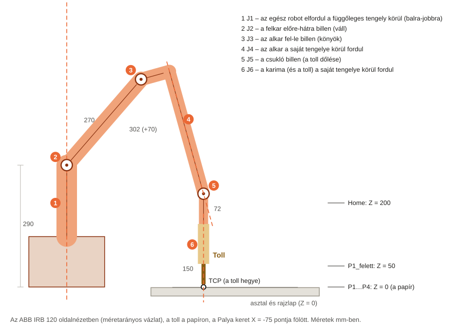
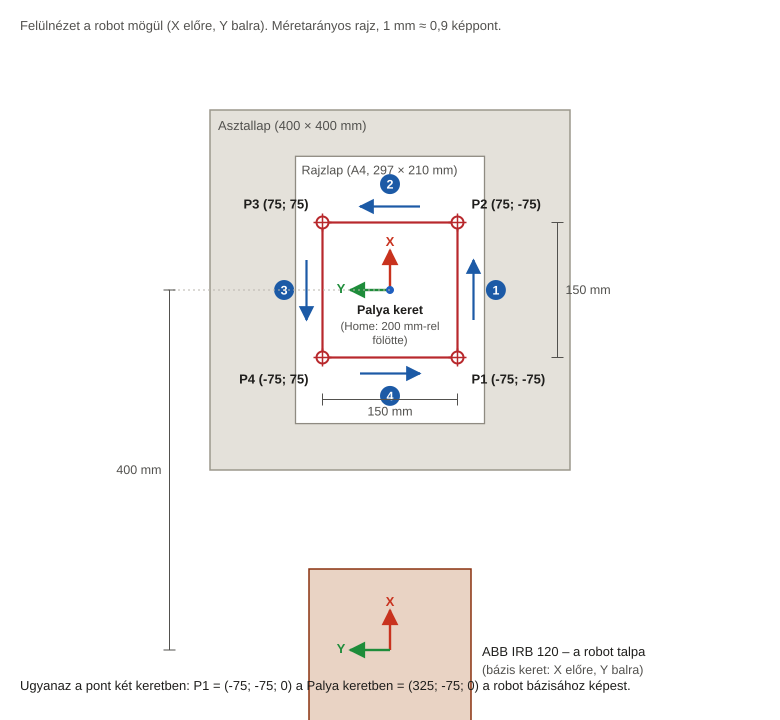
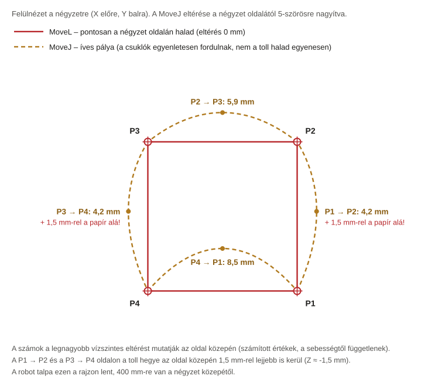

# 2. feladat – Pályakövetés csuklós robottal a RoboDK-ban: részletes útmutató kezdőknek

Ez az útmutató a nulláról vezet végig a 2. mérési feladaton. **Nem kell programozni, és szkripteket sem
használsz:** mindent a RoboDK menüiből csinálsz meg, egérrel és néhány szám beírásával.

Minden lépésnél leírjuk:
- hová kattints, és mit írj be;
- mit kell utána látnod;
- mit tegyél, ha nem azt látod.

> **A feladat röviden.** Egy csuklós robot végrehajtó szerve (nálunk egy toll) kövessen egy előre meghatározott
> négyzet alakú pályát, először lassan, majd gyorsan.
>
> **Mérendő adatok:**
> 1. az egyes pályaszakaszok végrehajtási ideje;
> 2. a kezdő- és a végpozíció közötti eltérés;
> 3. a robot egyes tengelyeinek elfordulása;
> 4. a különböző sebességek hatása a pályakövetés pontosságára.
>
> **Értékelés:** a robot pontossága, ismételhetősége és a sebességváltoztatás hatása a mozgásra.

> 💡 **Ha az 1. feladatot már megcsináltad,** sok minden ismerős lesz: ugyanúgy töltöd be a robotot és a
> tárgyakat, ugyanúgy veszed fel a célpontokat, és ugyanúgy építed fel a programot. Az új dolgok: egy klasszikus
> ipari robot és a hat tengelye (8. lépés), a pálya saját koordináta-rendszere (12. és 19. lépés), a szakaszonkénti
> időmérés (M1) és a pályakövetés pontosságának vizsgálata (M5).

## Hogyan használd ezt az útmutatót?

| Jelölés | Jelentése |
|---|---|
| **File → Open** | Kattints a felső menüsorban a *File* menüre, majd a lenyíló listában az *Open* pontra. |
| `-75` | Pontosan ezt írd be. A mínuszjel a billentyűzet kötőjel (mínusz) gombja. |
| **Ctrl+S** | Tartsd lenyomva a Ctrl billentyűt, és közben nyomd meg az S-t. |
| ✅ **Ellenőrzés** | Ezt kell látnod, ha jól csináltad. Csak akkor menj tovább, ha stimmel. |
| ⚠️ **Ha nem így van** | A leggyakoribb hibák és a javításuk. |
| 💡 **Tipp** | Magyarázat vagy könnyítés. Nem kötelező. |
| 📸 **Képernyőkép** | Itt készíts képet a jegyzőkönyvbe. Mellette áll, hogy a Word-sablon melyik pontjába kerül. |

**Négy fontos szabály:**
1. A lépéseket **sorban** csináld, és ne hagyj ki egyet sem: a későbbi lépések a korábbiakra épülnek.
2. **Ments gyakran:** **Ctrl+S**. Ha elrontasz valamit, a **Ctrl+Z** visszavonja az utolsó műveletet.
3. A RoboDK **tizedespontot** használ (pl. `3.2`). A jegyzőkönyvbe tizedesvesszővel írd: 3,2.
4. Az útmutató az **angol** menüneveket használja. Verziótól függően egy-egy felirat kicsit eltérhet. Ilyenkor
   a hasonló nevű pontot keresd, vagy nézd meg a 12. fejezetet (Hibaelhárítás).

## Az egész munka egy pillantásra

| Rész | Mit csinálsz | Eredmény | Idő |
|---|---|---|---|
| **A. Előkészület** (2. fejezet) | fájlok letöltése, ismerkedés a képernyővel | letöltött modellek, Word-sablon | 15–30 perc |
| **B. A cella** (4. fejezet) | robot, toll, keret, asztal, rajzlap | a `Feladat2.rdk` állomás | 30–40 perc |
| **C. Tengelyek és célpontok** (5. fejezet) | a hat tengely kipróbálása, 6 célpont felvétele | `Home`, `P1_felett`, `P1`…`P4` | 30–40 perc |
| **D. Programok** (6–7. fejezet) | 2 négyzetprogram, 4 szakaszmérő, 2 MoveJ-változat | 8 program | 40–60 perc |
| **E. Mérések** (8–9. fejezet) | idők, helyzetek, csuklószögek, pályaeltérés | kitöltött T2.1–T2.9 táblázatok | 60–90 perc |
| **F. Jegyzőkönyv** (10–11. fejezet) | képek, szöveg, értékelés | a kész Word- és PDF-jegyzőkönyv | 1–2 óra |

---

## Tartalom

- [1. Fogalmak, amelyekre szükséged lesz](#1-fogalmak-amelyekre-szükséged-lesz)
- [2. Előkészületek](#2-előkészületek)
- [3. A cella terve: mit fogsz megépíteni?](#3-a-cella-terve-mit-fogsz-megépíteni)
- [4. A cella felépítése](#4-a-cella-felépítése) – 1–6. lépés
- [5. A robot tengelyei és a célpontok](#5-a-robot-tengelyei-és-a-célpontok) – 7–12. lépés
- [6. Az első program: Negyzet_lassu](#6-az-első-program-negyzet_lassu) – 13–15. lépés
- [7. A többi program](#7-a-többi-program) – 16–19. lépés
- [8. Mérések lépésről lépésre](#8-mérések-lépésről-lépésre) – M1–M6
- [9. Számítások lépésről lépésre](#9-számítások-lépésről-lépésre)
- [10. Az eredmények értelmezése és az értékelés](#10-az-eredmények-értelmezése-és-az-értékelés)
- [11. A jegyzőkönyv befejezése Wordben](#11-a-jegyzőkönyv-befejezése-wordben)
- [12. Hibaelhárítás](#12-hibaelhárítás)
- [A függelék: Gyorsbillentyűk](#a-függelék-gyorsbillentyűk)
- [B függelék: Dobozok készítése a RoboDK-ban, STL-fájlok nélkül](#b-függelék-dobozok-készítése-a-robodk-ban-stl-fájlok-nélkül)
- [C függelék: Hasznos dokumentáció](#c-függelék-hasznos-dokumentáció)

---

## 1. Fogalmak, amelyekre szükséged lesz

| Fogalom | Mit jelent | Hol látod a RoboDK-ban |
|---|---|---|
| **Csuklós robot** | Olyan robotkar, amelynek minden tengelye forgó csukló (mint az emberi karé: váll, könyök, csukló). A legelterjedtebb ipari robottípus. Nálunk: **ABB IRB 120**, 6 tengelyes, 580 mm hatótávolságú kis ipari robot. | a 3D nézetben |
| **Tengely, csukló** (*joint*, J1…J6) | A robot egy forgó része. Mindegyik szögét fokban adjuk meg. Az 1. ábra mutatja, melyik tengely mit mozgat. | a robotpanel *Joint axis jog* részében |
| **Állomás, állomásfa** | Az állomás egy RoboDK-projekt (`.rdk` fájl), a fa a cella elemeinek listája. Ami egy elem alatt beljebb van, az ahhoz van rögzítve. | a fa a képernyő bal oldalán |
| **Referencia keret** (*reference frame*) | Koordináta-rendszer: egy origó és három tengely (**X piros, Y zöld, Z kék**). Ehhez képest adod meg a pontok helyét. Nálunk a `Palya` keret a négyzet közepén van. | piros-zöld-kék nyilak |
| **Szerszám, TCP** (*tool, Tool Center Point*) | A robotra szerelt eszköz, illetve a „munkapontja”. Nálunk a szerszám egy toll, a TCP a toll hegye, 150 mm-re a robot karimájától. | kis koordináta-rendszer a toll hegyén |
| **Célpont** (*target*) | Egy elmentett robothelyzet: hol legyen a TCP, és merre nézzen a szerszám. | célpont-ikonok a fában |
| **MoveL** (*linear move*) | A TCP **egyenes vonalon** halad a célpontig. A négyzet oldalait ezzel rajzoljuk. | utasítás a programban |
| **MoveJ** (*joint move*) | Minden csukló egyszerre, egyenletesen fordul a célhelyzetbe. A TCP ilyenkor **nem egyenesen**, hanem íves pályán halad. | utasítás a programban |
| **Pályakövetés** | Mennyire halad a TCP a kívánt pályán (nálunk a négyzet oldalain). Az eltérést mm-ben mérjük. | – |
| **Pontos megállás, lekerekítés** | Pontos megállásnál a robot minden célpontban megáll (éles sarkok). Lekerekítésnél (*rounding*) a célpont előtt már a következő felé fordul, és a sarok lekerekedik. Nálunk pontos megállás kell: *Set Rounding* = `-1`. | utasítás a programban |
| **Szakaszidő, ciklusidő** | Egy mozgás, illetve a teljes program ideje a valódi robotra számolva. A RoboDK kiszámolja és kiírja. | a szimulációs sávon, a program neve mellett |


*1. ábra – Az ABB IRB 120 tengelyei oldalnézetben. A J2, a J3 és a J5 billenti a kart, a J1, a J4 és a J6 a saját
tengelye körül forgat.*

---

## 2. Előkészületek

### 2.1 A RoboDK

Ha az 1. feladathoz már telepítetted a RoboDK-t, nincs teendőd. Ha nem, kövesd az 1. feladat útmutatójának
[2.1 pontját](../feladat1/UTMUTATO.md#21-a-robodk-telepítése-és-a-licenc) (telepítés, licenc, angol nyelv).

### 2.2 A szükséges fájlok letöltése

1. Töltsd le a repót: a GitHubon **Code → Download ZIP**. Utána csomagold ki: jobb klikk a ZIP-fájlra →
   **Összes kibontása**.
2. A `feladat2` mappából ezekre lesz szükséged:

   | Fájl | Mire kell |
   |---|---|
   | `modellek/Toll.stl` | a toll és a tolltartó 3D-modellje (a hegye 150 mm-re van a karimától) |
   | `modellek/Asztallap.stl` | az asztallap (400 × 400 × 20 mm) |
   | `modellek/Rajzlap.stl` | a rajzlap (A4: 297 × 210 mm) |
   | `modellek/Negyzet_jel.stl` | a négyzet jelölése a papíron (150 × 150 mm, 2 mm-es vonal) |
   | `jegyzokonyv_sablon.docx` | a jegyzőkönyv Word-sablonja |
   | `UTMUTATO.pdf` | ez az útmutató |

3. Hozz létre egy munkamappát, például `C:\RoboDK_feladat2\`. Másold bele a négy `.stl` fájlt és a sablont.
4. Nyisd meg a sablont Wordben, és mentsd el a saját neveddel, például `Feladat2_jegyzokonyv_Nev.docx`.
   Ebbe dolgozol végig.

> 💡 **Tipp:** Az STL-fájlok egyszerű 3D-testek pontos méretekkel. Ezek nem szkriptek: úgy nyitod meg őket, mint
> bármilyen 3D-modellt. Ha inkább magad készítenéd el a dobozokat a RoboDK-ban, a B függelék leírja, hogyan.

### 2.3 A RoboDK ablaka és az alapműveletek


*2. ábra – A RoboDK ablakának részei (egyszerűsített vázlat, az 1. feladat állomásával)*

| # | Rész | Mire való |
|---|---|---|
| ① | **Menüsor** | Itt van minden parancs: *File, Edit, Program, View, Tools, Utilities, Connect, Help*. |
| ② | **Eszköztár** | A gyakori parancsok gombjai. Ha az egeret egy gomb fölé viszed, megjelenik a neve. |
| ③ | **Állomásfa** | A cella elemei. Itt jelölöd ki, nevezed át és rendezed az elemeket. |
| ④ | **3D nézet** | A cella térben. |
| ⑤ | **Szimulációs sáv** | Program futtatásakor jelenik meg. A csúszkával előre-hátra tekerheted a mozgást (ezt az M5 mérésnél használod). Mellette áll a program neve és **ideje**, például *Szakasz_1 time: 3.2s*. A csúszka melletti szám a szimuláció lépésszáma, **nem az út**. |
| ⑥ | **Állapotsor** | Üzenetek és tippek. |

| Mit akarsz | Hogyan |
|---|---|
| Elem kijelölése | bal klikk az elemre (a fában vagy a 3D nézetben) |
| Elem beállításainak megnyitása | dupla klikk az elemre. **Kivétel:** célpontra dupla klikk → a robot odaugrik; programra dupla klikk → a program lefut |
| Átnevezés | jelöld ki → **F2** → írd be az új nevet → **Enter** |
| Elem áthelyezése másik elem alá a fában | fogd meg a bal egérgombbal, húzd rá a másik elemre, és ott engedd el |
| Törlés / visszavonás / mentés | **Delete** / **Ctrl+Z** / **Ctrl+S** |
| Forgatás a 3D nézetben | a jobb egérgombot nyomva tartva húzd (laptopon: **Ctrl+Shift** + bal gomb) |
| Eltolás | a középső gombot (görgőt) lenyomva tartva húzd (laptopon: **Ctrl+Alt** + bal gomb) |
| Nagyítás | görgetés (laptopon: **Shift** + bal gomb) |

> ⚠️ **Vigyázz az Alt billentyűvel!** Ha a 3D nézetben az **Alt**-ot nyomva tartva húzol, az elemet arrébb
> viszed. Ha ez véletlenül megtörtént, nyomd meg a **Ctrl+Z**-t.

Részletesebben: az 1. feladat útmutatójának [2.3 pontja](../feladat1/UTMUTATO.md#23-ismerkedés-a-robodk-ablakával).

### 2.4 Képernyőkép készítése

1. Nyomd meg a **Win+Shift+S**-t, és egérrel jelöld ki a lefényképezendő területet.
2. A Wordben kattints a sárga „[Ide illeszd be a képernyőképet: …]” szövegre, töröld ki, és nyomd meg a
   **Ctrl+V**-t. A kép alatti képaláírást hagyd meg.

---

## 3. A cella terve: mit fogsz megépíteni?

A robot (ABB **IRB 120**) előtt egy asztal áll, rajta egy A4-es rajzlap. A rajzlap közepe 400 mm-re van a robot
talpától. A papírra egy 150 × 150 mm-es négyzet van rajzolva. A robot karimáján egy toll van, a toll hegye a TCP.
A robot:
1. a kiinduló helyzetből (`Home`) a négyzet első sarka (`P1`) fölé megy;
2. leereszkedik a papírra;
3. körbejárja a négyzetet: `P1` → `P2` → `P3` → `P4` → `P1`, egyenes vonalakon (MoveL);
4. felemelkedik, és visszatér a `Home`-ba.


*3. ábra – A cella felülnézetben, méretarányosan. A kék nyilak és a számok a négyzet bejárásának irányát és
sorrendjét mutatják.*

**Miért kell a `Palya` keret?** A négyzet pontjait nem a robothoz, hanem a négyzet közepéhez (a `Palya` keret
origójához) képest adod meg. Így a pontok egyszerűek (±75 mm), és ha a keretet elmozdítod vagy elforgatod, a
teljes pálya vele mozog, a programhoz nem kell nyúlni (19. lépés). Ez a koordináta-rendszerek használatának
lényege.

**Az elemek** (minden helyet a `Palya` keretben adunk meg):

| Elem | Mi ez | Fájl | Hely a `Palya` keretben (X; Y; Z) |
|---|---|---|---|
| `Toll` | szerszám a robot karimáján, TCP: **Z = 150 mm** (a toll hegye) | `Toll.stl` | – (a robotra kerül) |
| `Palya` | referencia keret a négyzet közepén, a robot talpától **X = 400 mm**-re | – | a robothoz képest (400; 0; 0) |
| `Asztallap` | 400 × 400 × 20 mm-es lap, a teteje 1,5 mm-rel a keret síkja alatt | `Asztallap.stl` | (0; 0; 0) |
| `Rajzlap` | A4-es lap (297 × 210 mm), a teteje 0,5 mm-rel a keret síkja alatt | `Rajzlap.stl` | (0; 0; 0) |
| `Negyzet_jel` | a négyzet vonalai a papíron (150 × 150 mm) | `Negyzet_jel.stl` | (0; 0; 0) |

**A célpontok** (a TCP helye a `Palya` keretben; a toll mindig függőlegesen lefelé néz):

| Célpont | X [mm] | Y [mm] | Z [mm] | Mire való |
|---|---|---|---|---|
| `Home` | 0 | 0 | 200 | kiinduló és végpont, a négyzet közepe fölött |
| `P1_felett` | -75 | -75 | 50 | 50 mm-rel az első sarok fölött |
| `P1` | -75 | -75 | 0 | 1. sarok (a robothoz közelebb, jobbra) |
| `P2` | 75 | -75 | 0 | 2. sarok (távolabb, jobbra) |
| `P3` | 75 | 75 | 0 | 3. sarok (távolabb, balra) |
| `P4` | -75 | 75 | 0 | 4. sarok (közelebb, balra) |

**A két sebességszint:**

| Szint | Lineáris sebesség | Lineáris gyorsulás | Csuklósebesség | Csuklógyorsulás |
|---|---|---|---|---|
| lassú | 50 mm/s | 250 mm/s² | 30 °/s | 100 °/s² |
| gyors | 500 mm/s | 2500 mm/s² | 180 °/s | 600 °/s² |

**A programok:**
- `Negyzet_lassu`, `Negyzet_gyors`: a fő program, a négyzet oldalai MoveL-ek (a feladat megoldása).
- `Szakasz_1` … `Szakasz_4`: négy rövid mérőprogram, mindegyik egyetlen oldalt rajzol meg. Ezekkel méred a
  szakaszidőket, és ezek végén olvasod le a robot helyzetét és a csuklószögeket.
- `Negyzet_MoveJ_lassu`, `Negyzet_MoveJ_gyors`: összehasonlító kísérlet. Itt a négyzet oldalai MoveJ-k, így
  láthatod és mérheted, mekkora a pályaeltérés, ha a robot nem egyenes vonalú mozgással halad.

---

## 4. A cella felépítése

### 1. lépés – Új állomás létrehozása és mentése

1. Indítsd el a RoboDK-t. Ha üdvözlő vagy licencablak jelenik meg, zárd be, vagy válaszd a próbaverziót.
2. Válaszd a **File → New Station** pontot (**Ctrl+N**).
3. Válaszd a **File → Save Station as…** pontot. Lépj be a munkamappádba (`C:\RoboDK_feladat2\`), fájlnévnek
   írd be: `Feladat2`, majd kattints a **Mentés**-re.

> ✅ **Ellenőrzés:** A fa legfelső eleme és az ablak címsora is *Feladat2*.

### 2. lépés – Az ABB IRB 120 robot betöltése

1. Válaszd a **File → Open Robot Library** pontot (**Ctrl+Shift+O**). Régebbi verzióban ennek a neve
   **File → Open online library**.
2. A keresőmezőbe írd be: `IRB 120`. Szűrhetsz gyártóra is: *Brand → ABB*.
3. Válaszd az **ABB IRB 120-3/0.6** robotot (3 kg teherbírás, 0,6 m hatótávolság): vidd az egeret a képe fölé,
   és kattints az **Open** gombra.
4. Néhány másodperc múlva a robot megjelenik a 3D nézetben. A könyvtár ablakát bezárhatod.

> ✅ **Ellenőrzés:** A fában megjelent az `ABB IRB 120-3/0.6 Base` (a robot talpának koordináta-rendszere), és
> alatta az `ABB IRB 120-3/0.6` (maga a robot). A robot narancssárga, függőlegesen áll, az alkarja előre nyúlik.

> ⚠️ **Ha nem így van:**
> - **Más változatot töltöttél be** (például *IRB 120T*-t vagy *IRB 1200*-at): jelöld ki a fában, nyomd meg a
>   **Delete**-et, és töltsd be az *IRB 120-3/0.6*-ot. A számítások ennek a méreteivel készültek.
> - **Nem jelent meg a robot:** ellenőrizd az internetkapcsolatot, vagy a könyvtárban a **Download** gombbal töltsd
>   le, és a `.robot` fájlt húzd be a RoboDK ablakába.

> 💡 **Tipp:** A fában a robot neve hosszú. Ebben az útmutatóban egyszerűen „a robot” (`ABB IRB 120-3/0.6`) és „a
> robot talpa” (`ABB IRB 120-3/0.6 Base`) néven hivatkozunk rájuk.

> 📸 **Képernyőkép → a sablon 6.1 pontjába:** a robot a 3D nézetben és a fa.

### 3. lépés – A toll felszerelése

A robot karimájára szereled a tollat, és a TCP-t a toll hegyére (150 mm) állítod.

**A) Ajánlott: a kész tollmodellel**

1. Válaszd a **File → Open** pontot, és nyisd meg a munkamappádból a `Toll.stl` fájlt.

   > ✅ **Ellenőrzés:** A fában megjelent a `Toll`. A 3D nézetben a robot talpánál látszik egy függőleges henger.

2. A fában fogd meg a `Toll` elemet, húzd rá az **`ABB IRB 120-3/0.6`** elemre (a robotra, nem a `Base`-re), és ott
   engedd el. Ha a RoboDK megkérdezi, mi legyen vele, válaszd, hogy a robot szerszáma (*tool*) legyen.

   > ✅ **Ellenőrzés:** A toll átugrik a robot karimájára (a robot „orrára”), és a fában a robot alá kerül,
   > szerszám-ikonnal.

3. Kattints duplán a `Toll`-ra: megnyílik a szerszám beállító ablaka.
4. A TCP helyét megadó hat mezőbe (*Tool Center Point (TCP) with respect to the robot flange*) írd be ezeket,
   minden szám után **Enter**:

   | X | Y | Z | 1. forgatás | 2. forgatás | 3. forgatás |
   |---|---|---|---|---|---|
   | `0` | `0` | **`150`** | `0` | `0` | `0` |

   > ⚠️ **Figyelj a kezdőértékekre!** A RoboDK magától Z = `200`-at ír be, ezt kell `150`-re átírnod. A három
   > forgatási mező mindegyike legyen pontosan `0`: ha bármelyikben más érték áll (például `-10`), a célpontok
   > megdőlt tollal jönnek létre, és a csuklószögek nem fognak egyezni az ellenőrző értékekkel.

5. Zárd be az ablakot.

> ✅ **Ellenőrzés:** A TCP kis koordináta-rendszere (piros, zöld és kék nyilacska) pontosan a toll kúpos hegyén
> látszik. A kék Z nyíl a tollból kifelé, a karimától elfelé mutat.

> ⚠️ **Ha nem így van:**
> - **A toll nem a karimán van:** valószínűleg nem a robotra húztad. **Ctrl+Z**, és próbáld újra.
> - **A TCP nem a hegyen van** (például a toll hegye alatt, a levegőben látszik): nyisd meg újra a `Toll` ablakát,
>   és ellenőrizd: Z = 150, a forgatások 0. A robotpanel *Tool Frame w.r.t. Robot Flange* sorában is ezt kell látnod:
>   0, 0, 150, 0, 0, 0.
> - **Nem sikerül:** használd a B) változatot.

**B) Egyszerűbb, tollmodell nélkül**

1. Kattints a fában a robotra, majd válaszd a **Program → Add Empty Tool** pontot.
2. Kattints duplán az új szerszámra (például *Tool 1*). Állítsd be: Z = `150`, a többi mező `0`. Zárd be.
3. **F2** → `Toll` → **Enter**.

> 💡 **Tipp:** A B) változatban nincs látható toll, csak a TCP kis koordináta-rendszere. A mérési eredményeket ez
> nem befolyásolja.

> 📸 **Képernyőkép → a sablon 6.2 pontjába:** a toll a roboton és a TCP-ablak (Z = 150).

### 4. lépés – A Palya referencia keret

Létrehozol egy koordináta-rendszert a négyzet közepén, 400 mm-re a robot előtt.

1. Kattints egyszer a fában az `ABB IRB 120-3/0.6 Base` elemre, hogy ki legyen jelölve.
2. Válaszd a **Program → Add Reference Frame** pontot.

   > ✅ **Ellenőrzés:** A `Base` alatt megjelent egy új keret (például *Frame 2*). Ha a legfelső szintre került,
   > húzd rá a `Base`-re.

3. **F2** → `Palya` → **Enter**.
4. Kattints duplán a `Palya`-ra. A megnyíló ablakban a keret helye látszik a szülőjéhez (a robot talpához)
   képest. Írd be (mindegyik után **Enter**), majd zárd be az ablakot:

   | X | Y | Z | 1. forgatás | 2. forgatás | 3. forgatás |
   |---|---|---|---|---|---|
   | `400` | `0` | `0` | `0` | `0` | `0` |

> ✅ **Ellenőrzés:** A 3D nézetben a keret 400 mm-re van a robot előtt, a robot talpának magasságában. A piros X
> nyíl a robottól elfelé mutat, a tengelyei párhuzamosak a robot talpának tengelyeivel.

> 💡 **Tipp:** Ha a keretek túl kicsik vagy túl nagyok, a **+** és a **-** billentyűvel nagyíthatod és
> kicsinyítheted őket.

### 5. lépés – Az asztallap, a rajzlap és a négyzet jelölése

Betöltöd a három tárgyat, és mindhármat a `Palya` keretben a (0; 0; 0) helyre teszed. Az STL-fájlokban a tárgyak
már a helyes helyzetben vannak a keret origójához képest.

1. Válaszd a **File → Open** pontot, majd nyisd meg az `Asztallap.stl` fájlt.
2. Húzd a fában az `Asztallap`-ot a `Palya` keretre.

   > ✅ **Ellenőrzés:** Az `Asztallap` most beljebb, a `Palya` alatt látszik.

3. Kattints duplán az `Asztallap`-ra. Írd be: X = `0`, Y = `0`, Z = `0`, és a három forgatás `0` (mindegyik után
   **Enter**). Zárd be az ablakot.
4. Ugyanígy töltsd be, húzd a `Palya` alá, és állítsd (0; 0; 0)-ra a `Rajzlap.stl`-t és a `Negyzet_jel.stl`-t is.
5. **Színek** (nem kötelező, de a képeken jobban látszik): kattints duplán a tárgyra → **More options…** → szín
   (*Color*). Javaslat: az asztallap világosszürke, a rajzlap fehér, a négyzet jelölése piros. Másik út:
   **Tools → Change Color Tool**, majd kattints a tárgyra.
6. Ments: **Ctrl+S**.

> ✅ **Ellenőrzés:** A cella úgy néz ki, mint a 3. ábrán: a robot előtt az asztallap, rajta középen a fehér
> rajzlap, a rajzlapon a 150 mm-es piros négyzet. A `Palya` keret origója a négyzet közepén van.

> ⚠️ **Ha nem így van:**
> - **Egy tárgy rossz helyen van:** ellenőrizd, hogy a fában a `Palya` alatt van-e, és hogy az ablakában a hely
>   (0; 0; 0). Ha van *w.r.t.* (*with respect to*, azaz „valamihez képest”) legördülő lista, abban a `Palya`
>   legyen kiválasztva.
> - **A tárgy óriási vagy apró:** a RoboDK rossz mértékegységgel olvasta be. Töröld, és nyisd meg újra. A modellek
>   milliméterben vannak.

> 💡 **Tipp: miért nincs a papír pontosan a Z = 0 síkban?** A papír teteje 0,5 mm-rel, a négyzet vonalai
> 0,2 mm-rel, az asztallap teteje 1,5 mm-rel a keret síkja alatt van. Így a toll hegye (Z = 0) nem ér hozzá
> semmihez, és a RoboDK nem jelez hamis ütközést. A mérési eredményeket ez nem befolyásolja; a jegyzőkönyvben
> említsd meg.

> 📸 **Képernyőkép → a sablon 6.3 pontjába:** a `Palya` keret és a három tárgy a fában és a 3D nézetben.

### 6. lépés – Ellenőrzés: így néz ki a fa

```
Feladat2
└── ABB IRB 120-3/0.6 Base
    ├── ABB IRB 120-3/0.6
    │   └── Toll
    └── Palya
        ├── Asztallap
        ├── Rajzlap
        └── Negyzet_jel
```

A sorrend kicsit eltérhet, a lényeg, hogy melyik elem melyik alatt van. Ha minden stimmel, ments: **Ctrl+S**.

---

## 5. A robot tengelyei és a célpontok

### 7. lépés – A robotpanel megnyitása és beállítása

1. Kattints duplán a fában a robotra (`ABB IRB 120-3/0.6`). Megnyílik a **robotpanel**.
2. A panel két legördülő listájában válaszd ki:
   - a szerszám listában (*Tool*) a `Toll`-at;
   - a referencia keret listában (*Reference*) a `Palya`-t.

> ✅ **Ellenőrzés:** A fában a `Toll` és a `Palya` ikonján megjelenik egy kis zöld pötty: ezek az **aktívak**. Az új
> célpontok mostantól a `Palya` alá kerülnek.

3. A panel részei (a feliratok verziótól függően kicsit eltérhetnek):

   | Rész a panelen | Mit mutat | Mit csinálj vele |
   |---|---|---|
   | **Joint axis jog** (J1…J6) | a hat csukló szöge fokban, mindegyik mellett **+** és **-** gomb és csúszka | itt mozgatod egyenként a tengelyeket (8. lépés), itt írsz be csuklószögeket (9. lépés), és innen olvasod le őket |
   | **Tool Frame (TF) w.r.t. Robot Flange (FF)** | a TCP helye a karimához képest: **0, 0, 150, 0, 0, 0** | **ne nyúlj hozzá!** |
   | **Reference Frame (RF) w.r.t. Robot Base (BF)** | a `Palya` helye a robothoz képest: **400, 0, 0, 0, 0, 0** | **ne nyúlj hozzá!** |
   | **Tool Frame (TF) w.r.t. Reference Frame (RF)** | a TCP helye a `Palya`-hoz képest (X, Y, Z és három forgatás) | **ezt fogod használni:** ha ide számot írsz, a robot odamegy, és innen olvasod le a TCP helyét |

> ⚠️ **Vigyázz:** Ha véletlenül a második vagy a harmadik mezőcsoportba írtál, a toll TCP-jét vagy a `Palya` helyét
> változtattad meg. Nyomd meg a **Ctrl+Z**-t, vagy írd vissza a helyes értéket (Z = 150, illetve X = 400).

### 8. lépés – A hat tengely kipróbálása (T2.1)

A feladat egyik célja a csuklós robot tengelyeinek megismerése. Ezért most egyenként megmozgatod őket.

1. A robotpanel **Joint axis jog** részében kattints néhányszor a **J1** melletti **+** gombra, majd a **-**
   gombra. Figyeld a 3D nézetben, mi mozdul el, és merre. A csúszkát egérrel is húzhatod.
2. Ugyanezt csináld meg a J2, J3, J4, J5 és J6 tengellyel is.
3. Írd be a Word-sablon **T2.1** táblázatába, mit mozgat az adott tengely (például „az egész robot elfordul a
   függőleges tengely körül”), és milyen tartományban mozoghat. A tartomány a csúszka két végén lévő érték (ha a
   csúszkát a végéig húzod, leolvashatod), vagy a robot adatlapján található.

> ✅ **Ellenőrzés:** Az 1. ábra szerint:
>
> | Tengely | Mit mozgat | Mozgás | Tartomány (ABB IRB 120 adatlap, ellenőrizd) |
> |---|---|---|---|
> | J1 | az egész robotot a függőleges tengely körül | forgás (balra-jobbra) | ±165° |
> | J2 | a felkart (váll) | billenés (előre-hátra) | ±110° |
> | J3 | az alkart (könyök) | billenés (fel-le) | -110° … +70° |
> | J4 | az alkart a saját hossztengelye körül | forgás | ±160° |
> | J5 | a csuklót (a toll dőlését) | billenés | ±120° |
> | J6 | a karimát és a tollat a saját tengelye körül | forgás | ±400° |

> 💡 **Tipp:** A J1, a J4 és a J6 a saját tengelye körül forgat (*forgó* tengelyek), a J2, a J3 és a J5 billenti a
> kart (*billentő* tengelyek). A J4, a J5 és a J6 tengelye egy pontban, a csuklóközéppontban metszi egymást. Ez a
> klasszikus ipari csuklós robotok felépítése.

> 📸 **Képernyőkép → a sablon 6.4 pontjába:** a robotpanel és a robot egy kimozdított tengellyel.

### 9. lépés – A robot kiinduló helyzetbe állítása

Egy jól ismert helyzetbe állítod a robotot. Ha innen indulsz, minden célpontnál ugyanazt a karállást kapod, és a
csuklószögeid egyezni fognak az útmutató ellenőrző értékeivel (11. lépés).

1. A robotpanel **Joint axis jog** részében írd be egyenként ezeket a csuklószögeket (mindegyik után **Enter**):

   | J1 | J2 | J3 | J4 | J5 | J6 |
   |---|---|---|---|---|---|
   | `0` | `0` | `0` | `0` | `90` | `0` |

> ✅ **Ellenőrzés:**
> - A felkar függőlegesen felfelé áll, az alkar vízszintesen előre nyúlik, a toll függőlegesen lefelé néz.
> - A *Tool Frame w.r.t. Reference Frame* mezőkben kb. ez áll: X ≈ `-98`, Y ≈ `0`, Z ≈ `408`.
> - A három forgatás (a RoboDK ABB-formátumában, *Rot[Z,Y',X'']*) kb. `-180`, `0`, `180`: **a középső 0**. Ez jelenti,
>   hogy a toll pontosan függőleges. **A forgatásokhoz ne nyúlj.**
> - A robotpanel *Tool Frame w.r.t. Robot Flange* sorában `0`, `0`, `150`, `0`, `0`, `0` áll.

> ⚠️ **Ha nem így van:** ellenőrizd, hogy a szerszám listában a `Toll`, a referencia listában a `Palya` van-e
> kiválasztva (7. lépés), és hogy a `Toll` TCP-je Z = 150.

### 10. lépés – A hat célpont felvétele

A robotot sorban a hat helyzetbe állítod, és mindegyiket elmented célpontként. **A forgatásokhoz nem kell
nyúlnod:** a toll a 9. lépés óta pontosan lefelé néz, és ez így is marad, ha csak az X, Y és Z értéket írod át.

**Az első célpont (`Home`), részletesen:**

1. A robotpanel *Tool Frame w.r.t. Reference Frame* részében írd be: X = `0`, **Enter**; Y = `0`, **Enter**;
   Z = `200`, **Enter**.

   > ✅ **Ellenőrzés:** A toll hegye a négyzet közepe fölött van, 200 mm magasan.

2. Válaszd a **Program → Teach Target** pontot (**Ctrl+T**).

   > ✅ **Ellenőrzés:** A fában a `Palya` alatt megjelent egy új célpont (például *Target 1*).

3. Rögtön nevezd át: **F2** → `Home` → **Enter**.

**A további öt célpont:** mindegyiknél ugyanez a három lépés (X, Y, Z beírása → **Ctrl+T** → **F2**, név, **Enter**).

| Sorrend | Név | X | Y | Z |
|---|---|---|---|---|
| 1. | `Home` (kész) | `0` | `0` | `200` |
| 2. | `P1_felett` | `-75` | `-75` | `50` |
| 3. | `P1` | `-75` | `-75` | `0` |
| 4. | `P2` | `75` | `-75` | `0` |
| 5. | `P3` | `75` | `75` | `0` |
| 6. | `P4` | `-75` | `75` | `0` |

> ✅ **Ellenőrzés:** A `Palya` alatt hat célpont van. A négy sarok-célpont pontosan a piros négyzet sarkain látszik,
> a `P1_felett` a `P1` fölött, a `Home` a négyzet közepe fölött. Ments: **Ctrl+S**.

> ⚠️ **Ha nem így van:**
> - **A toll ferde, és/vagy a hegye nem ér le a papírra:** a célpontokat hibás szerszámbeállítással vetted fel
>   (3. lépés: Z = 200 maradt, vagy egy forgatás nem 0). Javítsd a `Toll`-t (Z = `150`, forgatások `0`), majd
>   javítsd a célpontokat: írd be a 9. lépés csuklószögeit, utána sorban minden célpontnál írd be az X, Y, Z értéket,
>   és jobb klikk a célponton → **Teach Current Position**. Így a programok is megmaradnak. A végén minden
>   célpontban a középső forgatás 0, a toll függőleges, és a hegye a papírt éri.
> - **Elfelejtetted átírni a koordinátákat a Ctrl+T előtt:** állítsd a robotot a jó helyre, majd jobb klikk a
>   célponton → **Teach Current Position**. Ez felülírja a célpontot a robot jelenlegi helyzetével.
> - **A robot nem mozdul, vagy hibát ír** (*target not reachable*): elírtál egy számot. Írd be újra.

### 11. lépés – A célpontok ellenőrzése és a csuklószögek felírása (T2.2)

1. Kattints duplán a `Home` célpontra: a robot odaugrik.
2. Olvasd le a robotpanel **Joint axis jog** részéről a hat csuklószöget, és írd be a Word-sablon **T2.2**
   táblázatába, egy tizedesjegyre kerekítve.
3. Ugyanezt csináld meg a többi öt célponttal is.

> ✅ **Ellenőrzés:** Ha a 9. lépés kiinduló helyzetéből indultál, ezeket az értékeket kell látnod (±0,1°):
>
> | Célpont | J1 | J2 | J3 | J4 | J5 | J6 |
> |---|---|---|---|---|---|---|
> | `Home` | 0,0 | 24,4 | 10,2 | 0,0 | 55,4 | 0,0 |
> | `P1_felett` | -13,0 | 32,4 | 33,1 | 0,0 | 24,5 | -13,0 |
> | `P1` | -13,0 | 41,8 | 31,6 | 0,0 | 16,6 | -13,0 |
> | `P2` | -9,0 | 62,2 | -10,5 | 0,0 | 38,3 | -9,0 |
> | `P3` | 9,0 | 62,2 | -10,5 | 0,0 | 38,3 | 9,0 |
> | `P4` | 13,0 | 41,8 | 31,6 | 0,0 | 16,6 | 13,0 |

**Amit ebből a táblázatból már most láthatsz:**
- A **J4 mindig 0**: a toll függőleges, ezért az alkart nem kell elfordítani.
- A **J6 mindig egyenlő a J1-gyel**: ha a robot a J1-gyel elfordul, a J6 ugyanannyival visszafordítja a tollat, hogy
  az ne forduljon el a papírhoz képest.
- A `P1` és a `P4`, illetve a `P2` és a `P3` csak a J1 és a J6 előjelében különbözik: a négyzet szimmetrikus a
  robot X tengelyére.

> ⚠️ **Ha nálad más számok vannak, de a robot a jó helyen áll:**
> - **Egy szög előjele ellentétes** (például a J6-é), de a nagysága egyezik: ez a tengely forgásirányának
>   megállapodásából adódik. Nem hiba; a jegyzőkönyvbe a saját értékeidet írd.
> - **A J1 és a J6 egyezik, de a J2, a J3 és a J5 más** (például a `P2`-ben J2 ≈ 55,5, J3 ≈ -8,9, J5 ≈ 43,5): a
>   `Toll` TCP-je nem 150 mm (ez a Z = 200-hoz tartozó érték). Javítsd a 3. lépés szerint (Z = 150, forgatások 0),
>   majd a célpontokat vedd fel újra a 9. lépéstől: a régieket töröld, vagy a robotot a helyes helyzetbe állítva
>   jobb klikk a célponton → **Teach Current Position**.
> - **Egészen más számok** (például J4 ≈ 180 vagy J5 negatív): a robot más karállással (konfigurációval) éri el a
>   pontot. Töröld a célpontokat, és kezdd újra a 9. lépéstől.

> 📸 **Képernyőkép → a sablon 6.5 pontjába:** a célpontok a fában és a 3D nézetben, mellettük a robotpanel.

### 12. lépés – Ugyanaz a pont két koordináta-rendszerben (T2.3)

Ez a lépés a koordináta-rendszerek használatát mutatja meg.

1. Kattints duplán a `P1` célpontra.
2. A robotpanel *Tool Frame w.r.t. Reference Frame* mezőiben a `P1` koordinátái látszanak a `Palya` keretben:
   (-75; -75; 0). Írd be a **T2.3** táblázatba.
3. A robotpanel referencia keret listájában válaszd a **robot talpát** (`ABB IRB 120-3/0.6 Base`).

   > ✅ **Ellenőrzés:** A robot nem mozdult, de a mezőkben most (325; -75; 0) áll: ugyanaz a pont, a robot talpához
   > képest. 325 = 400 - 75, mert a `Palya` origója 400 mm-re van a robot előtt.

4. Írd be ezt is a T2.3-ba, majd csináld meg ugyanezt a `P2`, a `P3` és a `P4` célponttal is.
5. **Fontos:** a végén állítsd vissza a referencia listát a **`Palya`**-ra.

> ✅ **Ellenőrzés:** A két keretben mért X mindig pontosan 400-zal tér el, az Y és a Z ugyanaz.

---

## 6. Az első program: Negyzet_lassu

A program a `Home`-ból a `P1` fölé megy, leereszkedik, lassan körbejárja a négyzetet, felemelkedik, és visszatér a
`Home`-ba.

**Hogyan kerül egy utasítás a programba?** (Ugyanúgy, mint az 1. feladatban.)
- Az új utasítás abba a programba kerül, amelyiket utoljára létrehoztad vagy kijelölted, a program végére.
- **Mozgásutasításnál először a célpontra kattints a fában, és csak utána válaszd a menüpontot.** Ha nincs kijelölt
  célpont, a RoboDK új célpontot hoz létre a robot aktuális helyzetében. Ha mégis megtörtént: töröld az utasítást és
  a fölösleges új célpontot (például *Target 7*), és csináld újra.
- Ha egy utasítás rossz helyre került, a fában fogd meg, és húzd a helyére a programon belül.

### 13. lépés – Üres program létrehozása

1. Válaszd a **Program → Add Program** pontot.
2. Nevezd át: **F2** → `Negyzet_lassu` → **Enter**.

### 14. lépés – A program utasításai

**1. utasítás: a sebesség beállítása**

1. Válaszd a **Program → Set Speed Instruction** pontot. Ha az ablak nem nyílik meg magától, kattints duplán az új
   *Set Speed* sorra.
2. Pipáld be mind a négy sort, és írd be a **lassú** értékeket:

   | Mező | Érték |
   |---|---|
   | *Linear speed* (lineáris sebesség) | `50` mm/s |
   | *Joint speed* (csuklósebesség) | `30` °/s |
   | *Linear acceleration* (lineáris gyorsulás) | `250` mm/s² |
   | *Joint acceleration* (csuklógyorsulás) | `100` °/s² |

3. **OK**.

> ⚠️ **Fontos:** Ha egy mezőt nem pipálsz be, a RoboDK a robot alapértékét használja, és a mért idők nem fognak
> egyezni a számítottakkal.

**2. utasítás: pontos megállás a sarkokban**

1. Válaszd a **Program → Set Rounding Instruction** pontot.
2. Írd be: `-1`, majd **OK**.

> 💡 **Tipp:** A `-1` azt jelenti, hogy nincs lekerekítés: a robot minden célpontban pontosan megáll, így a négyzet
> sarkai élesek. Ha ide például `10`-et írnál, a robot a sarkok előtt 10 mm-rel már kanyarodni kezdene.

**3–11. utasítás: a mozgások**

| # | Először kattints erre | Utána ezt válaszd | Mit csinál |
|---|---|---|---|
| 3 | `Home` célpont | **Program → Move Joint Instruction** | kiinduló helyzet |
| 4 | `P1_felett` | **Program → Move Joint Instruction** | a négyzet első sarka fölé megy |
| 5 | `P1` | **Program → Move Linear Instruction** | függőlegesen leteszi a tollat a papírra (50 mm) |
| 6 | `P2` | **Program → Move Linear Instruction** | 1. oldal: P1 → P2 (150 mm) |
| 7 | `P3` | **Program → Move Linear Instruction** | 2. oldal: P2 → P3 |
| 8 | `P4` | **Program → Move Linear Instruction** | 3. oldal: P3 → P4 |
| 9 | `P1` | **Program → Move Linear Instruction** | 4. oldal: P4 → P1, a négyzet bezárul |
| 10 | `P1_felett` | **Program → Move Linear Instruction** | felemeli a tollat |
| 11 | `Home` | **Program → Move Joint Instruction** | visszatér a kiinduló helyzetbe |

> ✅ **Ellenőrzés:** Az első mozgásutasítás előtt a RoboDK beszúr két sort: *Set Reference Frame (Palya)* és *Set
> Tool Frame (Toll)*. **Ezek maradjanak.** Ha nem jelentek meg, add hozzá őket kézzel (**Program → Set Reference
> Frame Instruction**, illetve **Set Tool Frame Instruction**), és húzd őket a *MoveJ (Home)* elé.
>
> A program sorai:
>
> ```
> Negyzet_lassu
>   1  Set Speed 50 mm/s, 30 °/s, 250 mm/s², 100 °/s²
>   2  Set Rounding -1
>      Set Reference Frame: Palya              a RoboDK szúrta be
>      Set Tool Frame: Toll                    a RoboDK szúrta be
>   3  MoveJ Home
>   4  MoveJ P1_felett
>   5  MoveL P1
>   6  MoveL P2
>   7  MoveL P3
>   8  MoveL P4
>   9  MoveL P1
>  10  MoveL P1_felett
>  11  MoveJ Home
> ```

> 💡 **Tipp:** A `P1` célpontot kétszer használod (5. és 9. sor). Ez rendben van: ugyanarra a pontra többször is
> hivatkozhatsz.

### 15. lépés – Az első futtatás

1. Kattints duplán a `Home` célpontra: a robot a kiinduló helyzetbe áll.
2. Kattints **duplán** a `Negyzet_lassu` programra.

> ✅ **Ellenőrzés:** A robot a négyzet első sarka fölé megy, leteszi a tollat, lassan körbejárja a piros négyzetet
> (a toll hegye pontosan a vonalon halad, a sarkokban megáll), majd felemelkedik, és visszatér a `Home`-ba.
>
> Alul a szimulációs sávon: *Negyzet_lassu time: 17.9s*. Ez a 9. fejezet számított értéke (17,86 s).

> ⚠️ **Ha nem így van:**
>
> | Mit látsz | Mi a teendő |
> |---|---|
> | A toll nem a vonalon halad | Valamelyik oldal MoveJ lett MoveL helyett, vagy egy célpont koordinátája rossz. Kattints duplán egyenként a mozgásutasításokra: a robot oda ugrik, ahová az adott sor viszi. |
> | A sarkok lekerekítettek | A *Set Rounding* sor hiányzik, vagy nem `-1` az értéke. |
> | Hibaüzenet egy MoveL-nél (*singularity*, *axis limit*) | Elírtad egy célpont koordinátáit, vagy nem a 9. lépés kiinduló helyzetéből vetted fel őket. |
> | A kiírt idő nagyon más | Lásd a 12. fejezetet (Hibaelhárítás). |

> 💡 **Tipp:** Futtatás közben a **Backspace** megállítja és folytatja a szimulációt, az **Esc** leállítja. A
> szóközt nyomva tartva gyorsabban játssza le.

> 📸 **Képernyőkép → a sablon 6.6 pontjába:** a program sorai, és a robot a négyzet rajzolása közben.

Ments: **Ctrl+S**.

---

## 7. A többi program

### 16. lépés – A gyors változat: Negyzet_gyors

1. Jelöld ki a fában a `Negyzet_lassu` programot, és nyomd meg a **Ctrl+C**-t.
2. Jelöld ki a fa legfelső elemét (`Feladat2`), és nyomd meg a **Ctrl+V**-t.
3. Nevezd át a másolatot: **F2** → `Negyzet_gyors` → **Enter**.
4. Nyisd le a programot (a neve előtti kis nyíllal), és kattints duplán a **Set Speed** sorára. Írd át a **gyors**
   értékekre, majd **OK**:

   | *Linear speed* | *Joint speed* | *Linear acceleration* | *Joint acceleration* |
   |---|---|---|---|
   | `500` | `180` | `2500` | `600` |

5. Kattints duplán a `Home`-ra, majd futtasd le a programot.

> ✅ **Ellenőrzés:** A robot ugyanazt a négyzetet rajzolja, csak sokkal gyorsabban. A szimulációs sávon:
> *Negyzet_gyors time: 3.5s*.

> ⚠️ **Vigyázz:** Ne a programra kattints duplán, mert az lefuttatja. A *Set Speed* sorára kattints duplán.

### 17. lépés – A négy szakaszmérő program: Szakasz_1 … Szakasz_4

A RoboDK csak a teljes program idejét írja ki. Ezért minden oldalhoz készítesz egy kétsoros programot: ennek az
ideje pontosan az adott oldal ideje.

**`Szakasz_1` (az 1. oldal: P1 → P2), részletesen:**

1. **Program → Add Program**, majd **F2** → `Szakasz_1` → **Enter**.
2. **Program → Set Speed Instruction**: a **lassú** értékek (50, 30, 250, 100), mind a négy bepipálva → **OK**.
3. **Program → Set Rounding Instruction**: `-1` → **OK**.
4. Kattints a fában a `P2` célpontra → **Program → Move Linear Instruction**.

> ✅ **Ellenőrzés:** A program sorai: *Set Speed*, *Set Rounding*, (*Set Reference Frame*, *Set Tool Frame*),
> *MoveL P2*.

**A másik három:** másold le a `Szakasz_1`-et (**Ctrl+C**, a `Feladat2`-n **Ctrl+V**), nevezd át, és cseréld ki a
mozgás célpontját:
1. Jelöld ki a *MoveL P2* sort, és nyomd meg a **Delete**-et.
2. Kattints az új célpontra, majd **Program → Move Linear Instruction**.

| Program | Melyik oldal | A mozgás célpontja | Honnan indul (erre állítod előtte a robotot) |
|---|---|---|---|
| `Szakasz_1` | 1. oldal | `P2` | `P1` |
| `Szakasz_2` | 2. oldal | `P3` | `P2` |
| `Szakasz_3` | 3. oldal | `P4` | `P3` |
| `Szakasz_4` | 4. oldal | `P1` | `P4` |

> 💡 **Tipp:** A szakaszmérő programokat sorban, egymás után futtatod (M1). Ilyenkor a robot pontosan úgy járja
> körbe a négyzetet, mint a fő programban, csak minden oldal ideje külön látszik, és minden sarokban leolvashatod
> a helyzetét és a csuklószögeit.

### 18. lépés – Összehasonlító kísérlet: a MoveJ-változatok

Itt azt vizsgálod, mi történik, ha a négyzet oldalait **csuklómozgással** (MoveJ) rajzoltatod. Ez mutatja meg,
miért kell pályakövetéshez lineáris mozgás.

1. Másold le a `Negyzet_lassu` programot, és nevezd át: `Negyzet_MoveJ_lassu`.
2. Nyisd le a programot. Kattints jobb gombbal a **6. sorra** (*MoveL P2*), és a menüben válaszd a csuklómozgásra
   váltást. A menüpont neve verziótól függően például *Joint Move* vagy *Change to Joint*.

   > ✅ **Ellenőrzés:** A sor neve MoveJ-re változik, és az ikonja is.

3. Ugyanezt csináld meg a **7., 8. és 9. sorral** (*MoveL P3*, *MoveL P4*, *MoveL P1*). Az 5. és a 10. sor (le és
   fel) maradjon MoveL.
4. Kattints duplán a `Home`-ra, majd futtasd le a programot.

   > ✅ **Ellenőrzés:** A robot most enyhén íves vonalakon jár körbe: a toll hegye az oldalak közepén néhány mm-rel
   > kifelé (és két oldalon kicsit lefelé) tér el a piros vonaltól. Közelről, felülről nézve jól látszik. A
   > szimulációs sávon: *Negyzet_MoveJ_lassu time: 10.5s*.

5. Készíts belőle gyors másolatot is: `Negyzet_MoveJ_gyors` (a *Set Speed* a gyors értékekkel, 16. lépés).

> ⚠️ **Ha a jobb gombos menüben nincs ilyen pont,** cseréld le a sort: jelöld ki → **Delete** → kattints a
> célpontjára → **Program → Move Joint Instruction** → az új sort (a program végéről) húzd a törölt sor helyére.

> 📸 **Képernyőkép:**
> - a sablon **6.7** pontjába a programok a fában és a `Negyzet_gyors` *Set Speed* ablaka;
> - a **6.8** pontba egy szakaszmérő program sorai és a `Negyzet_MoveJ_lassu` futás közben, felülnézetben.

Ments: **Ctrl+S**.

### 19. lépés (ajánlott) – A koordináta-rendszer kipróbálása: a pálya elforgatása

Ez a lépés megmutatja, mire jó a `Palya` keret: elforgatod, és a négyzet a programmal együtt elfordul.

1. Kattints duplán a `Palya` keretre.
2. A harmadik forgatási mezőbe (a Z tengely körüli forgatás, *Rz*) írd be: `30`, majd **Enter**. Zárd be az ablakot.

   > ✅ **Ellenőrzés:** A rajzlap, a piros négyzet és a hat célpont együtt 30°-kal elfordult a keret közepe körül.

3. Kattints duplán a `Home`-ra, és futtasd le a `Negyzet_lassu` programot.

   > ✅ **Ellenőrzés:** A robot az elforgatott négyzetet rajzolja, a programhoz nem nyúltál. A program ideje
   > ugyanannyi, mert az oldalak hossza nem változott.

4. 📸 **Képernyőkép → a sablon 6.9 pontjába:** az elforgatott négyzet rajzolás közben.
5. **Fontos:** állítsd vissza a `Palya` keretet: dupla klikk, Rz = `0`, **Enter**. Ellenőrizd, hogy a négyzet
   visszafordult. Ments: **Ctrl+S**.

> ⚠️ **Ha a mérések előtt elfelejted visszaállítani,** a csuklószögek nem fognak egyezni az ellenőrző értékekkel.

---

## 8. Mérések lépésről lépésre

### 8.0 A mérés szabályai (mindig tartsd be őket)

1. **Indítás előtt állítsd a robotot a program első pontjára** (dupla klikk a célponton). A `Negyzet_…`
   programoknál ez a `Home`, a `Szakasz_…` programoknál a táblázatban megadott sarok. Különben a RoboDK a robot
   mostani helyzetéből odavezető mozgást is beleszámolja az időbe.
2. **Az időt a szimulációs sávról olvasd le**, a csúszka mellől: például *Szakasz_1 time: 3.2s*. A RoboDK egy
   tizedesre kerekít, ezért a leolvasás felbontása 0,1 s. A csúszka melletti szám a lépésszám, **nem az út**.
3. **A helyzetet és a csuklószögeket a robotpanelről olvasd le**, a mozgás végén. A robotpanel legyen végig nyitva,
   a referencia keret listában a `Palya`, a szerszám listában a `Toll`.
4. **Ne stopperrel mérj!** A RoboDK gyorsabban játssza le a mozgást a valós időnél; a kiírt idő viszont a valódi
   robotra számolt idő.
5. **Ha egy érték gyanús, ismételd meg** a mérést (a robotot újra a kiinduló pontra állítva).

### M1. Szakaszidők, kezdő- és végpozíció, csuklószögek – egy menetben → T2.4, T2.6, T2.7

Ezzel a méréssorozattal egyszerre méred az oldalak idejét (M1), a kezdő- és a végpozíciót (M3) és a csuklószögeket a
sarkokban (M4). Kétszer csinálod végig (két kör), hogy az ismételhetőséget is lásd.

**1. kör, lassú sebesség:**

1. Kattints duplán a `P1` célpontra. Olvasd le a robotpanelről a TCP X, Y és Z értékét és a hat csuklószöget: ez a
   **kezdőpozíció** (T2.6 *kezdő* sor, T2.7 `P1` sor).
2. Kattints duplán a `Szakasz_1`-re. A végén olvasd le az időt (T2.4, *P1 → P2*, *1. kör*), és a robotpanelről a
   hat csuklószöget (T2.7, `P2` sor).
3. **Ne kattints célpontra!** A robot most a `P2`-ben áll. Kattints duplán a `Szakasz_2`-re: idő és csuklószögek
   (`P3`).
4. Ugyanígy a `Szakasz_3` (`P4`) és a `Szakasz_4`. A `Szakasz_4` végén a robot újra a `P1`-ben áll: olvasd le a
   TCP X, Y és Z értékét és a csuklószögeket. Ez a **végpozíció** (T2.6 *vég* sor).

**2. kör, lassú sebesség:** ismételd meg az 1–4. pontot, és az időket a T2.4 *2. kör* oszlopába írd.

**Gyors sebesség:** kattints duplán mind a négy `Szakasz_…` program *Set Speed* sorára, és írd át a gyors értékekre
(500, 180, 2500, 600). Utána ismételd meg mindkét kört, és a gyors oszlopokba írd az eredményeket.

> ✅ **Ellenőrzés:** A számított értékek (9.2):
>
> | Szakasz | lassú | gyors |
> |---|---|---|
> | P1 → P2, P2 → P3, P3 → P4, P4 → P1 (mindegyik) | 3,20 s → kiírva *3.2s* | 0,50 s → kiírva *0.5s* |
> | a négy oldal összesen | 12,80 s | 2,00 s |
>
> A négy oldal ideje egyforma, mert mindegyik 150 mm-es egyenes, és ugyanazzal a sebességgel készül. A két kör
> eredménye is egyforma.

> 📸 **Képernyőkép → 12. ábra:** a szimulációs sáv egy szakaszmérő program végén (a program neve és ideje), mellette
> a robotpanel.

### M2. A teljes programok ideje → T2.5

Mind a négy `Negyzet_…` programmal:
1. Kattints duplán a `Home`-ra.
2. Kattints duplán a programra, és a végén olvasd le az időt.
3. Csináld meg még egyszer, és ha ugyanannyi, írd be a T2.5-be.

> ✅ **Ellenőrzés:** A számított értékek (9.3):
>
> | Program | Számított idő | Kiírva |
> |---|---|---|
> | `Negyzet_lassu` | 17,86 s | *17.9s* |
> | `Negyzet_gyors` | 3,47 s | *3.5s* |
> | `Negyzet_MoveJ_lassu` | 10,53 s | *10.5s* |
> | `Negyzet_MoveJ_gyors` | 3,30 s | *3.3s* |

### M3. A kezdő- és a végpozíció közötti eltérés → T2.6

Az M1 mérésből már megvannak az adatok. Számold ki az eltérést mindkét sebességnél:

- e = √(ΔX² + ΔY² + ΔZ²), ahol ΔX = X(vég) − X(kezdő), és ugyanígy ΔY és ΔZ.

Hasonlítsd össze a csuklószögeket is: a négyzet bejárása után ugyanazok-e, mint előtte?

> ✅ **Ellenőrzés:** A szimulációban a kezdő- és a végpozíció pontosan ugyanaz: (-75,000; -75,000; 0,000), tehát
> e = 0 mm mindkét sebességnél, és a csuklószögek is megegyeznek.

### M4. A tengelyek elfordulása szakaszonként → T2.7

Az M1 mérésben felírt csuklószögekből számold ki minden oldalra és minden tengelyre az elfordulást:

- ΔJ = J(az oldal végén) − J(az oldal elején), előjellel.

A különbséget a robotpanelen látható, nem kerekített értékekből számold, és csak a végeredményt kerekítsd egy
tizedesre (a kerekített szögekből számolva 0,1°-kal eltérhet). Utána keresd meg soronként a legnagyobb |ΔJ|-t (melyik tengely fordult a legtöbbet).

> ✅ **Ellenőrzés:** A számított értékek (9.4):
>
> | Oldal | ΔJ1 | ΔJ2 | ΔJ3 | ΔJ4 | ΔJ5 | ΔJ6 | Legtöbbet forduló tengely |
> |---|---|---|---|---|---|---|---|
> | P1 → P2 | 4,0 | 20,4 | -42,0 | 0,0 | 21,6 | 4,0 | J3 (42,0°) |
> | P2 → P3 | 17,9 | 0,0 | 0,0 | 0,0 | 0,0 | 17,9 | J1 és J6 (17,9°) |
> | P3 → P4 | 4,0 | -20,4 | 42,0 | 0,0 | -21,6 | 4,0 | J3 (42,0°) |
> | P4 → P1 | -26,0 | 0,0 | 0,0 | 0,0 | 0,0 | -26,0 | J1 és J6 (26,0°) |
>
> - A robottól elfelé és felé haladó oldalakon (P1 → P2, P3 → P4) a billentő tengelyek (J2, J3, J5) dolgoznak: a
>   kar kinyúlik, illetve visszahúzódik.
> - Az oldalirányú oldalakon (P2 → P3, P4 → P1) csak a J1 és a J6 fordul: a robot elfordul a talpa körül.
> - A J4 egyáltalán nem mozdul.
> - Egy teljes kör után minden tengely visszaér a kiinduló szögébe (a ΔJ-k összege oszloponként 0).

> 💡 **Tipp:** Ha nálad egy tengely előjele ellentétes, de a nagysága egyezik, az a forgásirány megállapodásából
> adódik (11. lépés). A P2 → P3 és a P4 → P1 oldalon a ΔJ2, a ΔJ3 és a ΔJ5 csak az oldal végére lesz 0: közben ezek
> a tengelyek is mozognak egy kicsit, mert a toll távolsága a robot talpától az oldal közepén más, mint a sarkokban.

### M5. A sebesség hatása a pályakövetés pontosságára → T2.8

**a) MoveL, lassú és gyors:** az M1-ben minden sarokban leolvastad a csuklószögeket. Most olvasd le a sarkokban a
TCP helyzetét is (egy körön, mindkét sebességnél), és számold ki az eltérést a kívánt saroktól. Közben nézd meg
közelről (felülről) a 3D nézetben, hogy a toll hegye a piros vonalon halad-e.

> ✅ **Ellenőrzés:** Mindkét sebességnél minden sarok pontos (eltérés 0 mm), és a toll a vonalon halad.

**b) MoveJ, lassú és gyors: a pályaeltérés az oldalak közepén.** Itt a csúszkával megállítod a robotot az oldalak
közepén, és leolvasod, mennyire tért el a toll hegye a négyzet vonalától.

1. Kattints duplán a `Home`-ra, majd futtasd le a `Negyzet_MoveJ_lassu` programot. A végén a szimulációs sáv
   ottmarad.
2. A robotpanel legyen nyitva (referencia: `Palya`). Fogd meg a csúszkát, és lassan húzd vissza addig, amíg a robot
   az **1. oldal (P1 → P2) közepén** van: a TCP **X értéke ≈ 0** (legyen -5 és +5 között).
3. Olvasd le a TCP X, Y és Z értékét, és írd be a T2.8-ba. A kívánt pont: (0; -75; 0).
   - Az eltérés: e = √(ΔY² + ΔZ²), ahol ΔY = Y − (-75) és ΔZ = Z − 0. (Az X itt nem számít, mert az oldal X irányú.)
4. Ugyanígy a többi oldal közepén:

   | Oldal | Ennél állj meg | A kívánt pont | Az eltérés |
   |---|---|---|---|
   | P1 → P2 | X ≈ 0 | (0; -75; 0) | √(ΔY² + ΔZ²) |
   | P2 → P3 | Y ≈ 0 | (75; 0; 0) | √(ΔX² + ΔZ²) |
   | P3 → P4 | X ≈ 0 | (0; 75; 0) | √(ΔY² + ΔZ²) |
   | P4 → P1 | Y ≈ 0 | (-75; 0; 0) | √(ΔX² + ΔZ²) |

5. Ismételd meg a `Negyzet_MoveJ_gyors` programmal is.


*4. ábra – A MoveL és a MoveJ pályája felülnézetben. A MoveJ eltérése ötszörösre nagyítva.*

> ✅ **Ellenőrzés:** A számított értékek (9.5), **mindkét sebességnél ugyanazok**:
>
> | Oldal | Leolvasott helyzet (≈) | Eltérés |
> |---|---|---|
> | P1 → P2 | (0; -78,9; -1,5) | 4,2 mm (ebből 1,5 mm lefelé, a papír alá!) |
> | P2 → P3 | (80,9; 0; 0) | 5,9 mm |
> | P3 → P4 | (0; 78,9; -1,5) | 4,2 mm |
> | P4 → P1 | (-66,5; 0; 0) | 8,5 mm |
>
> Mivel a csúszkát nem tudod pontosan az oldal közepére állítani, a leolvasott érték néhány tized mm-rel eltérhet.

> 📸 **Képernyőkép → 13. ábra:** a `Negyzet_MoveJ_lassu` megállítva az egyik oldal közepén, mellette a robotpanel a
> TCP-koordinátákkal.

### M6. Ütközésvizsgálat (ajánlott) → T2.9

1. Kapcsold be: **Tools → Check Collisions**. A **Tools → Collision Map** (**Shift+X**) ablakban hagyd az
   alapbeállítást (a *Clearance* `0`), és zárd be.
2. Jobb klikk a `Negyzet_lassu` programra → **Check Path and Collisions** (**Shift+F5**). Írd fel az eredményt.
3. Ugyanezt csináld meg a `Negyzet_gyors`, a `Negyzet_MoveJ_lassu` és a `Negyzet_MoveJ_gyors` programmal is.

> ✅ **Ellenőrzés:**
> - A MoveL-programoknál nincs ütközés.
> - A MoveJ-programoknál a RoboDK ütközést jelez a `Toll` és a `Rajzlap` (esetleg a `Negyzet_jel`) között: a toll
>   hegye a P1 → P2 és a P3 → P4 oldalon 1,5 mm-rel a papír alá menne. Ez a pályaeltérés közvetlen következménye.

> 💡 **Tipp:** A mérések idejére az ütközésvizsgálatot kikapcsolhatod (**Tools → Check Collisions** még egyszer),
> mert lassíthatja a szimulációt. A kiírt időt nem befolyásolja.

> 📸 **Képernyőkép → 14. ábra:** a Shift+F5 eredménye egy MoveJ-programnál.

---

## 9. Számítások lépésről lépésre

### 9.1 Hogyan számolja a RoboDK a mozgás idejét?

A robot egyenletesen gyorsul a beállított sebességig, azzal halad, majd egyenletesen lassul. A sebesség–idő görbe
ezért trapéz alakú (5. ábra), és a görbe alatti terület a megtett út.


*5. ábra – A trapéz sebességprofil: a) a robot eléri a beállított sebességet, b) a szakasz túl rövid hozzá*

```
L      = a szakasz hossza
         MoveL-nél: a két célpont távolsága [mm]
         MoveJ-nél: a legnagyobb csuklóelfordulás |ΔJ| [°] (a T2.2 táblázatból)
v, a   = a beállított sebesség és gyorsulás
         MoveL-nél: lineáris [mm/s, mm/s²];  MoveJ-nél: csukló [°/s, °/s²]
s_gy   = v² / a   ennyi út kell a felgyorsuláshoz és a megálláshoz együtt

ha L ≥ s_gy  (hosszú szakasz):  t = L/v + v/a       és eléri a beállított v-t
ha L < s_gy  (rövid szakasz):   t = 2·√(L/a)        és csak v_max = √(a·L)-ig gyorsul
```

A robot minden célpontban megáll (*Set Rounding* = -1), ezért a szakaszok ideje összeadódik. MoveJ-nél minden csukló
egyszerre indul és egyszerre ér célba, ezért az időt a **legtöbbet forduló csukló** határozza meg.

### 9.2 Egy oldal ideje (T2.4)

Adatok: L = 150 mm (a négyzet oldala).

| | lassú (v = 50 mm/s; a = 250 mm/s²) | gyors (v = 500 mm/s; a = 2500 mm/s²) |
|---|---|---|
| s_gy = v²/a | 50² / 250 = **10 mm** | 500² / 2500 = **100 mm** |
| hosszú vagy rövid? | 150 ≥ 10: hosszú, eléri az 50 mm/s-ot | 150 ≥ 100: hosszú, eléri az 500 mm/s-ot |
| t = L/v + v/a | 150/50 + 50/250 = 3 + 0,2 = **3,20 s** | 150/500 + 500/2500 = 0,3 + 0,2 = **0,50 s** |
| a négy oldal | 4 · 3,20 = **12,80 s** | 4 · 0,50 = **2,00 s** |
| átlagsebesség a négyzeten | 600 / 12,80 = **46,9 mm/s** | 600 / 2,00 = **300 mm/s** |

A tízszeres sebesség csak 6,4-szer rövidebb időt ad: a gyors változatnál a 150 mm-ből 100 mm a gyorsítás és a
lassítás, a robot csak 50 mm-en halad teljes sebességgel.

### 9.3 A teljes programok (T2.5)

**A függőleges mozgások** (`P1_felett` ↔ `P1`, 50 mm, MoveL, 2 db):
- lassú: s_gy = 10 mm < 50 mm → t = 50/50 + 50/250 = **1,200 s**;
- gyors: s_gy = 100 mm > 50 mm, rövid szakasz → t = 2·√(50/2500) = **0,283 s** (v_max = √(2500 · 50) = 353,6 mm/s).

**A `Home` ↔ `P1_felett` mozgások** (MoveJ, 2 db): a T2.2 szerint a J5 fordul a legtöbbet:
|ΔJ5| = |24,5 − 55,4| = **30,9°**.
- lassú: s_gy = 30²/100 = 9° < 30,9° → t = 30,9/30 + 30/100 = **1,332 s**;
- gyors: s_gy = 180²/600 = 54° > 30,9° → t = 2·√(30,9/600) = **0,454 s** (ω_max = 136,3 °/s).

| Szakasz | lassú | gyors |
|---|---|---|
| `Home` → `P1_felett` és `P1_felett` → `Home` (2 db, MoveJ) | 2 · 1,332 = 2,664 s | 2 · 0,454 = 0,908 s |
| le és fel (2 db, MoveL, 50 mm) | 2 · 1,200 = 2,400 s | 2 · 0,283 = 0,566 s |
| a négyzet (4 oldal, MoveL, 9.2) | 12,800 s | 2,000 s |
| **`Negyzet_…` összesen** | **17,86 s** | **3,47 s** |

**A MoveJ-változatoknál** a négy oldal is MoveJ. Az idejüket a legtöbbet forduló csukló adja (9.4 táblázat):

| Oldal | max \|ΔJ\| | lassú (30 °/s; 100 °/s²) | gyors (180 °/s; 600 °/s²) |
|---|---|---|---|
| P1 → P2 | 42,0° (J3) | 42,0/30 + 0,3 = 1,702 s | 2·√(42,0/600) = 0,529 s |
| P2 → P3 | 17,9° (J1) | 17,9/30 + 0,3 = 0,898 s | 2·√(17,9/600) = 0,346 s |
| P3 → P4 | 42,0° (J3) | 1,702 s | 0,529 s |
| P4 → P1 | 26,0° (J1) | 26,0/30 + 0,3 = 1,166 s | 2·√(26,0/600) = 0,416 s |
| a négyzet összesen | | 5,468 s | 1,821 s |
| **`Negyzet_MoveJ_…` összesen** (+ a MoveJ- és a függőleges szakaszok, mint fent) | | **10,53 s** | **3,30 s** |

A MoveJ-vel tehát lassú sebességnél kevesebb mint feleannyi idő alatt rajzolja meg a négyzetet (5,47 s a 12,80 s helyett), csak éppen nem pontosan.

### 9.4 A tengelyek elfordulása (T2.7)

A 11. lépés ellenőrző táblázatából, például a P1 → P2 oldalra:
- ΔJ1 = -8,973 − (-12,995) = 4,0°; ΔJ2 = 62,234 − 41,797 = 20,4°; ΔJ3 = -10,494 − 31,554 = -42,0°;
- ΔJ4 = 0°; ΔJ5 = 38,261 − 16,648 = 21,6°; ΔJ6 = 4,0°.

(A robotpanel több tizedesjegyet mutat; ezekből számolj, és csak a végén kerekíts.)

A J1 elfordulása a geometriából is kiszámolható: a J1 szöge a TCP irányszöge a robot talpából nézve,
J1 = arctg(Y / X), ahol X és Y a robot talpához képest értendő (T2.3):
- `P1`: arctg(-75 / 325) = **-13,0°**; `P2`: arctg(-75 / 475) = **-9,0°**;
- tehát a P1 → P2 oldalon ΔJ1 = 4,0°, a P4 → P1 oldalon ΔJ1 = -13,0 − 13,0 = **-26,0°**.

### 9.5 A pályaeltérés MoveJ-nél (T2.8)

MoveJ-nél a vezérlő a **csuklószögeket** változtatja egyenletesen a kezdő- és a végérték között, nem a TCP helyét.
Mivel a TCP helye a csuklószögek bonyolult (nemlineáris) függvénye, a TCP nem egyenesen halad.

**Egy oldal, amit kézzel is ki tudsz számolni: P4 → P1.** Itt csak a J1 (és a J6) fordul, a többi csukló áll. A TCP
ezért egy **körív** mentén halad a robot talpa körül, állandó távolságra a J1 tengelyétől:
- a sugár: r = √(325² + 75²) = **333,5 mm** (a `P4` és a `P1` távolsága a robot talpától);
- az oldal közepén (Y = 0) a körív a robottól r = 333,5 mm-re van, a négyzet oldala viszont csak 325 mm-re;
- az eltérés: 333,5 − 325 = **8,5 mm**, a robottól elfelé (a négyzet belseje felé).

Ugyanígy a P2 → P3 oldalon: r = √(475² + 75²) = 480,9 mm, az eltérés 480,9 − 475 = **5,9 mm** (kifelé).

A P1 → P2 és a P3 → P4 oldalon a J2, a J3 és a J5 is mozog, ezért ott a TCP magassága is változik. Ezt az eltérést
(4,2 mm, ebből 1,5 mm lefelé) a robot geometriájából számítógéppel számoltuk ki.

**Miért nem függ a sebességtől?** MoveJ-nél minden csukló ugyanazt a sebességprofilt követi (együtt indulnak és együtt
érnek célba), ezért a csuklószögek *aránya* minden pillanatban ugyanaz, csak gyorsabban vagy lassabban telik az idő.
A pálya alakja tehát ugyanaz, lassan és gyorsan is.

---

## 10. Az eredmények értelmezése és az értékelés

### 10.1 Mit mér a szimuláció, és mit nem?

- A RoboDK **ideális kinematikai modellel** számol. A megálló (pontos) célpontokat a robot sebességtől függetlenül
  **pontosan eléri**, és a MoveL-pálya pontosan egyenes.
- A szimuláció **determinisztikus**: ugyanaz a program mindig ugyanazt az eredményt adja, ezért az ismételhetőség a
  szimulációban ideális.
- **Valódi robotnál** a nagyobb sebesség és gyorsulás nagyobb pályahibát okoz: a hajtások késnek, a robot a
  sarkokban túllendül, a karok rugalmasan deformálódnak. Az ismételhetőséget az adatlap adja meg (ISO 9283); az
  ABB IRB 120-nál ez 0,01 mm. Ezt ellenőrizd az adatlapon.
- A szimulációban **a pályakövetés pontosságát a mozgás típusa (MoveL vagy MoveJ) és a lekerekítés befolyásolja**,
  nem a sebesség.

### 10.2 Mit fogsz látni, és miért?

| Megfigyelés | Magyarázat |
|---|---|
| A négy oldal ideje egyforma. | Mind a négy 150 mm-es egyenes, ugyanazzal a sebességgel és gyorsulással. |
| A tízszeres sebesség csak kb. 6,4-szer rövidebb oldalidőt ad. | Gyors beállításnál a 150 mm-ből 100 mm a gyorsítás és a lassítás (9.2). |
| A teljes program gyors beállításnál csak kb. 5-ször rövidebb. | A rövid függőleges mozgásokon és a MoveJ-szakaszokon a robot el sem éri a beállított sebességet. |
| A kezdő- és a végpozíció ugyanaz, a két kör ideje is. | Ideális, determinisztikus szimuláció (10.1). |
| Az X irányú oldalakon a J2, J3, J5, az Y irányúakon a J1 és J6 dolgozik. | A robottól elfelé a kar kinyúlik, oldalra a robot a talpa körül fordul (9.4). |
| MoveL-lel a pálya pontos, MoveJ-vel 4–9 mm-rel eltér, és a toll a papír alá menne. | MoveJ-nél a csuklók haladnak egyenletesen, nem a TCP (9.5). |
| A MoveJ pályaeltérése lassan és gyorsan ugyanakkora. | A pálya alakja a sebességtől független, csak az idő változik (9.5). |

### 10.3 Mit írj az értékelésbe?

Az értékelés legyen **a te mérésed** értelmezése. Hivatkozz a táblázatokra (például „a T2.4 táblázat szerint…”).

1. **Szakaszidők és sebesség.** Mennyi volt egy oldal ideje lassan és gyorsan? Egyformák voltak-e az oldalak?
   Arányosan csökkent-e az idő a sebességgel? Miért nem?
   - *„Egy 150 mm-es oldal ideje lassú beállításnál … s, gyors beállításnál … s volt (T2.4). A sebesség tízszeresére
     növelése az időt csak …-szorosára csökkentette, mert …”*
2. **Pontosság és ismételhetőség.** Mekkora volt a kezdő- és a végpozíció közötti eltérés? Egyezett-e a két kör?
   - *„A négyzet bejárása után a TCP a (…; …; …) helyen volt, az eltérés a kezdőponttól … mm (T2.6). A két kör ideje és
     helyzete …”*
3. **A tengelyek.** Melyik oldalon melyik tengely dolgozott a legtöbbet, és miért?
   - *„A robottól elfelé haladó P1 → P2 oldalon a J3 fordult a legtöbbet (… °), mert …, az oldalirányú P4 → P1 oldalon
     viszont csak a J1 és a J6 (… °), mert …”*
4. **A sebesség hatása a pályakövetésre.** Okozott-e a nagyobb sebesség nagyobb eltérést? Mi okozott eltérést? Mi
   lenne más egy valódi robotnál?
   - *„A MoveL-programoknál az eltérés lassan és gyorsan is … mm volt (T2.8). A MoveJ-változatnál az oldalak közepén
     … mm-es eltérést mértem, ami a sebességtől nem függött, mert … Valódi robotnál a nagy sebesség …”*

---

## 11. A jegyzőkönyv befejezése Wordben

A [`jegyzokonyv_sablon.docx`](jegyzokonyv_sablon.docx) felépítése: címlap, tartalomjegyzék, Bevezetés, A feladat
leírása, Az állomás felépítése, A robot tengelyei és a célpontok (T2.1–T2.3), Programok, A megvalósítás lépései,
Mérési eredmények (T2.4–T2.9), Értékelés, Összefoglalás, Források.

**Melyik kép hová kerül:**

| Útmutató | Sablon |
|---|---|
| 2. lépés (robot) | 6.1 |
| 3. lépés (toll, TCP) | 6.2 |
| 5. lépés (keret, asztal, rajzlap) | 6.3 |
| 8. lépés (a tengelyek kipróbálása) | 6.4 |
| 11. lépés (célpontok, robotpanel) | 6.5 |
| 15. lépés (az első program) | 6.6 |
| 16–18. lépés (a programok) | 6.7 és 6.8 |
| 19. lépés (elforgatott pálya) | 6.9 |
| M1 (szimulációs sáv) | 12. ábra |
| M5 (MoveJ megállítva) | 13. ábra |
| M6 (ütközésvizsgálat) | 14. ábra |
| a kész cella a 3D nézetben | 1. ábra (3. fejezet) |
| a programok a fában | 2. ábra (5. fejezet) |

**Teendők:**
- A sárga, szögletes zárójeles részeket (*[…]*) cseréld ki a saját szövegedre, adataidra és képeidre, majd töröld a
  kiemelést.
- A táblázatok **halványsárga celláiba** írd a mért és a számított értékeket.
- **Képek alá** írj egy-két mondatot arról, mit csináltál, milyen értékekkel.
- **Tartalomjegyzék:** jobb klikk rajta → **Mező frissítése** (F9).
- **PDF:** Fájl → Mentés másként → PDF.

**Ellenőrzőlista beadás előtt:**
- [ ] A `Feladat2.rdk` el van mentve, és mind a 8 program hibátlanul fut.
- [ ] A `Palya` keret forgatása vissza van állítva 0-ra (19. lépés).
- [ ] *A megvalósítás lépései* fejezetben minden pontnál van kép és egy-két mondat.
- [ ] A T2.1–T2.9 táblázatok ki vannak töltve, a leolvasásokról is van kép (12–14. ábra).
- [ ] A számított és a mért értékek egymás mellett szerepelnek, és ha eltérnek, megmagyaráztad, miért.
- [ ] Nincs több sárga *[…]* rész a Word-fájlban.
- [ ] Az értékelésben a saját mért számaid szerepelnek, és megmagyaráztad a szimuláció korlátait (10.1).
- [ ] A tartalomjegyzék frissítve van, és a PDF elkészült.

---

## 12. Hibaelhárítás

| Probléma | Megoldás |
|---|---|
| Nem találok egy menüpontot. | Lehet, hogy a te verziódban kicsit más a neve. Keresd a hasonló nevűt ugyanabban a menüben. Ha a menük nem angolul vannak: **Tools → Language → English**. |
| Véletlenül elmozdítottam valamit egérrel. | **Ctrl+Z**. Ha már késő: kattints duplán az elemre, és írd be újra a helyes koordinátákat. |
| Eltűnt egy elem a 3D nézetből. | Elrejtetted (F7). Jelöld ki a fában, és nyomd meg az **F7**-et. |
| A robot nem éri el a pontot. | Elírtál egy koordinátát, vagy a `Palya` keret nem X = 400-on van. Ellenőrizd a célpontot: jobb klikk → **Target Options…** (**F3**). |
| A célpontok nem a `Palya` alá kerültek. | A robotpanelen nem a `Palya` volt kiválasztva (7. lépés). Húzd át őket, vagy vedd fel újra. |
| MoveL-nél a RoboDK szingularitást jelez. | A célpontokat nem a 9. lépés kiinduló helyzetéből vetted fel, vagy elírtál egy koordinátát. A 4. lépésben a `Palya` X = 400 legyen: közelebb (például 330 mm-en) a robot csuklója a P1 és a P4 közelében szinguláris helyzetbe kerül. |
| A kiírt idő 0,1 s-nál jobban eltér a számítottól. | Ellenőrizd a *Set Speed* értékeit: mind a négy be van-e pipálva. A program elején legyen *Set Rounding* `-1`. A robot a program első pontjáról induljon. |
| A csuklószögeim egészen mások. | Más karállással vetted fel a célpontokat (11. lépés). Töröld őket, és kezdd újra a 9. lépéstől. |
| A szakaszmérő program 0 s-ot ír ki. | A robot már a célpontban állt, amikor elindítottad (például kétszer futtattad egymás után). Állítsd a robotot a táblázat szerinti kiinduló sarokra, és futtasd újra. |
| A csúszkával nem tudom pontosan X = 0-ra állítani a robotot. | Nem is kell: elég, ha -5 és +5 között van. Kattints a csúszkára, és a nyílbillentyűkkel léptesd, ha a verziód engedi. |
| A robotpanel nem frissül, amikor a csúszkát húzom. | Engedd el a csúszkát, és várj egy pillanatot. Ha így sem, kattints a panelre. |
| A MoveJ-változat nem jelez ütközést. | Be van-e kapcsolva a **Tools → Check Collisions**? A `Rajzlap` a `Palya` alatt van-e, a (0; 0; 0) helyen? |

---

## A függelék: Gyorsbillentyűk

| Billentyű | Mit csinál |
|---|---|
| **Ctrl+N** / **Ctrl+S** | új állomás / mentés |
| **Ctrl+Z** / **Ctrl+Y** | visszavonás / újra |
| **Ctrl+C** / **Ctrl+V** | másolás / beillesztés (a fában is) |
| **Ctrl+Shift+O** | robotkönyvtár (*Open Robot Library*) |
| **Ctrl+T** | célpont felvétele a robot aktuális helyzetében (*Teach Target*) |
| **F2** / **F3** | átnevezés / célpont beállításai |
| **F5** / **Shift+F5** | program ellenőrzése / ütközésvizsgálattal |
| **Shift+X** | *Collision Map* |
| **F7** | a kijelölt elem elrejtése / megjelenítése |
| **+** / **-** | a keretek nagyítása / kicsinyítése |
| **Szóköz** (nyomva tartva) | gyorsabb szimuláció |
| **Backspace** / **Esc** | a szimuláció szüneteltetése / leállítása |

---

## B függelék: Dobozok készítése a RoboDK-ban, STL-fájlok nélkül

A **Components** bővítménnyel (**Utilities → Components → Shape**, bekapcsolása: az 1. feladat útmutatójának
[B függeléke](../feladat1/UTMUTATO.md#b-függelék-dobozok-készítése-a-robodk-ban-stl-fájlok-nélkül)) dobozokat
hozhatsz létre:

| Doboz | X | Y | Z | Hely a `Palya`-ban, ha a doboz origója az alaplap közepén van |
|---|---|---|---|---|
| `Asztallap` | 400 | 400 | 20 | (0; 0; -21,5) |
| `Rajzlap` | 297 | 210 | 1 | (0; 0; -1,4) |

A négyzet jelölése (`Negyzet_jel`) elhagyható: a célpontok helye így is látszik. Ha a dobozok pontosan érintkeznek,
a *Collision Map*-ben kapcsold ki (dupla klikk a cellára) az *Asztallap – Rajzlap* párt.

---

## C függelék: Hasznos dokumentáció

- [Getting Started](https://robodk.com/doc/en/Getting-Started.html): állomás, robot, keret, szerszám, célpont, program
- [Robot Panel](https://robodk.com/doc/en/Interface-Robot-Panel.html): csuklószögek, TCP-helyzet, tengelyek mozgatása
- [Reference Frames](https://robodk.com/doc/en/Basic-Guide.html#RefFrames): koordináta-rendszerek a RoboDK-ban
- [Program Instructions](https://robodk.com/doc/en/Robot-Programs-Program-Instructions.html): MoveJ, MoveL, Set Speed, Set Rounding
- [Simulate Program](https://robodk.com/doc/en/Robot-Programs-Simulate-Program.html): futtatás, csúszka, szünet
- [Cycle Time](https://robodk.com/doc/en/General-Cycle-Time.html): hogyan számolja a RoboDK a ciklusidőt
- [Collision Detection](https://robodk.com/doc/en/Collision-Avoidance-Collision-Detection.html): ütközésvizsgálat
- ABB IRB 120 termékoldal és adatlap (tengelytartományok, sebességek, ismételhetőség): [abb.com](https://new.abb.com/products/robotics/robots/articulated-robots/irb-120)
