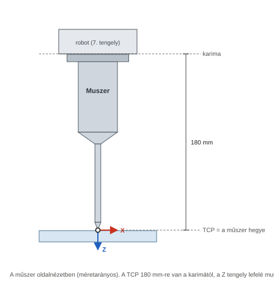
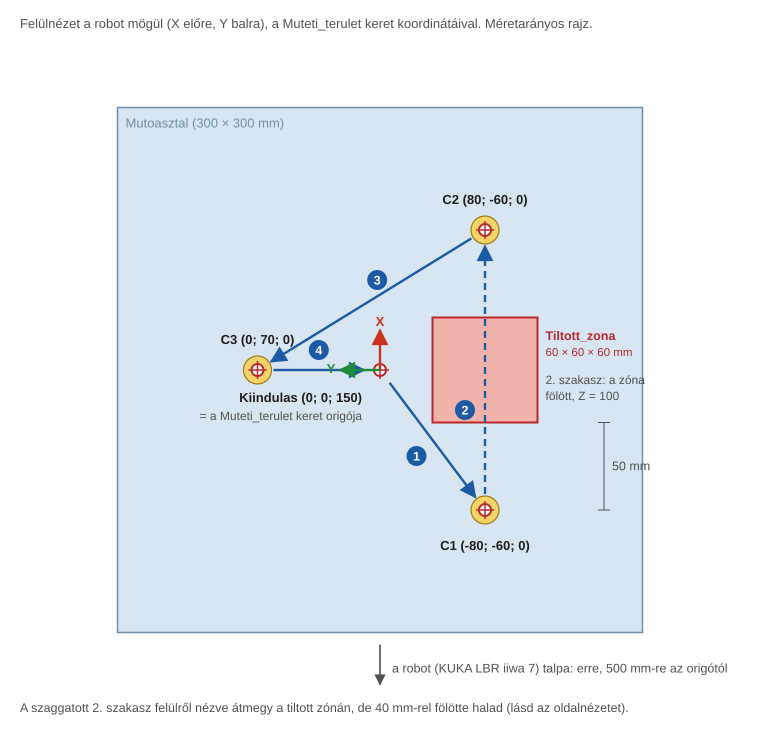
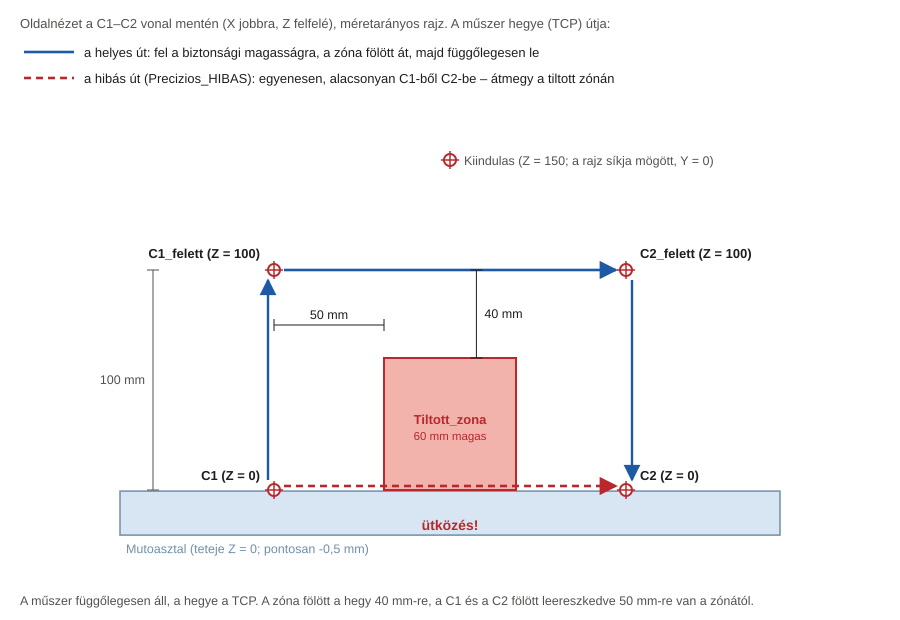

# 3. feladat – Precíziós mozgás orvosi robottal a RoboDK-ban: részletes útmutató kezdőknek

Ez az útmutató a nulláról vezet végig a 3. mérési feladaton. **Nem kell programozni, és szkripteket sem
használsz:** mindent a RoboDK menüiből csinálsz meg, egérrel és néhány szám beírásával.

Minden lépésnél leírjuk:
- hová kattints, és mit írj be;
- mit kell utána látnod;
- mit tegyél, ha nem azt látod.

> **A feladat röviden.** Egy orvosi robotkarhoz hasonló robot egy virtuális műtéti területen egy kiindulási pontból
> sorban elér három célpontot úgy, hogy közben a tiltott területet nem érinti. Először lassan, majd gyorsabban.
>
> **Mérendő adatok:**
> 1. az egyes pontok elérésének pontossága;
> 2. a teljes feladat végrehajtási ideje;
> 3. a végrehajtó szerv legnagyobb eltérése a kívánt pozíciótól;
> 4. a különböző sebességbeállítások hatása a pontosságra.
>
> **Értékelés:** a robotnak minden célpontot a lehető legkisebb eltéréssel kell elérnie, miközben az akadályt
> elkerüli. A mérés alapján állapítsd meg, hogyan befolyásolja a sebesség a precíziót.

> 💡 **Ha az 1. vagy a 2. feladatot már megcsináltad,** sok minden ismerős lesz: ugyanúgy töltöd be a robotot és a
> tárgyakat, veszed fel a célpontokat és építed fel a programot. Az új dolgok: egy 7 tengelyes robot, a tiltott zóna
> és az ütközésvizsgálat (11. és 16. lépés), a biztonsági magasság elve (3. fejezet), valamint a pontosság és az
> ismételhetőség mérése (M1–M4).

## Hogyan használd ezt az útmutatót?

| Jelölés | Jelentése |
|---|---|
| **File → Open** | Kattints a felső menüsorban a *File* menüre, majd a lenyíló listában az *Open* pontra. |
| `-80` | Pontosan ezt írd be. A mínuszjel a billentyűzet kötőjel (mínusz) gombja. |
| **Ctrl+S** | Tartsd lenyomva a Ctrl billentyűt, és közben nyomd meg az S-t. |
| ✅ **Ellenőrzés** | Ezt kell látnod, ha jól csináltad. Csak akkor menj tovább, ha stimmel. |
| ⚠️ **Ha nem így van** | A leggyakoribb hibák és a javításuk. |
| 💡 **Tipp** | Magyarázat vagy könnyítés. Nem kötelező. |
| 📸 **Képernyőkép** | Itt készíts képet a jegyzőkönyvbe. Mellette áll, hogy a Word-sablon melyik pontjába kerül. |

**Négy fontos szabály:**
1. A lépéseket **sorban** csináld, és ne hagyj ki egyet sem: a későbbi lépések a korábbiakra épülnek.
2. **Ments gyakran:** **Ctrl+S**. Ha elrontasz valamit, a **Ctrl+Z** visszavonja az utolsó műveletet.
3. A RoboDK **tizedespontot** használ (pl. `57.5`). A jegyzőkönyvbe tizedesvesszővel írd: 57,5.
4. Az útmutató az **angol** menüneveket használja. Verziótól függően egy-egy felirat kicsit eltérhet. Ilyenkor
   a hasonló nevű pontot keresd, vagy nézd meg a 12. fejezetet (Hibaelhárítás).

## Az egész munka egy pillantásra

| Rész | Mit csinálsz | Eredmény | Idő |
|---|---|---|---|
| **A. Előkészület** (2. fejezet) | fájlok letöltése | letöltött modellek, Word-sablon | 15 perc |
| **B. A cella** (4. fejezet) | robot, műszer, keret, műtőasztal, célpontjelek, tiltott zóna | a `Feladat3.rdk` állomás | 30–40 perc |
| **C. Célpontok és ütközés** (5. fejezet) | 7 célpont felvétele, az ütközésvizsgálat beállítása | `Kiindulas`, `C1`…`C3` és a fölöttük lévő pontok | 30 perc |
| **D. Programok** (6–7. fejezet) | 2 precíziós program, 4 mérőprogram, 1 hibás program | 7 program | 40–60 perc |
| **E. Mérések** (8–9. fejezet) | helyzetek, idők, ismételhetőség, távolság a zónától, ütközés | kitöltött T3.1–T3.7 táblázatok | 60–90 perc |
| **F. Jegyzőkönyv** (10–11. fejezet) | képek, szöveg, értékelés | a kész Word- és PDF-jegyzőkönyv | 1–2 óra |

---

## Tartalom

- [1. Fogalmak, amelyekre szükséged lesz](#1-fogalmak-amelyekre-szükséged-lesz)
- [2. Előkészületek](#2-előkészületek)
- [3. A cella terve: mit fogsz megépíteni?](#3-a-cella-terve-mit-fogsz-megépíteni)
- [4. A cella felépítése](#4-a-cella-felépítése) – 1–6. lépés
- [5. A célpontok és az ütközésvizsgálat](#5-a-célpontok-és-az-ütközésvizsgálat) – 7–11. lépés
- [6. Az első program: Precizios_lassu](#6-az-első-program-precizios_lassu) – 12–13. lépés
- [7. A többi program](#7-a-többi-program) – 14–16. lépés
- [8. Mérések lépésről lépésre](#8-mérések-lépésről-lépésre) – M1–M5
- [9. Számítások lépésről lépésre](#9-számítások-lépésről-lépésre)
- [10. Az eredmények értelmezése és az értékelés](#10-az-eredmények-értelmezése-és-az-értékelés)
- [11. A jegyzőkönyv befejezése Wordben](#11-a-jegyzőkönyv-befejezése-wordben)
- [12. Hibaelhárítás](#12-hibaelhárítás)
- [A függelék: Gyorsbillentyűk](#a-függelék-gyorsbillentyűk)
- [B függelék: Dobozok készítése a RoboDK-ban, STL-fájlok nélkül](#b-függelék-dobozok-készítése-a-robodk-ban-stl-fájlok-nélkül)
- [C függelék: Hasznos dokumentáció](#c-függelék-hasznos-dokumentáció)

---

## 1. Fogalmak, amelyekre szükséged lesz

| Fogalom | Mit jelent | Hol látod a RoboDK-ban |
|---|---|---|
| **Orvosi robot** | Műtéteknél vagy diagnosztikánál használt robotkar, amely nagyon pontosan és lassan mozog, és nem érinthet bizonyos területeket. Nálunk: **KUKA LBR iiwa 7 R800**. Erre a robotra épül a KUKA orvosi robotja, az **LBR Med**. | a 3D nézetben |
| **7 tengelyes (redundáns) robot** | A J1…J7 tengellyel egy tengellyel több van, mint amennyi a helyzethez és az irányhoz kell. Ezért ugyanazt a pontot többféle „könyöktartással” is elérheti (mint az emberi kar). Ez segít kikerülni az akadályokat. | a robotpanelen 7 csuklószög |
| **Referencia keret, szerszám, TCP, célpont** | Ugyanaz, mint az 1. és a 2. feladatban. Nálunk a keret a `Muteti_terulet` (a műtőasztal közepe), a szerszám egy vékony műszer, a TCP a műszer hegye, 180 mm-re a robot karimájától. | a fában és a 3D nézetben |
| **Tiltott zóna** | Olyan terület, amelybe a robot semelyik része nem léphet be (például egy érzékeny szerv). Nálunk egy 60 × 60 × 60 mm-es piros kocka. | `Tiltott_zona` a fában |
| **Biztonsági magasság** | Az a magasság, amelyen a robot a célpontok között közlekedik. Elég magas ahhoz, hogy a műszer a tiltott zóna fölött haladjon el. Nálunk Z = 100 mm, a zóna 60 mm magas, tehát 40 mm a biztonsági távolság. | a `…_felett` célpontok |
| **MoveL** | A TCP egyenes vonalon halad. Precíziós feladatnál mindenhol ezt használjuk, mert így a pálya kiszámítható, és pontosan tudjuk, hol halad el a műszer. | utasítás a programban |
| **Pontosság** | Mennyire közel ér a robot a **kívánt** ponthoz. Az eltérést mm-ben mérjük: e = √(ΔX² + ΔY² + ΔZ²). | – |
| **Ismételhetőség** | Ha a robot ugyanazt a mozgást többször megismétli, mennyire ugyanoda ér. Az ismételt mérések szórásával jellemezzük. | – |
| **Ütközésvizsgálat** | A RoboDK kiszámolja, hogy a mozgás során összeér-e a robot (vagy a szerszám) bármelyik tárggyal. | **Tools → Check Collisions**, **Shift+F5** |


*1. ábra – A műszer oldalnézetben. A TCP a műszer hegye, 180 mm-re a robot karimájától.*

---

## 2. Előkészületek

### 2.1 A RoboDK

Ha az 1. vagy a 2. feladathoz már telepítetted a RoboDK-t, nincs teendőd. Ha nem, kövesd az 1. feladat
útmutatójának [2.1 pontját](../feladat1/UTMUTATO.md#21-a-robodk-telepítése-és-a-licenc). A RoboDK ablakáról és az
alapműveletekről az 1. feladat útmutatójának [2.3 pontja](../feladat1/UTMUTATO.md#23-ismerkedés-a-robodk-ablakával)
szól, a képernyőkép készítéséről a [2.4 pontja](../feladat1/UTMUTATO.md#24-képernyőkép-készítése).

### 2.2 A szükséges fájlok letöltése

1. Töltsd le a repót: a GitHubon **Code → Download ZIP**, majd csomagold ki.
2. A `feladat3` mappából ezekre lesz szükséged:

   | Fájl | Mire kell |
   |---|---|
   | `modellek/Muszer.stl` | a műszer 3D-modellje (a hegye 180 mm-re van a karimától) |
   | `modellek/Mutoasztal.stl` | a műtőasztal (300 × 300 × 20 mm) |
   | `modellek/Celpontjelek.stl` | három sárga korong a C1, a C2 és a C3 helyén |
   | `modellek/Tiltott_zona.stl` | a tiltott zóna (60 × 60 × 60 mm-es kocka) |
   | `jegyzokonyv_sablon.docx` | a jegyzőkönyv Word-sablonja |
   | `UTMUTATO.pdf` | ez az útmutató |

3. Hozz létre egy munkamappát, például `C:\RoboDK_feladat3\`. Másold bele a négy `.stl` fájlt és a sablont.
4. Nyisd meg a sablont Wordben, és mentsd el a saját neveddel, például `Feladat3_jegyzokonyv_Nev.docx`.

> ⚠️ **Fontos:** A RoboDK a tiltott zónát a **neve** alapján nem ismeri fel: a zóna egy közönséges tárgy, és az
> ütközésvizsgálat figyeli. Ezért a 11. lépésben be kell kapcsolnod az ütközésvizsgálatot.

---

## 3. A cella terve: mit fogsz megépíteni?

A robot (KUKA **LBR iiwa 7 R800**) előtt egy műtőasztal áll, a közepe 500 mm-re van a robot talpától. Az asztalon
három célpont van (C1, C2, C3), és a C1 és a C2 között egy tiltott zóna. A robot a kiindulási pontból (`Kiindulas`)
indul, és:
1. a C1 fölé megy a biztonsági magasságra (Z = 100), majd függőlegesen leereszkedik a C1-re;
2. függőlegesen visszaemelkedik, a biztonsági magasságon **a zóna fölött** átmegy a C2 fölé, és leereszkedik a C2-re;
3. visszaemelkedik, a C3 fölé megy, leereszkedik a C3-ra;
4. visszaemelkedik, és visszatér a kiindulási pontba.


*2. ábra – A műtéti terület felülnézetben, méretarányosan. A kék nyilak a pálya vetületét és sorrendjét mutatják.*


*3. ábra – Oldalnézet a C1–C2 vonal mentén. A kék a helyes út, a piros szaggatott a hibás, egyenes út, amely átmegy
a tiltott zónán.*

**Az akadálykerülés elve:**
- A célpontokat **függőlegesen, felülről** közelíti meg a robot. Így a leereszkedés közben a műszer 50 mm-re marad a
  zónától (a C1 és a C2 50 mm-re van a zóna szélétől).
- A célpontok között a **biztonsági magasságon** (Z = 100 mm) halad. A zóna 60 mm magas, így a műszer hegye 40 mm-rel
  a zóna fölött halad el.
- Minden mozgás **MoveL**, így a pálya pontosan az, amit a 3. ábra mutat.

**Az elemek** (minden helyet a `Muteti_terulet` keretben adunk meg):

| Elem | Mi ez | Fájl | Hely a `Muteti_terulet` keretben (X; Y; Z) |
|---|---|---|---|
| `Muszer` | szerszám a robot karimáján, TCP: **Z = 180 mm** (a műszer hegye) | `Muszer.stl` | – (a robotra kerül) |
| `Muteti_terulet` | referencia keret a műtőasztal közepén, a robot talpától **X = 500 mm**-re | – | a robothoz képest (500; 0; 0) |
| `Mutoasztal` | 300 × 300 × 20 mm-es lap, a teteje 0,5 mm-rel a keret síkja alatt | `Mutoasztal.stl` | (0; 0; 0) |
| `Celpontjelek` | három 16 mm átmérőjű sárga korong a célpontok helyén | `Celpontjelek.stl` | (0; 0; 0) |
| `Tiltott_zona` | 60 × 60 × 60 mm-es kocka, piros | `Tiltott_zona.stl` | (0; -60; 0) |

**A célpontok** (a TCP helye a `Muteti_terulet` keretben; a műszer mindig függőlegesen lefelé néz):

| Célpont | X [mm] | Y [mm] | Z [mm] | Szerep |
|---|---|---|---|---|
| `Kiindulas` | 0 | 0 | 150 | kiindulási és végpont |
| `C1_felett` | -80 | -60 | 100 | biztonsági pont a C1 fölött |
| `C1` | -80 | -60 | 0 | 1. célpont |
| `C2_felett` | 80 | -60 | 100 | biztonsági pont a C2 fölött |
| `C2` | 80 | -60 | 0 | 2. célpont |
| `C3_felett` | 0 | 70 | 100 | biztonsági pont a C3 fölött |
| `C3` | 0 | 70 | 0 | 3. célpont |

**A két sebességszint:**

| Szint | Lineáris sebesség | Lineáris gyorsulás | Csuklósebesség | Csuklógyorsulás |
|---|---|---|---|---|
| lassú | 20 mm/s | 100 mm/s² | 10 °/s | 40 °/s² |
| gyors | 200 mm/s | 1000 mm/s² | 60 °/s | 200 °/s² |

**A programok:**
- `Precizios_lassu`, `Precizios_gyors`: a feladat megoldása, a teljes mozgás.
- `Meres_C1`, `Meres_C2`, `Meres_C3`, `Meres_vissza`: négy mérőprogram. Mindegyik a teljes mozgás egy darabja, és
  egy célpontban (vagy a kiindulási pontban) ér véget. A végükön leolvasod a műszer helyzetét, és külön látod az
  egyes részek idejét.
- `Precizios_HIBAS`: egy szándékosan hibás program, amely alacsonyan, egyenesen megy át a C1-ből a C2-be. Ezzel
  bemutatod, hogy az ütközésvizsgálat észreveszi, ha a robot belép a tiltott zónába.

---

## 4. A cella felépítése

### 1. lépés – Új állomás létrehozása és mentése

1. Indítsd el a RoboDK-t. **File → New Station** (**Ctrl+N**).
2. **File → Save Station as…**: lépj be a munkamappádba, fájlnév: `Feladat3`, **Mentés**.

> ✅ **Ellenőrzés:** A fa legfelső eleme és az ablak címsora is *Feladat3*.

### 2. lépés – A KUKA LBR iiwa 7 robot betöltése

1. **File → Open Robot Library** (**Ctrl+Shift+O**; régebbi verzióban **File → Open online library**).
2. A keresőmezőbe írd be: `iiwa`. Szűrhetsz gyártóra is: *Brand → KUKA*.
3. Válaszd a **KUKA LBR iiwa 7 R800** robotot (7 kg teherbírás, 800 mm hatótávolság), és kattints az **Open**
   gombra. A könyvtár ablakát bezárhatod.

> ✅ **Ellenőrzés:** A fában megjelent a `KUKA LBR iiwa 7 R800 Base` (a robot talpa) és alatta a
> `KUKA LBR iiwa 7 R800` (a robot). A robot fehér-narancs, és egyenesen felfelé áll, mint egy gyertya.

> ⚠️ **Ha nem így van:** ha másik változatot (például *iiwa 14 R820*-at vagy *LBR Med*-et) töltöttél be, töröld
> (**Delete**), és töltsd be az *iiwa 7 R800*-at. Ha az iiwa nem érhető el, a feladat egy **UR5e**-vel is elvégezhető
> (az 1. feladat robotja): a célpontok és az idők ugyanazok, csak a 8. lépés kiinduló helyzete más (lásd ott).

> 💡 **Tipp:** Ebben az útmutatóban egyszerűen „a robot” és „a robot talpa” néven hivatkozunk rájuk.

> 📸 **Képernyőkép → a sablon 6.1 pontjába:** a robot a 3D nézetben és a fa.

### 3. lépés – A műszer felszerelése

**A) Ajánlott: a kész műszermodellel**

1. **File → Open**, és nyisd meg a `Muszer.stl` fájlt.
2. A fában húzd a `Muszer`-t a **robotra** (`KUKA LBR iiwa 7 R800`, nem a `Base`-re). Ha a RoboDK megkérdezi, a
   robot szerszáma (*tool*) legyen.

   > ✅ **Ellenőrzés:** A műszer átugrik a robot karimájára (a robot tetejére), és a fában a robot alá kerül,
   > szerszám-ikonnal.

3. Kattints duplán a `Muszer`-re, és a TCP mezőibe (*Tool Center Point (TCP) with respect to the robot flange*) írd
   be (minden szám után **Enter**):

   | X | Y | Z | 1. forgatás | 2. forgatás | 3. forgatás |
   |---|---|---|---|---|---|
   | `0` | `0` | **`180`** | `0` | `0` | `0` |

4. Zárd be az ablakot.

> ✅ **Ellenőrzés:** A TCP kis koordináta-rendszere pontosan a műszer hegyes végén látszik (1. ábra). A kék Z nyíl a
> karimától elfelé, a műszer irányába mutat.

**B) Egyszerűbb, műszermodell nélkül:** jelöld ki a robotot → **Program → Add Empty Tool** → dupla klikk az új
szerszámra → Z = `180`, a többi `0` → **F2** → `Muszer`.

> 📸 **Képernyőkép → a sablon 6.2 pontjába:** a műszer a roboton és a TCP-ablak (Z = 180).

### 4. lépés – A Muteti_terulet referencia keret

1. Kattints a fában a robot talpára (`KUKA LBR iiwa 7 R800 Base`).
2. **Program → Add Reference Frame**. Ha az új keret nem a `Base` alá került, húzd rá.
3. **F2** → `Muteti_terulet` → **Enter**.
4. Kattints duplán a `Muteti_terulet`-re, és írd be (mindegyik után **Enter**):

   | X | Y | Z | 1. forgatás | 2. forgatás | 3. forgatás |
   |---|---|---|---|---|---|
   | `500` | `0` | `0` | `0` | `0` | `0` |

> ✅ **Ellenőrzés:** A keret 500 mm-re van a robot előtt, a robot talpának magasságában; a piros X nyíl a robottól
> elfelé mutat.

### 5. lépés – A műtőasztal, a célpontjelek és a tiltott zóna

1. **File → Open** → `Mutoasztal.stl`. Húzd a fában a `Muteti_terulet` alá. Dupla klikk → hely: X = `0`, Y = `0`,
   Z = `0`, forgatások `0` → zárd be.
2. Ugyanígy a `Celpontjelek.stl`: a `Muteti_terulet` alá, hely (0; 0; 0).
3. Ugyanígy a `Tiltott_zona.stl`: a `Muteti_terulet` alá, de a helye:

   | X | Y | Z | forgatások |
   |---|---|---|---|
   | `0` | **`-60`** | `0` | `0` |

4. **Színek:** dupla klikk a tárgyra → **More options…** → szín (*Color*), vagy **Tools → Change Color Tool**.
   - `Mutoasztal`: világoskék;
   - `Celpontjelek`: sárga;
   - `Tiltott_zona`: **piros**. Ha a színválasztóban van átlátszóság (*Alpha*), állítsd kb. a felére (128): így a
     zóna áttetsző lesz, és mögötte is látod a műszert.
5. Ments: **Ctrl+S**.

> ✅ **Ellenőrzés:** A cella úgy néz ki, mint a 2. ábrán: a műtőasztalon három sárga korong, és a robot felől nézve
> jobbra, a két jobb oldali korong között a piros kocka.

> ⚠️ **Ha nem így van:**
> - **A piros kocka középen van:** az Y nem `-60`. Kattints duplán a `Tiltott_zona`-ra, és javítsd.
> - **A kocka bal oldalon van:** a mínuszjel hiányzik (Y = 60 lett).
> - **Egy tárgy rossz helyen van:** ellenőrizd, hogy a fában a `Muteti_terulet` alatt van-e.

> 💡 **Tipp: miért nincs az asztal pontosan a Z = 0 síkban?** Az asztallap teteje 0,5 mm-rel, a korongok teteje
> 0,2 mm-rel a keret síkja alatt van. Így a műszer hegye (Z = 0) a célpontokban nem ér hozzájuk, és a RoboDK nem
> jelez hamis ütközést. A jegyzőkönyvben említsd meg.

> 📸 **Képernyőkép → a sablon 6.3 pontjába:** a műtéti terület a tiltott zónával, a fában és a 3D nézetben.

### 6. lépés – Ellenőrzés: így néz ki a fa

```
Feladat3
└── KUKA LBR iiwa 7 R800 Base
    ├── KUKA LBR iiwa 7 R800
    │   └── Muszer
    └── Muteti_terulet
        ├── Mutoasztal
        ├── Celpontjelek
        └── Tiltott_zona
```

Ments: **Ctrl+S**.

---

## 5. A célpontok és az ütközésvizsgálat

### 7. lépés – A robotpanel megnyitása és beállítása

1. Kattints duplán a fában a robotra. Megnyílik a **robotpanel**.
2. Válaszd ki: szerszám (*Tool*) = `Muszer`, referencia keret (*Reference*) = `Muteti_terulet`.

> ✅ **Ellenőrzés:** A `Muszer` és a `Muteti_terulet` ikonján zöld pötty jelzi, hogy ezek az aktívak.

3. A panelen most **hét** csuklószög van (J1…J7). A *Tool Frame (TF) w.r.t. Reference Frame (RF)* mezőcsoportban
   látod és írod be a műszer hegyének helyét a `Muteti_terulet`-hez képest. A másik két mezőcsoporthoz (a szerszám
   és a keret helye) **ne nyúlj**.

### 8. lépés – A robot kiinduló helyzetbe állítása

1. A robotpanel **Joint axis jog** részében írd be (mindegyik után **Enter**):

   | J1 | J2 | J3 | J4 | J5 | J6 | J7 |
   |---|---|---|---|---|---|---|
   | `0` | `30` | `0` | `-60` | `0` | `90` | `0` |

> ✅ **Ellenőrzés:**
> - A robot **előre**, a műtőasztal felé hajol, a műszer függőlegesen lefelé néz, és a hegye az asztal fölött van.
> - A *Tool Frame w.r.t. Reference Frame* mezőkben kb.: X ≈ `100`, Y ≈ `0`, Z ≈ `380`.
> - A forgatási mezők között 180 (vagy -180) is szerepel. A forgatásokhoz ne nyúlj.

> ⚠️ **Ha nem így van:**
> - **A robot hátrafelé hajol** (a műszer a robot mögött van): a te verziódban ellentétes a tengelyek forgásiránya.
>   Írd be ezt: J2 = `-30`, J4 = `60`, J6 = `-90` (a többi `0`).
> - **A műszer nem lefelé néz:** írd be a forgatási mezőkbe: a három közül az X tengely körüli (*Rx*) legyen `180`,
>   a másik kettő `0`.
> - **UR5e-t használsz:** a kiinduló helyzet J = (0; -90; -90; -90; 90; -90), mint az 1. feladatban. A TCP
>   ellenőrző értékei ilyenkor mások, de a célpontok, a programok és az idők ugyanazok.

### 9. lépés – A hét célpont felvétele

A forgatásokhoz **nem kell nyúlnod**: a műszer a 8. lépés óta lefelé néz, és így is marad, ha csak az X, Y és Z
értéket írod át.

**Minden célpontnál:**
1. A robotpanel *Tool Frame w.r.t. Reference Frame* részében írd be az X, Y és Z értéket (mindegyik után **Enter**).
2. **Program → Teach Target** (**Ctrl+T**).
3. **F2**, írd be a nevet, **Enter**.

| Sorrend | Név | X | Y | Z |
|---|---|---|---|---|
| 1. | `Kiindulas` | `0` | `0` | `150` |
| 2. | `C1_felett` | `-80` | `-60` | `100` |
| 3. | `C1` | `-80` | `-60` | `0` |
| 4. | `C2_felett` | `80` | `-60` | `100` |
| 5. | `C2` | `80` | `-60` | `0` |
| 6. | `C3_felett` | `0` | `70` | `100` |
| 7. | `C3` | `0` | `70` | `0` |

> ✅ **Ellenőrzés:** A `Muteti_terulet` alatt hét célpont van. A `C1`, a `C2` és a `C3` pontosan a sárga korongok
> közepén látszik, a `…_felett` pontok 100 mm-rel fölöttük, a `Kiindulas` az asztal közepe fölött. Ments: **Ctrl+S**.

> ⚠️ **Ha nem így van:**
> - **Rossz helyre került egy célpont:** állítsd a robotot a jó helyre, majd jobb klikk a célponton → **Teach Current
>   Position**.
> - **A robot nem mozdul, vagy hibát ír:** elírtál egy számot. Írd be újra.

> 💡 **Tipp:** A 7 tengelyes robot ugyanazt a pontot többféle könyöktartással is elérheti, ezért a csuklószögek
> nálad kicsit eltérhetnek egy másik géptől. Ebben a feladatban nem a csuklószögeket, hanem a **műszer hegyének
> helyét** méred, és az mindig ugyanaz.

### 10. lépés – A célpontok ellenőrzése (T3.1)

1. Kattints duplán a `Kiindulas` célpontra: a robot odaugrik.
2. Olvasd le a robotpanelről a TCP X, Y és Z értékét, és írd be a Word-sablon **T3.1** táblázatába.
3. Ugyanezt csináld meg a többi hat célponttal is.

> ✅ **Ellenőrzés:** Minden célpontban pontosan a táblázat szerinti értéket látod (például `-80.000`, `-60.000`,
> `0.000`).

> 📸 **Képernyőkép → a sablon 6.4 pontjába:** a célpontok a fában és a 3D nézetben, mellettük a robotpanel.

### 11. lépés – Az ütközésvizsgálat bekapcsolása

1. Kapcsold be: **Tools → Check Collisions** (az eszköztáron is van gombja; bekapcsolva kiemelten látszik).
2. Nyisd meg: **Tools → Collision Map** (**Shift+X**). A táblázat azt mutatja, mely elempárok ütközését vizsgálja a
   RoboDK (zöld pipa: vizsgálja; piros X: nem vizsgálja).
3. Keresd meg a `Tiltott_zona` sorát. Ellenőrizd, hogy a `Muszer` és a robot tagjai (*KUKA LBR iiwa 7 R800 (J…)*)
   oszlopában **zöld pipa** van.
4. A **Clearance (mm)** mező maradjon `0.00`. Zárd be az ablakot.

> ✅ **Ellenőrzés:** A `Tiltott_zona` sorában a `Muszer`-nél és a robot tagjainál zöld pipa van. Piros X alapból csak a
> robot szomszédos tagjai között van.

> ⚠️ **Ha a `Tiltott_zona` és a `Muszer` cellájában piros X van:** kattints duplán a cellára, hogy zöld pipa legyen.

> 💡 **Tipp:** Bekapcsolt ütközésvizsgálat mellett a szimuláció lassabb lehet, és ha ütközés van, a RoboDK pirossal
> kiemeli az ütköző elemeket. A mérések idejére kikapcsolhatod; a kiírt időt nem befolyásolja. A program ellenőrzésénél
> (**Shift+F5**) viszont mindig legyen bekapcsolva.

> 📸 **Képernyőkép → a sablon 6.5 pontjába:** a *Collision Map* ablak.

---

## 6. Az első program: Precizios_lassu

**Emlékeztető:** mozgásutasításnál **először a célpontra kattints**, és csak utána válaszd a menüpontot. Az új
utasítás a kijelölt program végére kerül. Ha rossz helyre került, a fában húzd a helyére.

### 12. lépés – A program felépítése

1. **Program → Add Program**, majd **F2** → `Precizios_lassu` → **Enter**.
2. **1. utasítás:** **Program → Set Speed Instruction**. Pipáld be mind a négy sort, és írd be a **lassú** értékeket:

   | Mező | Érték |
   |---|---|
   | *Linear speed* | `20` mm/s |
   | *Joint speed* | `10` °/s |
   | *Linear acceleration* | `100` mm/s² |
   | *Joint acceleration* | `40` °/s² |

   **OK**.
3. **2. utasítás:** **Program → Set Rounding Instruction** → `-1` → **OK** (pontos megállás minden célpontban).
4. **3–13. utasítás, a mozgások:**

   | # | Először kattints erre | Utána ezt válaszd | Mit csinál |
   |---|---|---|---|
   | 3 | `Kiindulas` | **Program → Move Joint Instruction** | kiindulási helyzet |
   | 4 | `C1_felett` | **Program → Move Linear Instruction** | a C1 fölé megy (biztonsági magasság) |
   | 5 | `C1` | **Move Linear Instruction** | függőlegesen leereszkedik a C1-re |
   | 6 | `C1_felett` | **Move Linear Instruction** | függőlegesen visszaemelkedik |
   | 7 | `C2_felett` | **Move Linear Instruction** | a zóna fölött átmegy a C2 fölé |
   | 8 | `C2` | **Move Linear Instruction** | leereszkedik a C2-re |
   | 9 | `C2_felett` | **Move Linear Instruction** | visszaemelkedik |
   | 10 | `C3_felett` | **Move Linear Instruction** | a C3 fölé megy |
   | 11 | `C3` | **Move Linear Instruction** | leereszkedik a C3-ra |
   | 12 | `C3_felett` | **Move Linear Instruction** | visszaemelkedik |
   | 13 | `Kiindulas` | **Move Linear Instruction** | visszatér a kiindulási pontba |

> ✅ **Ellenőrzés:** A RoboDK az első mozgás elé beszúrta a *Set Reference Frame (Muteti_terulet)* és a *Set Tool
> Frame (Muszer)* sort; ezek maradjanak. A program:
>
> ```
> Precizios_lassu
>   1  Set Speed 20 mm/s, 10 °/s, 100 mm/s², 40 °/s²
>   2  Set Rounding -1
>      Set Reference Frame: Muteti_terulet     a RoboDK szúrta be
>      Set Tool Frame: Muszer                  a RoboDK szúrta be
>   3  MoveJ Kiindulas
>   4  MoveL C1_felett
>   5  MoveL C1
>   6  MoveL C1_felett
>   7  MoveL C2_felett
>   8  MoveL C2
>   9  MoveL C2_felett
>  10  MoveL C3_felett
>  11  MoveL C3
>  12  MoveL C3_felett
>  13  MoveL Kiindulas
> ```
>
> Csak az első mozgás MoveJ (a kiindulási helyzetbe állás); minden más MoveL.

### 13. lépés – Az első futtatás és az ütközésvizsgálat

1. Kattints duplán a `Kiindulas` célpontra, majd duplán a `Precizios_lassu` programra.

   > ✅ **Ellenőrzés:** A robot lassan a C1 fölé megy, függőlegesen leereszkedik a sárga korongra, felemelkedik, a
   > piros kocka **fölött** átmegy a C2-höz, leereszkedik, majd ugyanígy a C3-hoz, és visszatér. A szimulációs sávon:
   > *Precizios_lassu time: 57.5s*. Ez a 9. fejezet számított értéke (57,52 s).

2. Jobb klikk a programra → **Check Path and Collisions** (**Shift+F5**).

   > ✅ **Ellenőrzés:** Nem jelez ütközést, és egyik elem sem lesz piros.

> ⚠️ **Ha nem így van:**
>
> | Mit látsz | Mi a teendő |
> |---|---|
> | Ütközést jelez a `Muszer` és a `Tiltott_zona` között | Valamelyik `…_felett` célpont Z-je nem 100, vagy kimaradt egy *MoveL C…_felett* sor. |
> | Ütközést jelez a `Muszer` és a `Mutoasztal` vagy a `Celpontjelek` között | Egy célpont Z-je negatív lett, vagy a tárgyak nem a (0; 0; 0) helyen vannak. |
> | A robot furcsa kerülőt tesz | Valamelyik sor nem a jó célponthoz kötődik. Kattints duplán egyenként a sorokra. |
> | Hibaüzenet egy MoveL-nél | Elírtál egy koordinátát, vagy nem a 8. lépés kiinduló helyzetéből vetted fel a célpontokat. |

> 📸 **Képernyőkép → a sablon 6.6 pontjába:** a program sorai, és a robot a zóna fölött áthaladva.

Ments: **Ctrl+S**.

---

## 7. A többi program

### 14. lépés – A gyors változat: Precizios_gyors

1. Másold le a `Precizios_lassu`-t (**Ctrl+C**, a `Feladat3`-on **Ctrl+V**), és nevezd át: `Precizios_gyors`.
2. Nyisd le, kattints duplán a *Set Speed* sorára, írd át a **gyors** értékekre, majd **OK**:

   | *Linear speed* | *Joint speed* | *Linear acceleration* | *Joint acceleration* |
   |---|---|---|---|
   | `200` | `60` | `1000` | `200` |

3. Kattints duplán a `Kiindulas`-ra, majd futtasd le.

> ✅ **Ellenőrzés:** Ugyanaz a mozgás, gyorsabban: *Precizios_gyors time: 7.6s*. Shift+F5: nincs ütközés.

### 15. lépés – A négy mérőprogram

Mindegyik a teljes mozgás egy darabja, és célpontban ér véget:

| Program | Honnan indul | Mozgások | Hol ér véget |
|---|---|---|---|
| `Meres_C1` | `Kiindulas` | MoveL `C1_felett`, MoveL `C1` | `C1` |
| `Meres_C2` | `C1` | MoveL `C1_felett`, MoveL `C2_felett`, MoveL `C2` | `C2` |
| `Meres_C3` | `C2` | MoveL `C2_felett`, MoveL `C3_felett`, MoveL `C3` | `C3` |
| `Meres_vissza` | `C3` | MoveL `C3_felett`, MoveL `Kiindulas` | `Kiindulas` |

**`Meres_C1`, részletesen:**
1. **Program → Add Program**, **F2** → `Meres_C1`.
2. **Program → Set Speed Instruction**: a **lassú** értékek (20, 10, 100, 40), mind a négy bepipálva → **OK**.
3. **Program → Set Rounding Instruction** → `-1` → **OK**.
4. Kattints a `C1_felett`-re → **Program → Move Linear Instruction**.
5. Kattints a `C1`-re → **Program → Move Linear Instruction**.

**A másik három** ugyanígy készül, a táblázat szerinti mozgásokkal. (Másolhatod is a `Meres_C1`-et, és kicserélheted
a mozgássorokat: sor kijelölése → **Delete** → célpont → **Move Linear Instruction**.)

> ✅ **Ellenőrzés:** Ha a `Kiindulas`-ból indulva sorban lefuttatod a `Meres_C1`, `Meres_C2`, `Meres_C3` és
> `Meres_vissza` programot, a robot pontosan ugyanazt a mozgást végzi, mint a `Precizios_lassu`, és a négy idő
> összege megegyezik a program idejével (57,5 s).

> 📸 **Képernyőkép → a sablon 6.7 pontjába:** a programok a fában és a `Precizios_gyors` *Set Speed* ablaka.

### 16. lépés – Az akadálykerülés bemutatása: Precizios_HIBAS

Ez a program szándékosan rossz: a C1-ből egyenesen, alacsonyan megy át a C2-be, keresztül a tiltott zónán.

1. **Program → Add Program**, **F2** → `Precizios_HIBAS`.
2. **Set Speed** (a lassú értékek), **Set Rounding** `-1`.
3. Mozgások: MoveJ `Kiindulas`, MoveL `C1_felett`, MoveL `C1`, MoveL **`C2`** (közvetlenül, a `C2_felett` nélkül).
4. Ellenőrizd, hogy a **Tools → Check Collisions** be van kapcsolva. Jobb klikk a programra → **Check Path and
   Collisions** (**Shift+F5**).

> ✅ **Ellenőrzés:** A RoboDK **ütközést jelez** a `Muszer` és a `Tiltott_zona` között, és pirossal kiemeli őket.
> Ez bizonyítja, hogy a tiltott zóna figyelése működik, és a helyes programban a biztonsági magasság miatt nincs
> ütközés.

> 📸 **Képernyőkép → a sablon 6.8 pontjába és a 13. ábrához:** a hibás program ütközésjelzése (a piros elemek és az
> üzenet).

5. A képernyőkép után a programot hagyd meg (a jegyzőkönyvben hivatkozol rá), de a méréseknél ne használd.

Ments: **Ctrl+S**.

---

## 8. Mérések lépésről lépésre

### 8.0 A mérés szabályai (mindig tartsd be őket)

1. **Indítás előtt állítsd a robotot a program első pontjára** (dupla klikk a célponton): a `Precizios_…`
   programoknál a `Kiindulas`-ra, a mérőprogramoknál a 15. lépés táblázata szerinti pontra.
2. **Az időt a szimulációs sávról olvasd le** (például *Meres_C1 time: 11.0s*). A RoboDK egy tizedesre kerekít, a
   leolvasás felbontása 0,1 s.
3. **A helyzetet a robotpanelről olvasd le**, a mozgás végén, **mielőtt** bármire kattintanál. A panel legyen végig
   nyitva (szerszám: `Muszer`, referencia: `Muteti_terulet`). A robotpanel több tizedesjegyet mutat: írd fel mind a
   hármat (például `-80.000`).
4. **Ne stopperrel mérj!** A kiírt idő a valódi robotra számolt idő.
5. **Ha egy érték gyanús, ismételd meg** a mérést.

### M1. A célpontok elérésének pontossága és a részidők → T3.2, T3.3

**Lassú sebességgel:**
1. Kattints duplán a `Kiindulas`-ra. Olvasd le a TCP X, Y és Z értékét: ez a **kezdőpozíció** (T3.2, *Kiindulas –
   kezdet* sor).
2. Kattints duplán a `Meres_C1`-re. A végén:
   - olvasd le az időt (T3.3);
   - olvasd le a TCP X, Y és Z értékét: ez a **C1 elérése** (T3.2).
3. **Ne kattints célpontra!** A robot a C1-ben áll. Kattints duplán a `Meres_C2`-re: idő és helyzet (C2).
4. Ugyanígy a `Meres_C3` (C3) és a `Meres_vissza`. Az utóbbi végén a robot újra a `Kiindulas`-ban áll: ez a
   **végpozíció** (T3.2, *Kiindulas – vég* sor).

**Gyors sebességgel:** kattints duplán mind a négy mérőprogram *Set Speed* sorára, írd át a gyors értékekre (200,
60, 1000, 200), és ismételd meg az 1–4. pontot.

**Az eltérés** minden sorban: e = √(ΔX² + ΔY² + ΔZ²), ahol ΔX = mért X − kívánt X, és ugyanígy ΔY és ΔZ.

> ✅ **Ellenőrzés:**
> - **Pontosság:** minden célpontban pontosan a kívánt értéket látod (például C1: `-80.000`, `-60.000`, `0.000`),
>   tehát e = 0 mm, lassan és gyorsan is. A kezdő- és a végpozíció is azonos.
> - **Részidők** (9.2):
>
> | Mérőprogram | Út | lassú | gyors |
> |---|---|---|---|
> | `Meres_C1` | 211,8 mm | 10,99 s → *11.0s* | 1,46 s → *1.5s* |
> | `Meres_C2` | 360,0 mm | 18,60 s → *18.6s* | 2,40 s → *2.4s* |
> | `Meres_C3` | 352,6 mm | 18,23 s → *18.2s* | 2,36 s → *2.4s* |
> | `Meres_vissza` | 186,0 mm | 9,70 s → *9.7s* | 1,33 s → *1.3s* |
> | **összesen** | **1110,5 mm** | **57,52 s** | **7,55 s** |

> 📸 **Képernyőkép → 11. ábra:** a robot a C1-ben a `Meres_C1` végén, mellette a robotpanel a TCP-koordinátákkal és
> a szimulációs sáv.

### M2. A teljes feladat végrehajtási ideje → T3.4

1. Kattints duplán a `Kiindulas`-ra, majd duplán a `Precizios_lassu`-ra. A végén olvasd le az időt.
2. Csináld meg még egyszer; ha ugyanannyi, írd be a T3.4-be.
3. Ugyanígy a `Precizios_gyors`-sal.
4. Számold ki az átlagsebességet: a pálya hossza (1110,5 mm, 9.2) osztva az idővel.

> ✅ **Ellenőrzés:**
>
> | Program | Számított idő | Kiírva | Átlagsebesség |
> |---|---|---|---|
> | `Precizios_lassu` | 57,52 s | *57.5s* | 19,3 mm/s |
> | `Precizios_gyors` | 7,55 s | *7.6s* | 147,0 mm/s |
>
> A két mérésnek (M1 négy részideje és M2) egyeznie kell: 11,0 + 18,6 + 18,2 + 9,7 = 57,5 s.

> 📸 **Képernyőkép → 12. ábra:** a szimulációs sáv a `Precizios_lassu` végén.

### M3. Ismételhetőség → T3.5

Háromszor egymás után eléred ugyanazt a célpontot, és megnézed, mindig ugyanoda ér-e a műszer.

1. A mérőprogramok *Set Speed* sorai most a gyors értékeken állnak (M1). Kezdd a gyorssal:
   - dupla klikk a `Kiindulas`-ra, dupla klikk a `Meres_C1`-re, a végén olvasd le az időt és a TCP X, Y, Z értékét
     (*1. ismétlés*);
   - ismételd meg még kétszer (*2.* és *3. ismétlés*): minden alkalommal előbb a `Kiindulas`-ra kattints.
2. Állítsd vissza a `Meres_C1` *Set Speed* sorát a lassú értékekre, és ismételd meg a három futást.
3. Számold ki a három ismétlésre koordinátánként a legnagyobb és a legkisebb érték különbségét (*terjedelem*).

> ✅ **Ellenőrzés:** Mindhárom ismétlésnél ugyanazt kapod: (-80,000; -60,000; 0,000), 11,0 s, illetve 1,5 s. A
> terjedelem 0 mm: a szimuláció tökéletesen ismételhető (10.1).

### M4. A legnagyobb eltérés és a távolság a tiltott zónától → T3.6

**a) A legnagyobb eltérés a célpontokban:** az M1 és az M3 összes eltérése közül a legnagyobb, sebességenként.

**b) Az eltérés a pálya mentén, a zóna fölött.** Itt a csúszkával megállítod a robotot a zóna fölött, és megnézed,
hol halad a műszer hegye.

1. Kattints duplán a `Kiindulas`-ra, és futtasd le a `Precizios_lassu`-t. A végén a szimulációs sáv ottmarad.
2. Fogd meg a csúszkát, és húzd vissza addig, amíg a robot a C1 fölötti pontból a C2 fölé halad, és a TCP **X értéke
   ≈ 0** (legyen -5 és +5 között). Ekkor a műszer hegye pontosan a zóna közepe fölött van.
3. Olvasd le a TCP Y és Z értékét.
   - A kívánt pálya: Y = -60, Z = 100. Az eltérés a pályától: √((Y + 60)² + (Z − 100)²).
   - **A távolság a zóna tetejétől:** d = Z − 60 (a zóna 60 mm magas).
4. Ismételd meg a `Precizios_gyors`-sal.

> ✅ **Ellenőrzés:** Mindkét sebességnél Y = -60,000 és Z = 100,000: a pályaeltérés 0 mm, a műszer hegye
> **40 mm**-rel a zóna fölött halad el. Leereszkedéskor a C1-nél és a C2-nél a műszer 50 mm-re van a zóna
> oldalától (|X| − 30 = 80 − 30).

### M5. Ütközésvizsgálat és akadálykerülés → T3.7

Ellenőrizd, hogy be van-e kapcsolva a **Tools → Check Collisions**, majd mindhárom programnál: jobb klikk →
**Check Path and Collisions** (**Shift+F5**). Írd fel az eredményt.

> ✅ **Ellenőrzés:**
>
> | Program | Eredmény |
> |---|---|
> | `Precizios_lassu` | nincs ütközés |
> | `Precizios_gyors` | nincs ütközés |
> | `Precizios_HIBAS` | ütközés: `Muszer` – `Tiltott_zona` |
>
> A sebesség az ütközést nem befolyásolja: az ütközésvizsgálat a pálya **alakját** vizsgálja, és a pálya lassan és
> gyorsan is ugyanaz.

> 📸 **Képernyőkép → 13. ábra:** a `Precizios_HIBAS` ütközésjelzése (ha a 16. lépésben már elkészítetted, azt használd).

---

## 9. Számítások lépésről lépésre

### 9.1 A mozgás ideje (trapéz sebességprofil)

Ugyanaz, mint az 1. és a 2. feladatban (lásd az 1. feladat útmutatójának
[10.1 pontját](../feladat1/UTMUTATO.md#101-hogyan-számolja-a-robodk-a-mozgás-idejét)):

```
s_gy = v² / a                     ennyi út kell a felgyorsuláshoz és a megálláshoz együtt
ha L ≥ s_gy:  t = L/v + v/a       (eléri a beállított v-t)
ha L < s_gy:  t = 2·√(L/a)        (csak v_max = √(a·L)-ig gyorsul)
```

- lassú: v = 20 mm/s, a = 100 mm/s² → s_gy = 20² / 100 = **4 mm**;
- gyors: v = 200 mm/s, a = 1000 mm/s² → s_gy = 200² / 1000 = **40 mm**.

A legrövidebb szakaszunk 86 mm, ezért a robot **minden szakaszon eléri a beállított sebességet**, és minden
szakaszra t = L/v + v/a. Ebben a feladatban csak MoveL van, ezért a számításhoz csak a célpontok távolsága kell, a
robot csuklóira nincs szükség.

### 9.2 A szakaszok hossza és ideje (T3.3, T3.4)

A két pont távolsága: d = √(ΔX² + ΔY² + ΔZ²). Például `Kiindulas` (0; 0; 150) → `C1_felett` (-80; -60; 100):
d = √(80² + 60² + 50²) = √12 500 = **111,8 mm**.

| Szakasz | Hossz | lassú: L/20 + 0,2 | gyors: L/200 + 0,2 |
|---|---|---|---|
| `Kiindulas` → `C1_felett` | 111,8 mm | 5,790 s | 0,759 s |
| `C1_felett` → `C1` (le) | 100,0 mm | 5,200 s | 0,700 s |
| `C1` → `C1_felett` (fel) | 100,0 mm | 5,200 s | 0,700 s |
| `C1_felett` → `C2_felett` (a zóna fölött) | 160,0 mm | 8,200 s | 1,000 s |
| `C2_felett` → `C2` (le) | 100,0 mm | 5,200 s | 0,700 s |
| `C2` → `C2_felett` (fel) | 100,0 mm | 5,200 s | 0,700 s |
| `C2_felett` → `C3_felett`: √(80² + 130²) | 152,6 mm | 7,832 s | 0,963 s |
| `C3_felett` → `C3` (le) | 100,0 mm | 5,200 s | 0,700 s |
| `C3` → `C3_felett` (fel) | 100,0 mm | 5,200 s | 0,700 s |
| `C3_felett` → `Kiindulas`: √(70² + 50²) | 86,0 mm | 4,501 s | 0,630 s |
| **összesen (10 szakasz)** | **1110,5 mm** | **57,52 s** | **7,55 s** |

A mérőprogramok ideje a megfelelő sorok összege (például `Meres_C1` = 5,790 + 5,200 = 10,99 s).

**Miért nem tízszer gyorsabb a gyors változat?** A sebesség tízszeres, az idő viszont csak 57,52 / 7,55 = **7,6**-szer
rövidebb. Minden szakasz idejéhez hozzáadódik a v/a tag (a gyorsítás és a lassítás miatti többletidő), ami gyors
beállításnál is 0,2 s. A 10 szakaszon ez 2 s, a gyors programidő negyede.

### 9.3 A távolság a tiltott zónától (T3.6)

- A zóna fölött: a TCP magassága 100 mm, a zóna teteje 60 mm → **40 mm**.
- Leereszkedéskor: a C1 és a C2 X = ±80, a zóna széle X = ±30 → **50 mm** vízszintesen.
- A C3 a zónától: a C3 (0; 70), a zóna legközelebbi pontja (0; -30) → **100 mm**.

A legkisebb távolság tehát 40 mm, a zóna fölötti áthaladásnál. A műszer teste a hegy fölött van, ezért annak a
távolsága még nagyobb.

---

## 10. Az eredmények értelmezése és az értékelés

### 10.1 Mit mér a szimuláció, és mit nem?

- A RoboDK **ideális kinematikai modellel** számol: a megálló célpontokat sebességtől függetlenül pontosan eléri, és a
  MoveL-pálya pontosan egyenes. A mért eltérés ezért 0 mm (a kijelzés felbontásán belül).
- A szimuláció **determinisztikus**, az ismételhetőség ideális.
- **Valódi robotnál** a nagyobb sebesség és gyorsulás nagyobb pályahibát okoz: a hajtások késnek, a robot túllendül, a
  karok rugalmasan deformálódnak, és a műszer a megálláskor rezeghet. Ezért az orvosi robotok a célpontok közelében
  nagyon lassan mozognak. A KUKA LBR iiwa ismételhetősége az adatlap szerint ±0,1 mm (ISO 9283); ezt ellenőrizd az
  adatlapon.
- A **biztonságot** (az akadály elkerülését) a pálya alakja adja: a biztonsági magasság és a függőleges
  megközelítés. Ez lassan és gyorsan is ugyanaz.

### 10.2 Mit fogsz látni, és miért?

| Megfigyelés | Magyarázat |
|---|---|
| Minden célpontban 0 mm az eltérés, lassan és gyorsan is. | Ideális szimuláció (10.1). |
| A három ismétlés eredménye azonos. | A szimuláció determinisztikus. |
| A gyors program 7,6-szer rövidebb, nem tízszer. | A gyorsítás és a lassítás többletideje (v/a) nem csökken arányosan (9.2). |
| A műszer 40 mm-rel a zóna fölött halad el, nincs ütközés. | A biztonsági magasság (100 mm) nagyobb a zóna magasságánál (60 mm). |
| A hibás programnál ütközést jelez. | Az alacsony, egyenes út átmegy a zónán (3. ábra). |

### 10.3 Mit írj az értékelésbe?

Az értékelés legyen **a te mérésed** értelmezése. Hivatkozz a táblázatokra (például „a T3.2 táblázat szerint…”).

1. **A célpontok elérésének pontossága.** Mekkora volt az eltérés a három célpontban, lassan és gyorsan?
   - *„A C1, C2 és C3 célpontban a mért eltérés lassú és gyors beállításnál is … mm volt (T3.2), mert …”*
2. **A végrehajtási idő.** Mennyi volt a teljes idő a két sebességnél? Miért nem tízszeres a különbség?
   - *„A teljes feladat lassan … s, gyorsan … s alatt készült el (T3.4). A tízszeres sebesség csak …-szoros
     gyorsulást hozott, mert …”*
3. **Ismételhetőség és legnagyobb eltérés.** Ugyanoda ért-e a műszer minden ismétlésnél? Mekkora volt a legnagyobb
   eltérés, és mekkora a legkisebb távolság a tiltott zónától?
   - *„A három ismétlés terjedelme … mm volt (T3.5). A legnagyobb eltérés … mm, a zónától mért legkisebb távolság
     … mm (T3.6).”*
4. **Akadálykerülés és a sebesség hatása a precízióra.** Elkerülte-e a robot a zónát? Hogyan befolyásolja a sebesség
   a precíziót a szimulációban és egy valódi orvosi robotnál?
   - *„Az ütközésvizsgálat a helyes programoknál nem jelzett ütközést, a hibás programnál viszont … (T3.7). A
     szimulációban a sebesség csak az időt befolyásolta, a pontosságot nem; valódi robotnál viszont …”*

---

## 11. A jegyzőkönyv befejezése Wordben

A [`jegyzokonyv_sablon.docx`](jegyzokonyv_sablon.docx) felépítése: címlap, tartalomjegyzék, Bevezetés, A feladat
leírása, Az állomás felépítése, Célpontok (T3.1), Programok, A megvalósítás lépései, Mérési eredmények (T3.2–T3.7),
Értékelés, Összefoglalás, Források.

**Melyik kép hová kerül:**

| Útmutató | Sablon |
|---|---|
| 2. lépés (robot) | 6.1 |
| 3. lépés (műszer, TCP) | 6.2 |
| 5. lépés (műtéti terület, zóna) | 6.3 |
| 10. lépés (célpontok, robotpanel) | 6.4 |
| 11. lépés (Collision Map) | 6.5 |
| 13. lépés (az első program) | 6.6 |
| 14–15. lépés (programok) | 6.7 |
| 16. lépés (hibás program) | 6.8 és 13. ábra |
| M1 (a robot a C1-ben) | 11. ábra |
| M2 (szimulációs sáv) | 12. ábra |
| a kész cella a 3D nézetben | 1. ábra (3. fejezet) |
| a programok a fában | 2. ábra (5. fejezet) |

**Teendők:** a sárga *[…]* részek kitöltése, a halványsárga cellák kitöltése, egy-két mondat minden kép alá, a
tartalomjegyzék frissítése (jobb klikk → **Mező frissítése**), mentés PDF-be.

**Ellenőrzőlista beadás előtt:**
- [ ] A `Feladat3.rdk` el van mentve, és a programok hibátlanul futnak.
- [ ] A Shift+F5 a két precíziós programnál nem jelez ütközést, a hibás programnál igen, és erről van kép.
- [ ] *A megvalósítás lépései* fejezetben minden pontnál van kép és egy-két mondat.
- [ ] A T3.1–T3.7 táblázatok ki vannak töltve.
- [ ] A számított és a mért értékek egymás mellett szerepelnek, és ha eltérnek, megmagyaráztad, miért.
- [ ] Nincs több sárga *[…]* rész a Word-fájlban.
- [ ] Az értékelésben a saját mért számaid szerepelnek, és megmagyaráztad a szimuláció korlátait (10.1).
- [ ] A tartalomjegyzék frissítve van, és a PDF elkészült.

---

## 12. Hibaelhárítás

| Probléma | Megoldás |
|---|---|
| Nem találok egy menüpontot. | Lehet, hogy a te verziódban kicsit más a neve. Ha a menük nem angolul vannak: **Tools → Language → English**. |
| A robot a 8. lépésben hátrafelé hajol. | A tengelyek forgásiránya ellentétes: J2 = `-30`, J4 = `60`, J6 = `-90` (8. lépés). |
| A robot nem éri el a pontot. | Elírtál egy koordinátát, vagy a `Muteti_terulet` nem X = 500-on van. Ellenőrizd: jobb klikk a célponton → **Target Options…** (**F3**). |
| A célpontok nem a `Muteti_terulet` alá kerültek. | A robotpanelen nem a `Muteti_terulet` volt kiválasztva (7. lépés). |
| A helyes programnál is ütközést jelez. | Nézd meg, mely elemek pirosak (13. lépés táblázata). Ha a `Muszer` és a `Mutoasztal`: a tárgyak nem a (0; 0; 0) helyen vannak, vagy egy célpont Z-je negatív. |
| A hibás programnál nem jelez ütközést. | Be van-e kapcsolva a **Tools → Check Collisions**? A *Collision Map*-ben a `Muszer` – `Tiltott_zona` cellában zöld pipa van-e (11. lépés)? A zóna helye (0; -60; 0)? |
| A kiírt idő 0,1 s-nál jobban eltér a számítottól. | Ellenőrizd a *Set Speed* értékeit (mind a négy bepipálva), a *Set Rounding* `-1` legyen, és a robot a program első pontjáról induljon. |
| A mérőprogram 0 s-ot ír ki. | A robot már a végpontban állt (például kétszer futtattad egymás után). Állítsd a 15. lépés táblázata szerinti kiinduló pontra. |
| A mért helyzet nem pontosan a kívánt (például -79.998). | Ez a kijelzés kerekítése, nem valódi eltérés. Írd fel, és az eltérést ebből számold. |
| A csúszkával nem tudom pontosan X = 0-ra állítani a robotot. | Elég, ha -5 és +5 között van: a zóna fölött a Z és az Y nem változik. |
| A szimuláció nagyon lassú. | A lassú program 57,5 s-os: a szóközt nyomva tartva gyorsabban lejátszhatod. Az ütközésvizsgálat a mérések idejére kikapcsolható. |

---

## A függelék: Gyorsbillentyűk

| Billentyű | Mit csinál |
|---|---|
| **Ctrl+N** / **Ctrl+S** | új állomás / mentés |
| **Ctrl+Z** / **Ctrl+Y** | visszavonás / újra |
| **Ctrl+C** / **Ctrl+V** | másolás / beillesztés (a fában is) |
| **Ctrl+Shift+O** | robotkönyvtár |
| **Ctrl+T** | célpont felvétele (*Teach Target*) |
| **F2** / **F3** | átnevezés / célpont beállításai |
| **F5** / **Shift+F5** | program ellenőrzése / ütközésvizsgálattal |
| **Shift+X** | *Collision Map* |
| **F7** | a kijelölt elem elrejtése / megjelenítése |
| **Szóköz** (nyomva tartva) | gyorsabb szimuláció |
| **Backspace** / **Esc** | a szimuláció szüneteltetése / leállítása |

---

## B függelék: Dobozok készítése a RoboDK-ban, STL-fájlok nélkül

A **Components** bővítménnyel (**Utilities → Components → Shape**; bekapcsolása: az 1. feladat útmutatójának
[B függeléke](../feladat1/UTMUTATO.md#b-függelék-dobozok-készítése-a-robodk-ban-stl-fájlok-nélkül)):

| Doboz | X | Y | Z | Hely a `Muteti_terulet`-ben, ha a doboz origója az alaplap közepén van |
|---|---|---|---|---|
| `Mutoasztal` | 300 | 300 | 20 | (0; 0; -20,5) |
| `Tiltott_zona` | 60 | 60 | 60 | (0; -60; 0) |

A célpontjelek elhagyhatók. Ha a dobozok pontosan érintkeznek egymással, a *Collision Map*-ben kapcsold ki (dupla
klikk a cellára) a *Mutoasztal – Tiltott_zona* párt, de a *Muszer – Tiltott_zona* pár maradjon bekapcsolva.

---

## C függelék: Hasznos dokumentáció

- [Getting Started](https://robodk.com/doc/en/Getting-Started.html): állomás, robot, keret, szerszám, célpont, program
- [Robot Panel](https://robodk.com/doc/en/Interface-Robot-Panel.html): csuklószögek és TCP-helyzet
- [Program Instructions](https://robodk.com/doc/en/Robot-Programs-Program-Instructions.html): MoveJ, MoveL, Set Speed, Set Rounding
- [Simulate Program](https://robodk.com/doc/en/Robot-Programs-Simulate-Program.html): futtatás, csúszka, szünet
- [Cycle Time](https://robodk.com/doc/en/General-Cycle-Time.html): hogyan számolja a RoboDK a ciklusidőt
- [Collision Detection](https://robodk.com/doc/en/Collision-Avoidance-Collision-Detection.html): ütközésvizsgálat és *Collision Map*
- KUKA LBR iiwa és LBR Med termékoldal és adatlap (hatótávolság, ismételhetőség): [kuka.com](https://www.kuka.com/en-de/products/robot-systems/industrial-robots/lbr-iiwa)
